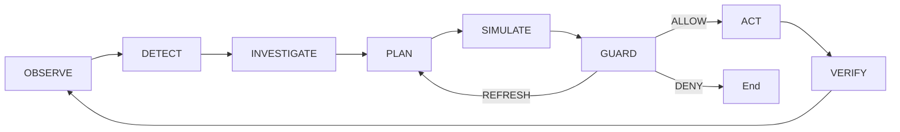
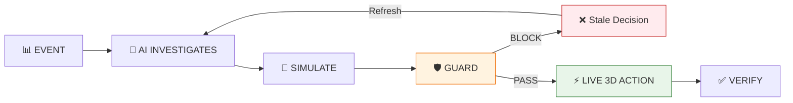
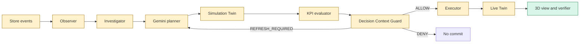

# RetailTwin AI

**Context-Guarded Autonomous 3D Retail Digital Twin**

> New to the project? Start with **[docs/README.md](docs/README.md)** for the documentation structure, or begin with **[docs/getting-started/PROJECT_DOCUMENTATION.md](docs/getting-started/PROJECT_DOCUMENTATION.md)** for a complete overview.

RetailTwin AI is an autonomous retail-operations system built around a live 3D Digital Twin. Store events trigger an AI control loop that gathers evidence, plans bounded actions, tests them in an isolated Simulation Twin, validates the selected decision with a deterministic Decision Context Guard (DCG), applies only authorized actions to the Live Twin, and verifies the result.

**This is not a chatbot project.** Chat can be an optional interface, but the primary product is event-driven autonomous operation.

## Canonical control loop



### Competition Story



**Flow:** `EVENT → AI INVESTIGATES → SIMULATE → GUARD → LIVE 3D ACTION → VERIFY`

## Why it matters

Retail conditions can change between the moment an AI makes a decision and the moment that decision reaches a live system. RetailTwin AI therefore binds decisions to exact context/evidence versions and rechecks them immediately before commit. If relevant state changed, **No-Stale-Commit** blocks the old decision and the agent refreshes/replans.

> **The LLM never owns the store state. The Digital Twin owns the truth; Gemini reasons over that truth and acts only through constrained tools.**

## Documentation

### Start Here

| Document                                                                                       | Description             |
| ---------------------------------------------------------------------------------------------- | ----------------------- |
| [docs/README.md](docs/README.md)                                                               | Documentation structure |
| [docs/getting-started/PROJECT_DOCUMENTATION.md](docs/getting-started/PROJECT_DOCUMENTATION.md) | Complete overview       |
| [docs/getting-started/PROJECT_CONTEXT.md](docs/getting-started/PROJECT_CONTEXT.md)             | Product definition      |
| [docs/getting-started/CURRENT_STATUS.md](docs/getting-started/CURRENT_STATUS.md)               | Implementation status   |

### Architecture & Design

| Document                                                                                 | Description           |
| ---------------------------------------------------------------------------------------- | --------------------- |
| [docs/architecture/ARCHITECTURE.md](docs/architecture/ARCHITECTURE.md)                   | System architecture   |
| [docs/architecture/DOMAIN_AND_DATA_MODEL.md](docs/architecture/DOMAIN_AND_DATA_MODEL.md) | Data models           |
| [docs/architecture/SECURITY.md](docs/architecture/SECURITY.md)                           | Security architecture |

### Development

| Document                                                                             | Description        |
| ------------------------------------------------------------------------------------ | ------------------ |
| [docs/development/DEVELOPMENT_GUIDE.md](docs/development/DEVELOPMENT_GUIDE.md)       | Zero to production |
| [docs/development/IMPLEMENTATION_GUIDE.md](docs/development/IMPLEMENTATION_GUIDE.md) | Role-based guide   |
| [docs/development/GCP_DOCUMENTATION.md](docs/development/GCP_DOCUMENTATION.md)       | GCP setup          |
| [docs/development/DEVELOPMENT_WORKFLOW.md](docs/development/DEVELOPMENT_WORKFLOW.md) | Git workflow       |

### API Reference

| Document                                                       | Description   |
| -------------------------------------------------------------- | ------------- |
| [docs/api/API_DOCUMENTATION.md](docs/api/API_DOCUMENTATION.md) | API endpoints |

### Architecture Decisions

| Document                                                                               | Description           |
| -------------------------------------------------------------------------------------- | --------------------- |
| [docs/adr/README.md](docs/adr/README.md)                                               | ADR index             |
| [docs/adr/0016-0017-dcg-no-stale-commit.md](docs/adr/0016-0017-dcg-no-stale-commit.md) | DCG & No-Stale-Commit |
| [docs/adr/0018-guarded-executor.md](docs/adr/0018-guarded-executor.md)                 | Guarded Executor      |
| [docs/adr/0041-demo-controller.md](docs/adr/0041-demo-controller.md)                   | Demo Controller       |

## Architecture at a glance



Green components are implemented or scaffolded in the current repository; yellow components remain planned or require integration evidence. A diagram is not a claim that a release gate has passed.

## Technology

| Layer                 | Technology                                                             |
| --------------------- | ---------------------------------------------------------------------- |
| **AI**                | Gemini on Vertex AI; Google ADK optional for specialized orchestration |
| **Frontend**          | React + TypeScript + React Three Fiber / Three.js                      |
| **Backend**           | Python + FastAPI on Cloud Run                                          |
| **Live Digital Twin** | Firestore                                                              |
| **Analytics/history** | BigQuery                                                               |
| **Events**            | Pub/Sub                                                                |
| **Assets**            | Cloud Storage                                                          |
| **Guard**             | deterministic Decision Context Guard                                   |

## Repository layout

```text
apps/              web + API
agents/            orchestrator, observer, investigator, planner, simulator, executor, verifier
guard/             Decision Context Guard
services/          twin, simulation, optimizer, forecasting
data/              schemas, synthetic scenarios, seed
infrastructure/    GCP + Firebase
assets/            3D assets
docs/              structured documentation
tests/             unit, integration and E2E
.github/           workflows
```

## Flagship scenario

The primary scenario is **Weekend Demand Surge**. A SKU starts selling faster than expected. The agent autonomously investigates inventory/shelf/demand evidence, generates candidate shelf/replenishment plans, simulates them, selects a trade-off and sends the decision to DCG. The demo deliberately changes relevant context before the first commit so DCG blocks the stale decision. The agent refreshes and replans automatically; a valid new decision is authorized, executed on the Live Twin, rendered in 3D and verified.

## MVP non-negotiables

1. Autonomous trigger — no prompt is required.
2. Gemini reasoning uses real constrained tools.
3. AI actions visibly modify a state-backed 3D Digital Twin.
4. Simulation happens before live execution.
5. DCG / No-Stale-Commit protects Live Twin.
6. A valid guarded action reaches Live Twin and is verified.

## Delivery levels

**MVP-SAFE:** one reliable autonomous scenario with Simulation + DCG + live 3D commit.  
**SUBMISSION-80:** complete loop, strong UI/evidence, recovery/replan, deployment and submission artifacts.  
**COMPETITION-100:** optional multi-agent ADK, advanced optimizer, richer 3D/traffic, rollback or vision only after stability.

The Submission Gate requires the flagship scenario to pass **20 consecutive E2E runs** before optional Competition-100 work is allowed.

## Run locally

- API setup: [apps/api/README.md](apps/api/README.md)
- Web client: [apps/web/README.md](apps/web/README.md)
- Copy [.env.example](.env.example) to `.env` only to override hosts or ports. Do not commit `.env`.

## Google Cloud

The shared project is `retailtwin-ai-511002` in `us-central1`. Day-0 resources stay inside the always-free limits. See [infrastructure/gcp/README.md](infrastructure/gcp/README.md).

## Current maturity

For the exact implementation state, including open integration work and unpassed gates, read [docs/getting-started/CURRENT_STATUS.md](docs/getting-started/CURRENT_STATUS.md).

## Contribution rule

Before starting an issue, read its dependencies, [docs/getting-started/CURRENT_STATUS.md](docs/getting-started/CURRENT_STATUS.md), [docs/development/DEVELOPMENT_WORKFLOW.md](docs/development/DEVELOPMENT_WORKFLOW.md), and the relevant architecture documents. If implementation changes a public schema, state transition, tool/action contract or security invariant, update the corresponding documentation and add or supersede an ADR in [docs/adr/](docs/adr/README.md).
