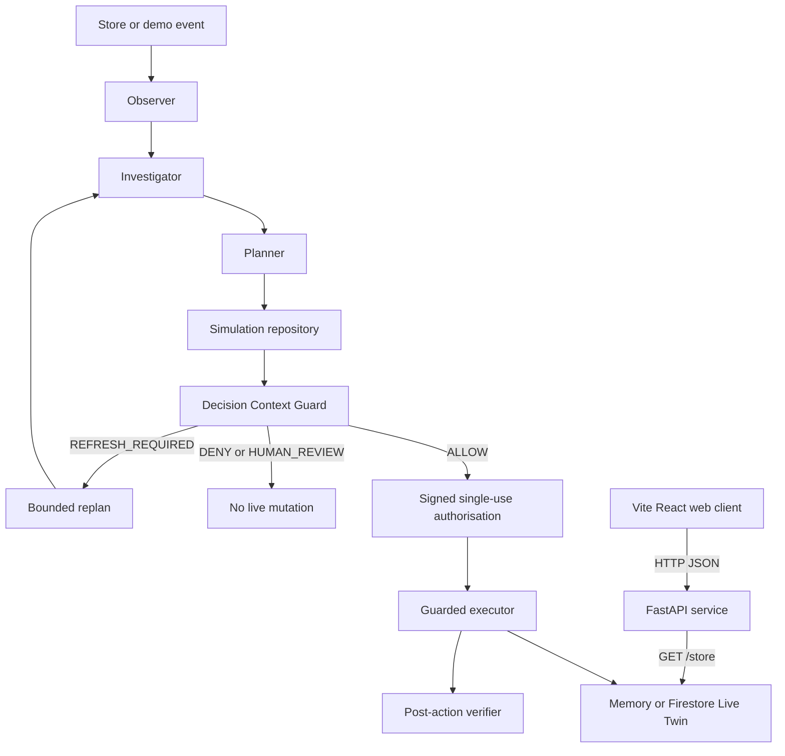
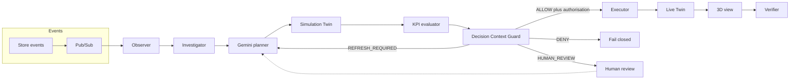
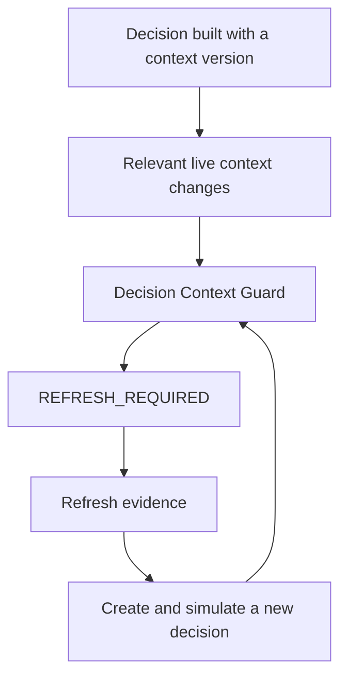

# RetailTwin AI — Technical Architecture

## 1. Architecture objective

> This document is a source-backed architecture map. It does not assert that a cloud deployment or release gate has passed; see `docs/CURRENT_STATUS.md` for recorded maturity and gate evidence.

RetailTwin AI preserves a boundary between AI reasoning and live operational state. The FastAPI service owns store reads, agent orchestration, guard decisions, and the guarded write path; the Vite/React client reads it over HTTP.



**Source anchors:** `apps/api/retailtwin_api/main.py`, `apps/api/retailtwin_api/routes.py`, `apps/api/retailtwin_api/settings.py`, `apps/api/retailtwin_api/agents/`, and `apps/web/src/core/api/`.

## 2. Architecture end-to-end flow



The diagram describes the implementation boundary, not proof that every external adapter or gate has run. The web client polls the API's `GET /store` route; it does not read a Live Twin directly. `docs/CURRENT_STATUS.md` records current gate evidence.

## 2. Technology stack

### Frontend
- React + TypeScript
- React Three Fiber / Three.js + Drei
- GLB/glTF assets where useful
- Firebase Hosting or appropriate Google Cloud deployment

### Backend
- Python
- FastAPI
- Cloud Run

### AI and orchestration
- Gemini on Vertex AI for evidence-grounded planning and explanation
- Google ADK is optional for specialized multi-agent orchestration after the single-orchestrator MVP is stable
- Structured tool/function calling only

### Operational data and runtime adapters
- **Store backend:** `fixture`, `memory`, or `firestore`; local settings default to in-process `memory` seeded from the committed fixture.
- **Firestore and BigQuery:** adapters and infrastructure are present in the repository; a source-level description is not a claim that a remote resource is live.
- **Pub/Sub:** `POST /events` accepts normalised events. In production, the autonomous subscription is designed for push delivery to `POST /pubsub/agent-events`; the application does not start a competing pull loop there.
- **Cloud Storage:** configured for static/3D assets in the infrastructure documentation.
- **Cloud Run and Firebase Hosting:** deployment workflows are configured; recorded runtime results belong to the release-gate workflow and evidence documents.
- **Secret Manager and Cloud Logging:** runtime integration points where configured; no secret value belongs in repository documentation.

### LLM provider architecture
The inference layer uses a **provider-neutral contract** in `apps/api/retailtwin_api/llm/contracts.py`.
All adapters implement `LlmProvider.complete(request: LlmRequest) -> LlmResponse`.

| Provider | Config | Credentials | Notes |
|---|---|---|---|
| `fake` | `LLM_PROVIDER=fake` | None | Deterministic; for tests, local dev, CI |
| `openai_compatible` | `LLM_PROVIDER=openai_compatible` | `LLM_BASE_URL`, `LLM_API_KEY` | Local proxies, OpenAI, Azure |
| `vertex_gemini` | `LLM_PROVIDER=vertex_gemini` | GCP ADC | Production Gemini on Vertex AI |

The fake provider is the default in `.env.example` and is the only provider used in CI. `create_provider` selects a registered adapter (ADR 0020). In production that call accepts only `vertex_gemini` on `retailtwin-ai-511002` in `us-central1`, with Application Default Credentials. That name cannot be replaced or removed, and the call uses the shipped Vertex builder. A fake provider, a loopback endpoint, and an API key are refused. The day-0 API does not construct a provider.

Issue #2 (ADR 0021) is the one production read: Gemini on Vertex AI must call `get_inventory` for a named SKU. The Live Twin document is the result. Model prose is not inventory. That read does not pass foundation gate #10 or gates G02–G06.

## 3. Component responsibilities

### Observer
Consumes normalized store events, deduplicates, preserves correlation IDs and starts an investigation without a human prompt.

### Investigator
Collects bounded, versioned evidence. It does not make up missing facts.

### Planner / Orchestrator
Uses Gemini to interpret evidence and produce structured candidate plans. Only allow-listed action schemas are legal.

### Simulation Service
Clones the relevant live state into an isolated simulation state and applies candidate actions there.

### KPI Evaluator
Computes business/operational effects. Values must be deterministic or model-derived.

### Decision Context Guard
Rechecks the proposed decision immediately before live commit. It is deterministic enforcement, not an LLM.

### Executor
The only application component that performs authorized live mutations. It requires a valid short-lived authorization bound to the decision/context/actions.

### Verifier
Reads post-action state and compares expected versus observed outcome.

### 3D Digital Twin
Displays Live or Simulation state. It is a state-driven operational interface, not an animation detached from backend truth.

## 4. Decision Context Guard

A Decision should contain at least:

```json
{
  "decision_id": "RT-D-1027",
  "agent_id": "retailtwin-orchestrator",
  "context_version": "store-001:v23871",
  "context_timestamp": "2026-10-07T08:00:00Z",
  "evidence": [],
  "proposed_actions": [],
  "simulation_id": "SIM-204",
  "expected_impact": {}
}
```

MVP gates:
1. **Decision integrity** — required fields/actions are valid.
2. **Context version** — relevant live entity versions still match.
3. **Freshness** — evidence/decision is within allowed TTL.
4. **Physical/business constraints** — inventory and shelf capacity are valid.
5. **Authorization/policy** — action is allowed for this autonomous mode.

Possible outcomes:
- `ALLOW`
- `DENY`
- `REFRESH_REQUIRED`
- `HUMAN_REVIEW`

### No-Stale-Commit



No valid authorization means no Live Twin mutation.

## 5. Commit authorization

After `ALLOW`, DCG/authorization service issues a short-lived authorization containing or referencing:
- decision ID;
- context hash/version;
- exact allowed action set/action hashes;
- expiry;
- optional nonce/replay protection.

Executor rejects missing, expired, reused or action-mismatched authorization.

## 6. State separation

**Live state and Simulation state must never share an unsafe mutation path.**

Simulation:
`Live snapshot/version → clone → simulation actions → KPI → discard/retain result`

Live:
`Decision → DCG → authorization → Executor → Live state`

The UI must clearly label LIVE versus SIMULATION.

## 7. Action risk

Suggested policy:
- **L1 / observation:** focus camera, highlight, read/analyze — automatic.
- **L2 / simulation:** move SKU, facings, planogram changes in Simulation Twin — automatic.
- **L3 / live low-risk:** bounded replenishment/layout action — autonomous only if policy permits and DCG passes.
- **High-risk business action:** price/promotion or other sensitive action — `HUMAN_REVIEW` unless explicitly permitted by competition policy configuration.

## 8. Reliability rules

- Pub/Sub events carry `event_id` and `correlation_id`.
- Consumers are idempotent where possible.
- Retries are bounded.
- Agent re-planning is bounded.
- Errors are visible; no silent live commit.
- Demo reset is deterministic.
- Structured logs preserve correlation/decision/simulation/action IDs.

## 9. Security rules

- No service-account key or secret in Git.
- Use service identities/IAM and Secret Manager as appropriate.
- Frontend cannot bypass backend guard/executor.
- Gemini never receives raw database credentials.
- Validate all tool arguments server-side.
- Live write APIs are not general-purpose public mutation endpoints.
- Audit live decisions/actions without storing hidden chain-of-thought.

## 10. Repository ownership map

| Area | Responsibility |
|---|---|
| `apps/web` | 3D user experience and typed HTTP client |
| `apps/api` | API and integration boundary |
| `apps/api/retailtwin_api/agents` | Observer, investigation, planning, simulation, execution, and verification |
| `apps/api/retailtwin_api/guard` | Deterministic live-action guard |
| `services/simulation` | Clone, apply, and evaluate simulation candidates |
| `services/optimizer` | Optional candidate optimiser |
| `services/forecasting` | Demand and risk services |
| `data` | Schemas, seed data, and synthetic scenarios |
| `infrastructure` | GCP and Firebase configuration |
| `tests` | Unit, integration, and end-to-end validation |

## 11. Deployment configuration

`firebase.json` configures a Firebase Hosting site with `apps/web/dist` as its public directory and a single-page-app rewrite to `/index.html`. `.github/workflows/web.yml` builds the web client with the repository variable `FIREBASE_API_BASE_URL`; on a `main` push it uses WIF/OIDC to deploy the Hosting configuration, then performs its configured smoke checks.

`.github/workflows/api.yml` has a separate `main`-push Cloud Run deployment job. Its declared production environment includes `APP_ENV=production`, `LOG_LEVEL=INFO`, and `LIVE_TWIN_BACKEND=firestore`. The manual scripts are different paths: `scripts/deploy-cloudrun.sh` uses Artifact Registry and sets additional runtime variables, while `scripts/deploy-web.sh` builds with its configured API origin and refuses a localhost value in the generated bundle.

These workflow definitions establish intended deployment behaviour only. They do not establish current Firebase Hosting, Cloud Run, API-origin, CORS, or remote-resource health for this commit.

**Source anchors:** `firebase.json`, `.firebaserc`, `.github/workflows/web.yml`, `.github/workflows/api.yml`, `scripts/deploy-web.sh`, and `scripts/deploy-cloudrun.sh`.

## 12. Validation limit

A route, adapter, workflow, or diagram is not deployment evidence. Use `docs/CURRENT_STATUS.md`, `docs/CLOUD_RUNTIME_MATRIX.md`, release-gate output, and historical evidence/runbooks to distinguish source configuration from recorded remote validation.
