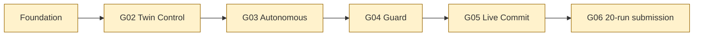

# RetailTwin AI — Current Status

Last audited: 2026-10-08

This page records repository and GitHub evidence, not the target architecture.

## Repository evidence

- `main` contains the React Three Fiber store scaffold from merged PR #56.
- The working tree was clean of tracked changes during the audit; pre-existing untracked agent metadata (`.claude/`, `AGENTS.md`, `CLAUDE.md`) is not part of this documentation change.
- The checked-out tree includes the day-0 FastAPI/store-read and event-ingest work merged through PR #57, but not the autonomous Gemini planner, Simulation Twin, DCG, Executor, Live Twin commit path, verifier, or deployment evidence required by the target architecture.

## GitHub evidence

- PR #59, “Align project documentation with current RetailTwin AI state”, is merged.
- PR #57, “Scaffold FastAPI backend and frontend API integration”, is merged; its scope is the day-0 API boundary and immutable in-process event intake, not the full autonomous control loop.
- Issues #49–#53 define G02–G06 release gates. Their existence is not evidence that the gates passed.

## Release gates

All gates remain **pending in this documentation audit** because no linked test, deployment, or 20-run evidence was available in the checked-out repository. Update this page only when evidence is committed or linked.

## Scope boundary

The architecture and demo documents describe contracts and acceptance criteria. They do not claim that a planned component is implemented. Browser and Gemini paths must remain proposal/read paths; only a guarded Executor may mutate the Live Twin.
