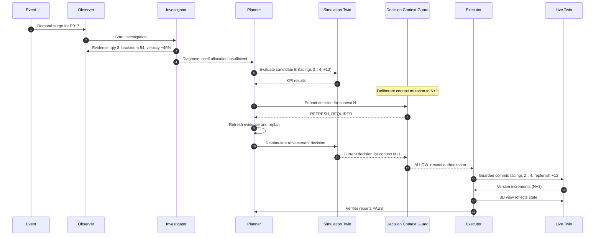
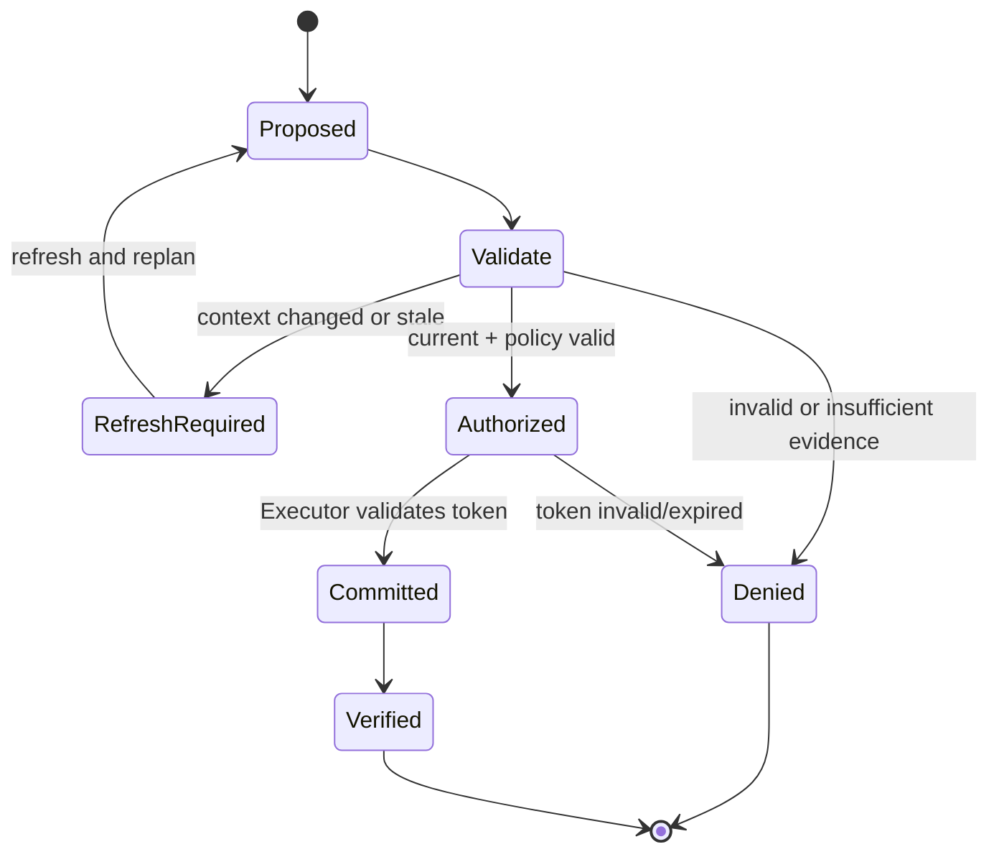

# RetailTwin AI — Demo, Testing and Acceptance

## 1. Demo purpose

The demo must prove that RetailTwin AI is an autonomous, context-guarded retail operator—not a chatbot attached to a 3D scene.

The audience should understand within seconds:
- the store is live state;
- an event triggered AI automatically;
- AI gathered evidence;
- alternatives were simulated;
- stale context was rejected;
- AI recovered automatically;
- only a valid decision changed the Live Twin.

## 2. Recommended 3-minute story

**0:00–0:10** — 3D store running, AUTOPILOT ON.  
**0:10–0:20** — Weekend demand spike appears for P017.  
**0:20–0:35** — Agent Activity shows evidence collection and diagnosis.  
**0:35–0:50** — Candidate A/B/C plans appear.  
**0:50–1:05** — Simulation Twin and KPI comparison.  
**1:05–1:20** — Context changes intentionally; DCG blocks stale decision.  
**1:20–1:35** — Agent refreshes evidence/replans automatically.  
**1:35–1:50** — DCG passes new decision; Executor commits.  
**1:50–2:05** — Live 3D shelf/facings/replenishment visibly change.  
**2:05–2:20** — Verifier reports PASS.  
**2:20–2:45** — Brief architecture/Google Cloud/DCG explanation.  
**2:45–3:00** — impact and closing statement.

Closing concept:

> RetailTwin AI does not just let AI manage a store. It ensures every autonomous action is still valid at the exact moment it reaches the live store.

## 3. Demo Scenario Mode

For reliability, provide a deterministic scenario controller.

It may control:
- random seed;
- event timing;
- initial state reset;
- the deliberate stale-context mutation.

It must **not** fake:
- Gemini tool calls;
- Firestore state;
- Simulation Twin;
- DCG result;
- Executor live mutation;
- verification.

A deterministic test scenario is acceptable; a prerecorded/faked backend result is not.

## 4. G04 stale-context acceptance

Precondition: Decision D1 was created from context version N.

Test:
1. simulate D1;
2. mutate a relevant live entity to version N+1;
3. submit D1;
4. DCG compares versions;
5. DCG returns `REFRESH_REQUIRED` or `DENY`;
6. no usable commit authorization exists;
7. Executor performs no live mutation;
8. UI/audit shows why;
9. Agent refreshes evidence and creates D2.

PASS only if the old decision cannot alter Live Twin.

## 5. G05 valid commit acceptance

1. Candidate is simulated.
2. Decision is tied to current context.
3. DCG returns `ALLOW`.
4. Short-lived authorization is issued for exact actions.
5. Executor validates authorization.
6. Exact action changes Live Twin.
7. Live version increments.
8. 3D Live view reflects state.
9. Audit record is written.
10. Verifier checks result.

## 6. G06 submission acceptance

Run the full flagship scenario **20 consecutive times** from deterministic reset.

For each run record:
- run ID;
- start/end time;
- event ID;
- decision IDs;
- simulation ID;
- DCG stale result;
- replacement decision;
- final guard result;
- action ID;
- verifier result;
- total duration;
- PASS/FAIL;
- failure stage/notes.

A failure breaks the consecutive streak. Fix the defect, reset, and start the 20-run streak again.

## 7. Required failure tests

At minimum test:
- duplicate Pub/Sub event;
- missing mandatory evidence;
- malformed/forbidden tool call;
- stale context;
- expired commit authorization;
- altered action after authorization;
- insufficient inventory;
- shelf capacity violation;
- backend/tool timeout;
- post-action verification mismatch.

## 8. Weekend Demand Surge sequence (stale-context protected)

Signature demo sequence: a stale decision is blocked, then a refreshed decision passes the guard before a guarded commit.



The first decision must not receive usable authorization after the deliberate mutation. The replacement decision must pass DCG before commit. No-Stale-Commit forbids applying a decision built for context N after context changed to N+1 without re-evaluation.

## 9. Decision Context Guard flow (fail-closed)



This is fail-closed: every validation failure ends without a Live Twin mutation.

## 10. Judge-visible evidence

The UI should show concise, factual activity such as:

```text
16:01:02 Trigger      Demand surge detected: P017
16:01:03 Evidence     Shelf qty 8; backroom 54; velocity +46%
16:01:05 Diagnosis    Shelf allocation likely insufficient
16:01:07 Simulation   A/B/C evaluated
16:01:08 Selection    Scenario B selected
16:01:09 Guard        REFRESH_REQUIRED — inventory version changed
16:01:11 Evidence     Context refreshed
16:01:14 Guard        ALLOW
16:01:15 Action       Facings 2→4; replenish +12
16:01:17 Verification PASS
```

These are evidence/action summaries, not model chain-of-thought.

## 11. Final submission checklist

- deployed working URL;
- public repository when competition submission requires it;
- no secrets in repository/history;
- README and architecture docs current;
- demo video under required duration;
- presentation deck;
- clear Google AI/Google Cloud usage;
- reproducible flagship scenario;
- G06 passed;
- final release/tag created.

## 12. MVP demo controller runbook

The MVP demo controller is a deterministic in-process orchestrator for the
Weekend Demand Surge flagship scenario.  It runs entirely within the FastAPI
process and requires no external infrastructure (no Pub/Sub, Firestore, or Gemini).

### Starting the API server

```bash
cd apps/api
python -m uvicorn retailtwin_api.main:app --reload
```

API available at `http://127.0.0.1:8000`.

### Demo controller API

| Method | Path | Description |
|--------|------|-------------|
| POST | `/demo/reset` | Reset TwinService to demo fixtures |
| POST | `/demo/start` | Run the autonomous loop once |
| GET  | `/demo/status` | Current phase, verdict, timeline |
| GET  | `/demo/timeline` | Full event timeline |

Query parameters:
- `seed: int` (optional) — random seed (reserved, non-functional in MVP)
- `stale_context_test: bool` (default `false`) — set `true` to simulate stale-context rejection

### Happy-path run (DCG returns ALLOW)

```bash
# 1. Reset to initial state
curl -X POST http://127.0.0.1:8000/demo/reset
# {"run_id": "...", "phase": "idle", "context_version": "...", "slots_loaded": 5}

# 2. Run the autonomous loop
curl -X POST http://127.0.0.1:8000/demo/start
# {"run_id": "...", "phase": "complete", "dcg_verdict": "ALLOW",
#   "executor_committed": true, "verifier_outcome": "PASS"}

# 3. Check final status
curl http://127.0.0.1:8000/demo/status | python -m json.tool
```

Expected outcome:
- `dcg_verdict`: `ALLOW`
- `executor_committed`: `true`
- `verifier_outcome`: `PASS`
- Timeline shows phases: `reset → event → simulate → dcg → execute → verify`

### Stale-context run (DCG returns REFRESH_REQUIRED)

```bash
curl -X POST http://127.0.0.1:8000/demo/reset
curl -X POST "http://127.0.0.1:8000/demo/start?stale_context_test=true"
# {"dcg_verdict": "REFRESH_REQUIRED", "executor_committed": false}
```

Expected outcome:
- `dcg_verdict`: `REFRESH_REQUIRED`
- `executor_committed`: `false`
- `verifier_outcome`: `FAIL`

### Architecture summary

```
apps/api/retailtwin_api/
  demo.py        DemoOrchestrator, DemoPhase, TimelineEvent, setup_demo()
  routes.py      /demo/reset, /demo/start, /demo/status, /demo/timeline

services/twin/__init__.py   TwinService (in-memory mutable store)
services/simulation/
  __init__.py              SimulationService (clone/apply/evaluate)
  kpi.py                   KPI scoring (availability + efficiency)
guard/decision_context_guard/__init__.py   DCG (5 validation gates)
agents/executor/__init__.py    ExecutorAgent (only DCG-authorized writes)
agents/verifier/__init__.py    VerifierAgent (post-action KPI comparison)
```

### Service wiring (setup_demo)

At app startup, `setup_demo()` injects the concrete service classes into the
orchestrator so the same API runs in both test (in-process) and production
(FastAPI worker) modes without changing the route handlers.

### Test evidence

```bash
python -m pytest apps/api/tests/test_demo_controller.py -v
python -m pytest apps/api/tests/test_dcg.py -v
python -m pytest apps/api/tests/test_executor.py -v
python -m pytest apps/api/tests/test_twin_service.py -v
python -m pytest apps/api/tests/ tests/e2e/ -v
```

Expected: 157 passed across the full suite.

