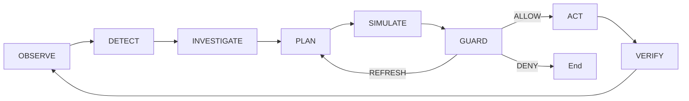

# RetailTwin AI — Documentation

Complete technical documentation for RetailTwin AI project.

## Documentation Structure

```
docs/
├── getting-started/           # Start here
│   ├── PROJECT_DOCUMENTATION.md    # Complete overview
│   ├── PROJECT_CONTEXT.md          # Product definition
│   └── CURRENT_STATUS.md           # Current implementation
│
├── architecture/              # System architecture
│   ├── ARCHITECTURE.md              # Technical architecture
│   ├── DOMAIN_AND_DATA_MODEL.md     # Data models & schemas
│   ├── SECURITY.md                  # Security architecture
│   └── AGENT_TIMELINE.md           # Agent activity timeline
│
├── development/               # Development guides
│   ├── DEVELOPMENT_GUIDE.md         # Zero to production
│   ├── IMPLEMENTATION_GUIDE.md     # Role-based guide
│   ├── DEVELOPMENT_WORKFLOW.md     # Git workflow
│   └── GCP_DOCUMENTATION.md        # Google Cloud setup
│
├── api/                      # API reference
│   └── API_DOCUMENTATION.md        # API endpoints
│
├── demo/                     # Demo documentation
│   ├── DEMO_AND_ACCEPTANCE.md      # Demo scenarios
│   └── README.md                    # Demo guide
│
├── adr/                      # Architecture decisions
│   ├── README.md                    # ADR index
│   ├── 0001-*.md                  # ADR files
│   └── template.md                  # ADR template
│
└── competition/              # Competition docs
    └── README.md
```

## Quick Start

### New to the project?

1. **[getting-started/PROJECT_DOCUMENTATION.md](getting-started/PROJECT_DOCUMENTATION.md)** — Complete project overview
2. **[getting-started/PROJECT_CONTEXT.md](getting-started/PROJECT_CONTEXT.md)** — What we are building
3. **[getting-started/CURRENT_STATUS.md](getting-started/CURRENT_STATUS.md)** — What is implemented

### Architecture & Design

1. **[architecture/ARCHITECTURE.md](architecture/ARCHITECTURE.md)** — System architecture
2. **[architecture/DOMAIN_AND_DATA_MODEL.md](architecture/DOMAIN_AND_DATA_MODEL.md)** — Data models
3. **[architecture/SECURITY.md](architecture/SECURITY.md)** — Security architecture

### Development

1. **[development/DEVELOPMENT_GUIDE.md](development/DEVELOPMENT_GUIDE.md)** — Step-by-step guide
2. **[development/IMPLEMENTATION_GUIDE.md](development/IMPLEMENTATION_GUIDE.md)** — Implementation guide
3. **[development/GCP_DOCUMENTATION.md](development/GCP_DOCUMENTATION.md)** — GCP setup

### API Reference

1. **[api/API_DOCUMENTATION.md](api/API_DOCUMENTATION.md)** — All API endpoints

### Architecture Decisions

- **[adr/README.md](adr/README.md)** — ADR index
- **[adr/0016-0017-dcg-no-stale-commit.md](adr/0016-0017-dcg-no-stale-commit.md)** — DCG & No-Stale-Commit
- **[adr/0018-guarded-executor.md](adr/0018-guarded-executor.md)** — Guarded Executor
- **[adr/0033-kpi-evaluator.md](adr/0033-kpi-evaluator.md)** — KPI Evaluator
- **[adr/0041-demo-controller.md](adr/0041-demo-controller.md)** — Demo Controller

## Key Concepts

| Concept | Description |
|---------|-------------|
| **Live Twin** | Canonical current state in Firestore |
| **Simulation Twin** | Isolated clone for what-if analysis |
| **DCG** | Decision Context Guard - 5 validation gates |
| **No-Stale-Commit** | Prevents outdated decisions |
| **Executor** | Only component that can mutate Live Twin |

## Control Loop



## Related Documentation

- [README.md](../README.md) — Project root README
- [infrastructure/gcp/README.md](../infrastructure/gcp/README.md) — GCP setup
