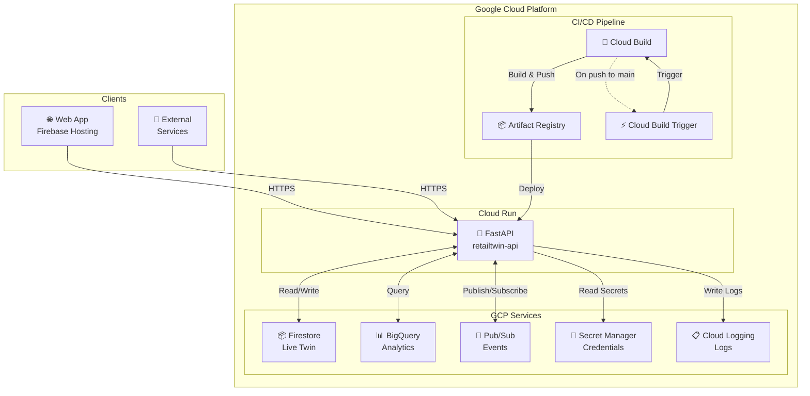
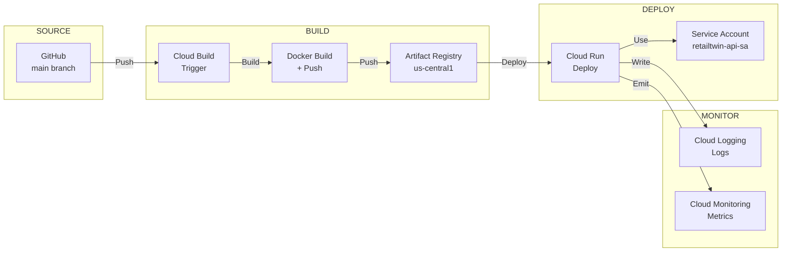
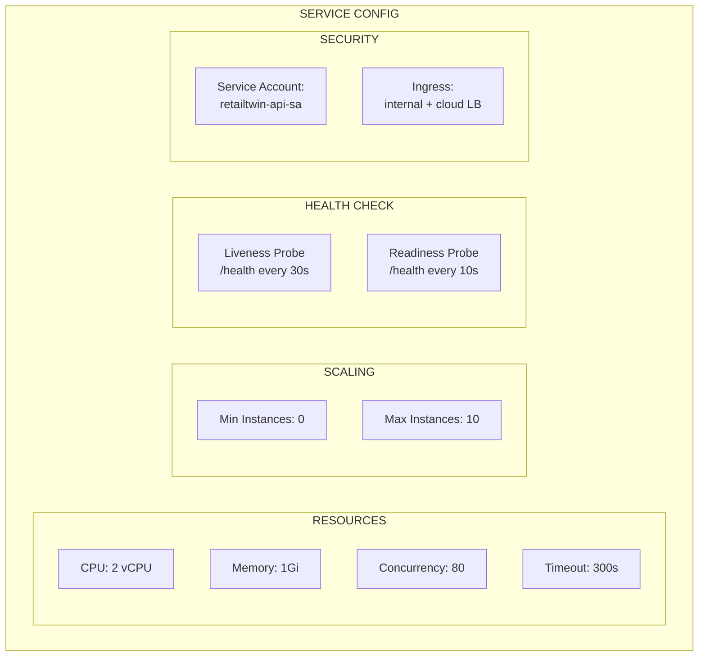
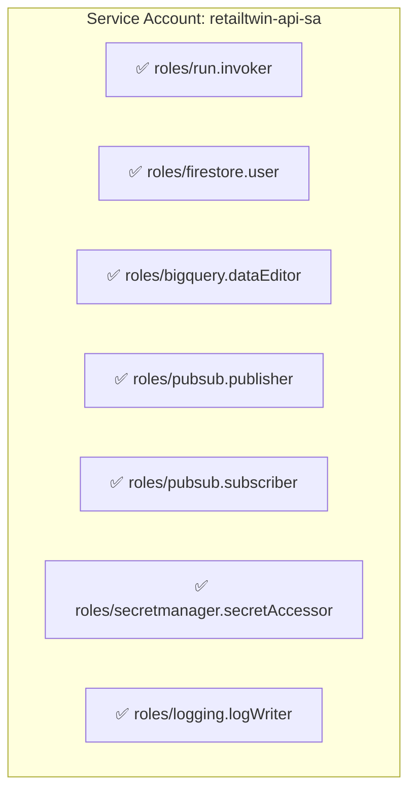
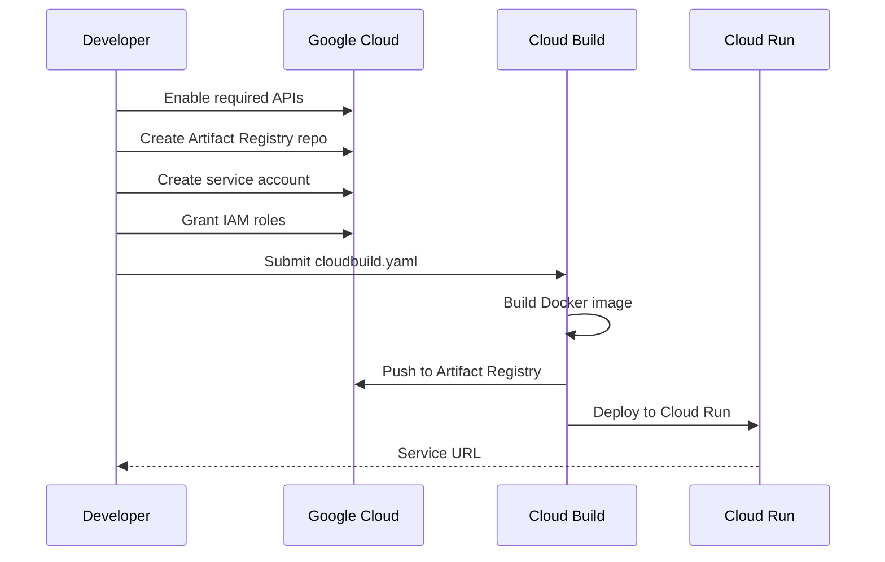
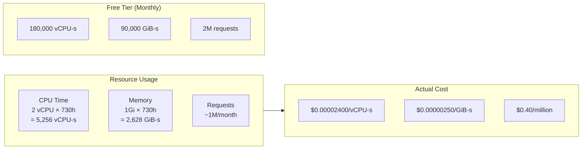
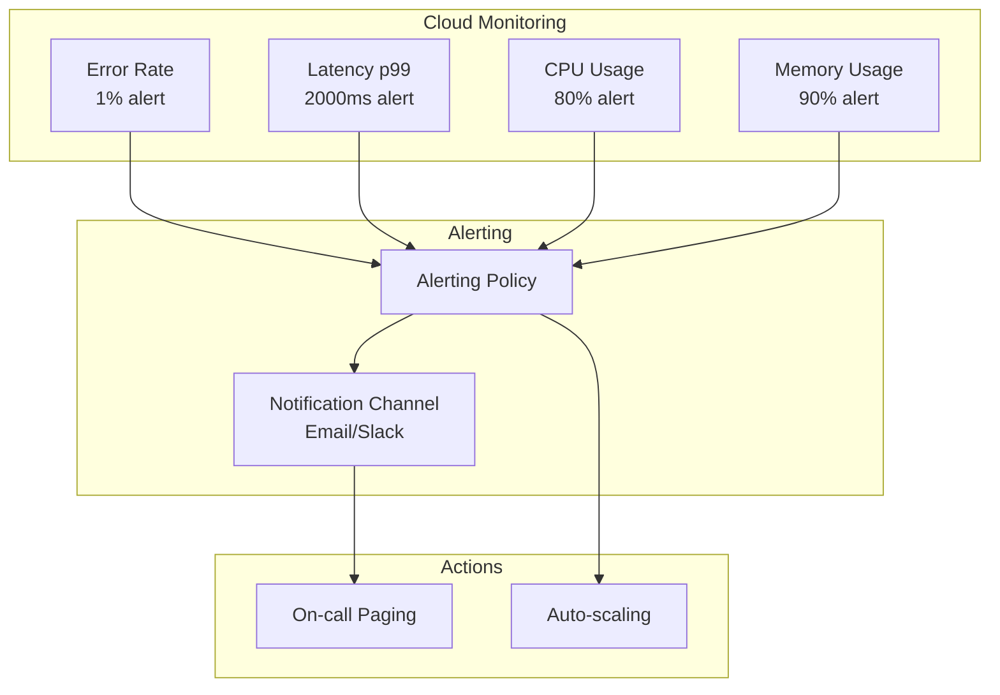
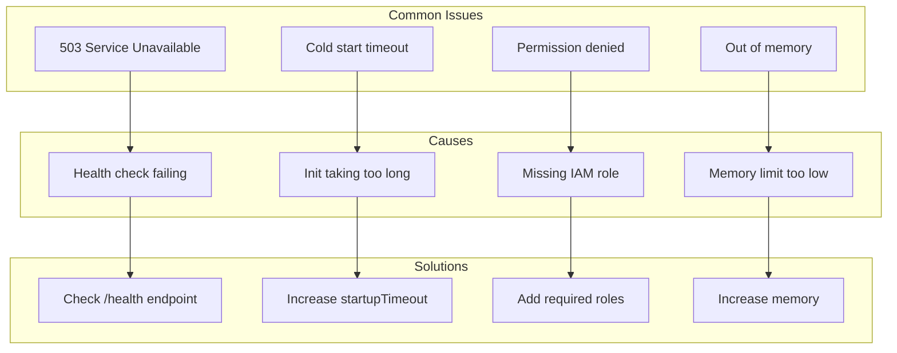
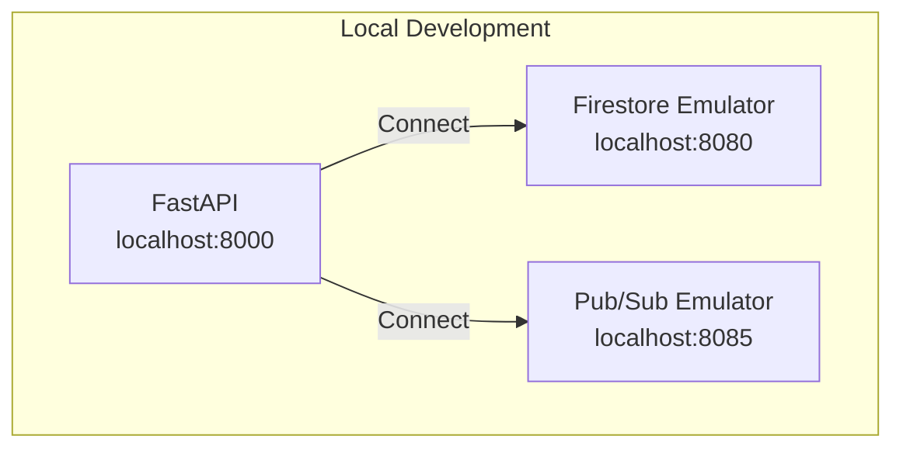

# ADR 0009-0034: Cloud Run Deployment

## Status

Accepted

## Context

The RetailTwin AI backend needs to run as a production-ready service on Google Cloud Platform. Cloud Run provides a serverless container platform that scales automatically and integrates with other GCP services.

## Problem

Development runs of FastAPI are not suitable for production:

- No automatic scaling
- No health checks
- No integration with GCP services
- No secret management
- No CI/CD pipeline

## Decision

We deploy the FastAPI backend to Cloud Run with:

1. Containerized deployment via Cloud Build
2. Environment-based configuration
3. Health check endpoints
4. GCP service integration
5. Secret Manager for credentials
6. CI/CD via Cloud Build triggers

## Architecture



## CI/CD Pipeline Flow



## Cloud Run Service Configuration



## Environment Variables

| Variable       | Source         | Description          |
| -------------- | -------------- | -------------------- |
| `ENVIRONMENT`  | Cloud Run      | `production`         |
| `GCP_PROJECT`  | Cloud Run      | Project ID           |
| `GCP_REGION`   | Cloud Run      | `us-central1`        |
| `LOG_LEVEL`    | Cloud Run      | `INFO`               |
| `CORS_ORIGINS` | Cloud Run      | Allowed origins      |
| `credentials`  | Secret Manager | Service account JSON |

## Service Account Roles



## Deployment Commands

### Initial Deployment



### Commands

```bash
# Set project
gcloud config set project retailtwin-ai-511002

# Enable APIs
gcloud services enable run.googleapis.com cloudbuild.googleapis.com artifactregistry.googleapis.com

# Create repository
gcloud artifacts repositories create retailtwin-api \
  --repository-format=docker --location=us-central1

# Deploy
gcloud builds submit --config=cloudbuild.yaml
```

## Cost Estimation



### Estimated Monthly Cost

| Resource  | Usage        | Free Tier | Cost       |
| --------- | ------------ | --------- | ---------- |
| CPU       | 5,256 vCPU-s | 180,000   | ~$0.13     |
| Memory    | 2,628 GiB-s  | 90,000    | ~$0.007    |
| Requests  | 1M           | 2M        | ~$0.40     |
| **Total** |              |           | **~$0.54** |

## Monitoring



## Troubleshooting



## Local Development



## Related Issues

- #9: [DAY-0] Deploy MVP API to Cloud Run
- #34: [D12] Productionize backend services on Cloud Run

## Implementation Files

```
infrastructure/gcp/
├── cloudbuild.yaml           # Cloud Build config
├── cloud_run_service.yaml    # Cloud Run spec
├── Dockerfile              # Container build
└── README.md               # Runbook
```

## Verification Checklist

- [ ] Service deploys successfully
- [ ] Health check passes
- [ ] Can reach Firestore
- [ ] Can reach BigQuery
- [ ] Can publish/subscribe to Pub/Sub
- [ ] Secrets accessible via Secret Manager
- [ ] Logs appear in Cloud Logging
- [ ] Metrics appear in Cloud Monitoring
- [ ] Rollback works
- [ ] CI/CD pipeline works
