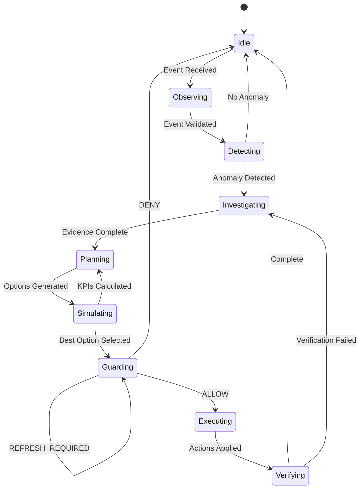
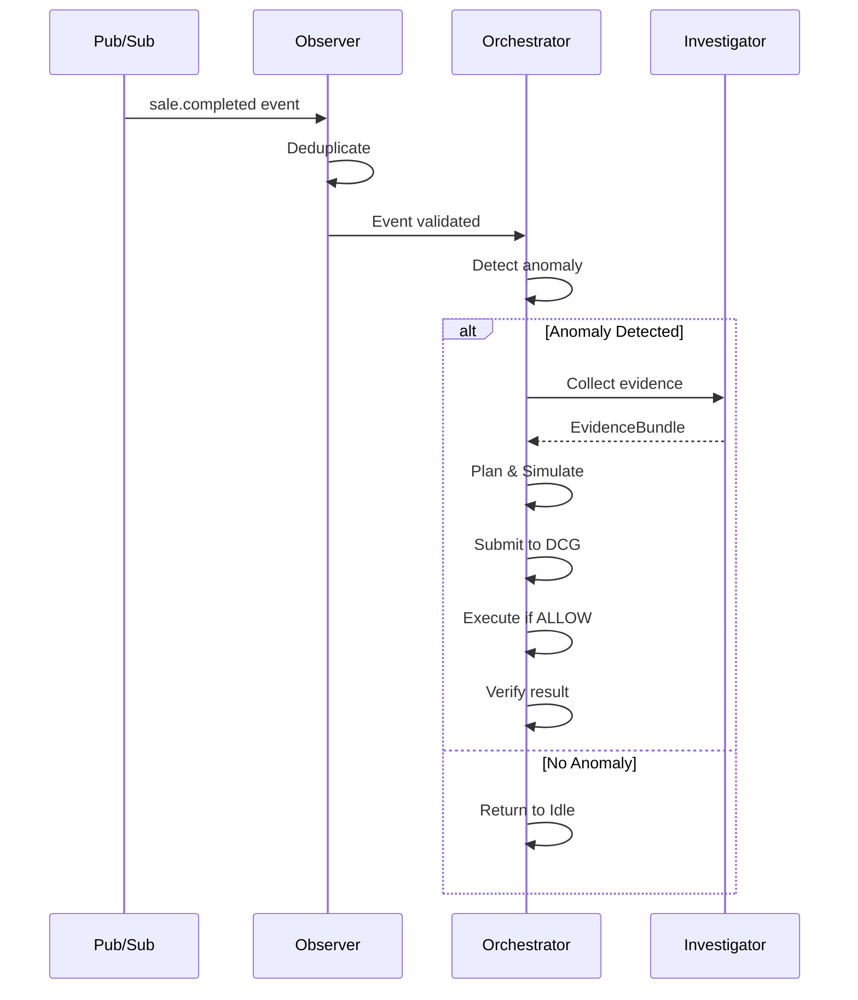

# ADR: Agent Orchestrator

## Status
Accepted

## Context

The Agent Orchestrator is the central controller that coordinates the autonomous control loop: Observe → Detect → Investigate → Plan → Simulate → Guard → Act → Verify.

## Problem

We need a state machine that:
1. Responds to store events autonomously
2. Coordinates multiple agent components
3. Handles failures and retries
4. Maintains correlation IDs across the pipeline

## Autonomous Control Loop

```mermaid
flowchart TB
    subgraph Loop["AUTONOMOUS CONTROL LOOP"]
        subgraph Observe["OBSERVE"]
            O1[Receive Event]
            O2[Deduplicate]
            O3[Emit Trigger]
        end
        
        subgraph Detect["DETECT"]
            D1[Check Thresholds]
            D2{Anomaly?}
            D3[Create Alert]
        end
        
        subgraph Investigate["INVESTIGATE"]
            I1[Collect Evidence]
            I2[Get Inventory]
            I3[Get Sales]
            I4[Build Bundle]
        end
        
        subgraph Plan["PLAN"]
            P1[Generate Options]
            P2[Simulate Each]
            P3[Evaluate KPIs]
            P4[Select Best]
        end
        
        subgraph Guard["GUARD"]
            G1[Submit to DCG]
            G2{Valid?}
            G3[REFRESH]
            G4[ALLOW]
        end
        
        subgraph Act["ACT"]
            A1[Execute Action]
            A2[Update Live Twin]
        end
        
        subgraph Verify["VERIFY"]
            V1[Check Result]
            V2[Record Outcome]
            V3[Complete]
        end
    end
    
    O3 --> D1
    D1 --> D2
    D2 -->|Yes| D3
    D2 -->|No| V3
    D3 --> I1
    I1 --> I2
    I2 --> I3
    I3 --> I4
    I4 --> P1
    P1 --> P2
    P2 --> P3
    P3 --> P4
    P4 --> G1
    G1 --> G2
    G2 -->|Stale| G3
    G2 -->|Valid| G4
    G3 --> I1
    G4 --> A1
    A1 --> A2
    A2 --> V1
    V1 --> V2
    V2 --> V3
```



## Orchestrator States



## Orchestrator Interface

```python
from pydantic import BaseModel
from enum import Enum
from typing import Optional

class OrchestratorState(str, Enum):
    IDLE = "idle"
    OBSERVING = "observing"
    DETECTING = "detecting"
    INVESTIGATING = "investigating"
    PLANNING = "planning"
    SIMULATING = "simulating"
    GUARDING = "guarding"
    EXECUTING = "executing"
    VERIFYING = "verifying"

class OrchestratorEvent(BaseModel):
    event_id: str
    event_type: str
    correlation_id: str
    payload: dict
    received_at: datetime

class OrchestratorResult(BaseModel):
    run_id: str
    correlation_id: str
    final_state: OrchestratorState
    dcg_verdict: str | None
    actions_committed: list[str]
    verifier_outcome: str | None
    duration_ms: float
    timeline: list[TimelineEvent]

class AgentOrchestrator:
    """
    Central controller for autonomous retail operations.
    
    Responsibilities:
    1. Event consumption and deduplication
    2. State machine management
    3. Agent component coordination
    4. Error handling and recovery
    """
    
    def __init__(
        self,
        observer: IObserver,
        investigator: IInvestigator,
        planner: IPlanner,
        simulation: ISimulationService,
        dcg: DecisionContextGuard,
        executor: ExecutorAgent,
        verifier: IVerifier
    ):
        self.observer = observer
        self.investigator = investigator
        self.planner = planner
        self.simulation = simulation
        self.dcg = dcg
        self.executor = executor
        self.verifier = verifier
        
        self._state = OrchestratorState.IDLE
        self._run_id: str | None = None
        self._timeline: list[TimelineEvent] = []
        self._current_decision: Decision | None = None
    
    async def process_event(
        self,
        event: OrchestratorEvent
    ) -> OrchestratorResult:
        """
        Process a store event through the full autonomous loop.
        """
        self._run_id = f"run-{uuid.uuid4().hex[:12]}"
        self._correlation_id = event.correlation_id
        self._timeline = []
        start_time = datetime.utcnow()
        
        try:
            # OBSERVE
            await self._transition_to(OrchestratorState.OBSERVING)
            await self._observe(event)
            
            # DETECT
            await self._transition_to(OrchestratorState.DETECTING)
            is_anomaly = await self._detect(event)
            
            if not is_anomaly:
                await self._transition_to(OrchestratorState.IDLE)
                return self._build_result(start_time, OrchestratorState.IDLE)
            
            # INVESTIGATE
            await self._transition_to(OrchestratorState.INVESTIGATING)
            evidence = await self._investigate(event)
            
            # PLANNING
            await self._transition_to(OrchestratorState.PLANNING)
            decision = await self._plan(evidence)
            
            # SIMULATION
            await self._transition_to(OrchestratorState.SIMULATING)
            best_scenario = await self._simulate(decision)
            
            # GUARD (with refresh loop)
            await self._transition_to(OrchestratorState.GUARDING)
            guard_result = await self._guard_with_refresh(decision, best_scenario)
            
            if guard_result.outcome == DCGOutcome.DENY:
                await self._transition_to(OrchestratorState.IDLE)
                return self._build_result(start_time, OrchestratorState.IDLE)
            
            # EXECUTE
            await self._transition_to(OrchestratorState.EXECUTING)
            await self._execute(guard_result.authorization)
            
            # VERIFY
            await self._transition_to(OrchestratorState.VERIFYING)
            verifier_result = await self._verify()
            
            await self._transition_to(OrchestratorState.IDLE)
            return self._build_result(
                start_time,
                OrchestratorState.IDLE,
                dcg_verdict=guard_result.outcome.value,
                verifier_outcome=verifier_result.outcome
            )
            
        except Exception as e:
            self._log_error(e)
            await self._transition_to(OrchestratorState.IDLE)
            return self._build_result(start_time, OrchestratorState.IDLE, error=str(e))
    
    async def _observe(self, event: OrchestratorEvent) -> None:
        """Receive and validate event."""
        self._log("OBSERVE", f"Event {event.event_id} received")
        validated = await self.observer.validate(event)
        if not validated:
            raise ValueError(f"Invalid event: {event.event_id}")
    
    async def _detect(self, event: OrchestratorEvent) -> bool:
        """Detect if event represents an anomaly."""
        self._log("DETECT", f"Checking anomaly for {event.event_type}")
        is_anomaly = await self.observer.detect_anomaly(event)
        self._log("DETECT", f"Anomaly detected: {is_anomaly}")
        return is_anomaly
    
    async def _investigate(self, event: OrchestratorEvent) -> EvidenceBundle:
        """Collect evidence about the situation."""
        self._log("INVESTIGATE", "Collecting evidence")
        evidence = await self.investigator.collect(event)
        self._log("INVESTIGATE", f"Evidence collected: {len(evidence.items)} items")
        return evidence
    
    async def _plan(self, evidence: EvidenceBundle) -> Decision:
        """Generate candidate plans."""
        self._log("PLAN", "Generating candidate plans")
        decision = await self.planner.create_decision(
            evidence=evidence,
            correlation_id=self._correlation_id
        )
        self._current_decision = decision
        self._log("PLAN", f"Decision created: {decision.decision_id}")
        return decision
    
    async def _simulate(self, decision: Decision) -> ScenarioEvaluation:
        """Simulate candidate actions."""
        self._log("SIMULATE", "Running simulation scenarios")
        candidates = await self.planner.generate_candidates(decision)
        
        result = await self.simulation.run_full_simulation(
            decision_id=decision.decision_id,
            candidate_actions=candidates
        )
        
        best = result.best_scenario
        self._log("SIMULATE", f"Best scenario: {best.scenario_id} (score: {best.composite_score.total_score})")
        return best
    
    async def _guard_with_refresh(
        self,
        decision: Decision,
        scenario: ScenarioEvaluation
    ) -> GuardResult:
        """
        Submit to DCG with automatic refresh on REFRESH_REQUIRED.
        """
        max_refreshes = 2
        refresh_count = 0
        
        while refresh_count <= max_refreshes:
            context = await self._get_current_context()
            result = await self.dcg.validate(
                decision=decision,
                context=context,
                inventory=self._get_inventory_service(),
                agent=self._get_current_agent(),
                mode=OperationalMode.AUTOPILOT
            )
            
            if result.outcome == DCGOutcome.ALLOW:
                auth = self.dcg.issue_authorization(decision, context)
                self._log("GUARD", f"ALLOW - Authorization issued: {auth.authorization_id}")
                return GuardResult(outcome=result.outcome, authorization=auth)
            
            elif result.outcome == DCGOutcome.REFRESH_REQUIRED:
                refresh_count += 1
                self._log("GUARD", f"REFRESH_REQUIRED (attempt {refresh_count})")
                
                if refresh_count > max_refreshes:
                    self._log("GUARD", "Max refreshes exceeded, DENY")
                    return GuardResult(outcome=DCGOutcome.DENY, authorization=None)
                
                # Refresh evidence and replan
                self._log("GUARD", "Refreshing evidence...")
                new_evidence = await self.investigator.refresh(decision.evidence)
                decision = await self.planner.replan(decision, new_evidence)
                self._current_decision = decision
                
            else:
                self._log("GUARD", f"{result.outcome} - Rejected")
                return GuardResult(outcome=result.outcome, authorization=None)
        
        return GuardResult(outcome=DCGOutcome.DENY, authorization=None)
    
    async def _execute(self, authorization: Authorization) -> None:
        """Execute authorized actions."""
        self._log("EXECUTE", f"Executing with auth: {authorization.authorization_id}")
        
        request = ExecutorRequest(
            authorization_id=authorization.authorization_id,
            actions=authorization.allowed_actions,
            correlation_id=self._correlation_id
        )
        
        result = await self.executor.execute(request)
        
        self._log("EXECUTE", f"Committed {len(result.committed_actions)} actions")
    
    async def _verify(self) -> VerifierResult:
        """Verify execution results."""
        self._log("VERIFY", "Verifying execution results")
        
        result = await self.verifier.verify(
            expected_state=self._current_decision.expected_impact,
            correlation_id=self._correlation_id
        )
        
        self._log("VERIFY", f"Verification: {result.outcome}")
        return result
    
    async def _transition_to(self, new_state: OrchestratorState) -> None:
        """Transition to a new state."""
        self._log(new_state.value.upper(), f"State: {self._state} -> {new_state}")
        self._state = new_state
    
    def _log(self, phase: str, message: str) -> None:
        """Add entry to timeline."""
        entry = TimelineEvent(
            phase=phase,
            timestamp=datetime.utcnow(),
            message=message,
            correlation_id=self._correlation_id
        )
        self._timeline.append(entry)
    
    def _build_result(
        self,
        start_time: datetime,
        final_state: OrchestratorState,
        dcg_verdict: str | None = None,
        verifier_outcome: str | None = None,
        error: str | None = None
    ) -> OrchestratorResult:
        """Build final result."""
        duration_ms = (datetime.utcnow() - start_time).total_seconds() * 1000
        
        return OrchestratorResult(
            run_id=self._run_id,
            correlation_id=self._correlation_id,
            final_state=final_state,
            dcg_verdict=dcg_verdict,
            actions_committed=[a.action_id for a in getattr(self, '_committed_actions', [])],
            verifier_outcome=verifier_outcome,
            duration_ms=duration_ms,
            timeline=self._timeline
        )
```

## Event Processing



## Error Recovery

```python
class OrchestratorError(Exception):
    """Base exception for orchestrator errors."""
    pass

class MaxRetriesExceeded(OrchestratorError):
    """Maximum retry attempts exceeded."""
    pass

class StaleContextLoop(OrchestratorError):
    """Context keeps going stale despite refreshes."""
    pass

# Recovery strategies
RECOVERY_STRATEGIES = {
    MaxRetriesExceeded: "log_and_reset",
    StaleContextLoop: "escalate_to_human",
    "default": "retry_with_backoff"
}
```

## Configuration

```python
ORCHESTRATOR_CONFIG = {
    "max_refresh_attempts": 2,
    "max_retries": 3,
    "retry_backoff_seconds": 5,
    "event_dedup_window_seconds": 60,
    "decision_ttl_seconds": 60,
    "evidence_ttl_seconds": 300,
}
```

## Related Issues

- #12: Implement Observer and autonomous event activation
- #13: Implement Investigator evidence collection
- #14: Implement Planner with structured Decision output
- #15: Integrate Agent with Simulation Service
- #16-18: DCG, No-Stale-Commit, Executor

## Implementation Files

```
agents/orchestrator/
├── __init__.py           # AgentOrchestrator
├── state_machine.py       # State transitions
├── event_handler.py       # Event processing
├── recovery.py            # Error recovery
└── tests/
    └── test_orchestrator.py
```
