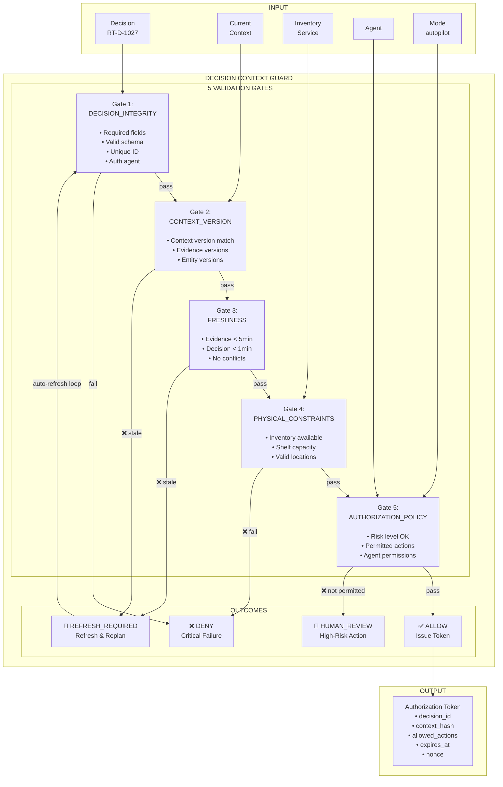
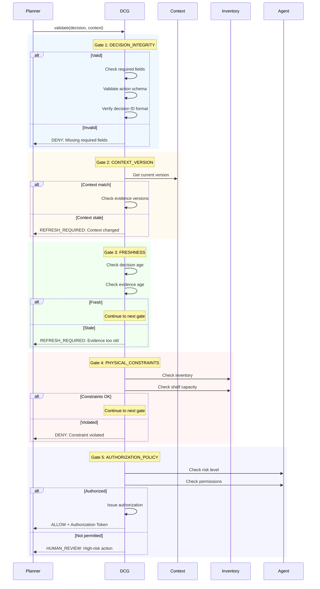
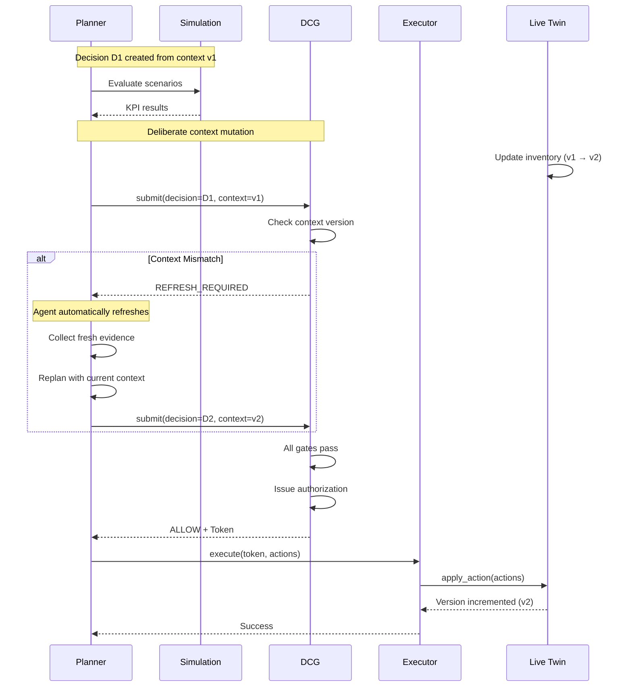
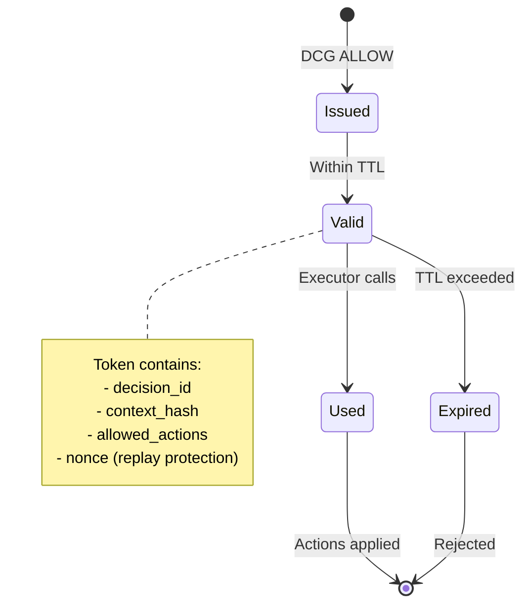

# ADR 0016-0017: Decision Context Guard (DCG) & No-Stale-Commit

## Status

Accepted

## Context

Autonomous AI agents can generate reasonable decisions that become invalid seconds later because business context changed (inventory sold, shelf restocked, etc.). We need a deterministic enforcement mechanism that:

1. Validates decisions before live execution
2. Detects when context has changed
3. Prevents stale decisions from mutating live state

## Problem

Without DCG:

- LLM-generated decisions may be applied against outdated state
- Inventory conflicts can occur
- Safety invariants may be violated
- Audit trail lacks deterministic validation

## Decision

We implement a **deterministic Decision Context Guard (DCG)** that:

1. Is NOT an LLM - pure logic enforcement
2. Validates 5 gates before authorization
3. Issues short-lived tokens for valid decisions
4. Supports No-Stale-Commit via context versioning

## DCG Architecture



## DCG Validation Flow



## No-Stale-Commit Flow



## Authorization Token Lifecycle



## Decision Schema

```python
class Decision(BaseModel):
    decision_id: str           # "RT-D-1027"
    agent_id: str              # "retailtwin-orchestrator"
    context_version: str        # "store-001:v23871"
    context_timestamp: datetime
    evidence: list[EvidenceItem]
    proposed_actions: list[Action]
    simulation_id: str | None
    expected_impact: dict
    risk_level: RiskLevel
    created_at: datetime
    expires_at: datetime


class EvidenceItem(BaseModel):
    type: str                  # "inventory", "sales", "shelf"
    entity_id: str             # "P017"
    entity_version: str        # "v981"
    observed_at: datetime
    value: dict


class Action(BaseModel):
    action_id: str
    action_type: ActionType    # MOVE_PRODUCT, CHANGE_FACINGS, REPLENISH
    sku: str
    target: str                # shelf_id, slot_id
    parameters: dict
    risk_level: RiskLevel
```

## Validation Gate Details

### Gate 1: Decision Integrity

```python
def validate_decision_integrity(decision: Decision) -> ValidationResult:
    """Check decision has all required fields and valid structure."""

    errors = []

    # Required fields
    if not decision.decision_id:
        errors.append("decision_id is required")
    if not decision.agent_id:
        errors.append("agent_id is required")
    if not decision.context_version:
        errors.append("context_version is required")
    if not decision.proposed_actions:
        errors.append("at least one action is required")

    # Decision ID format
    if not decision.decision_id.startswith("RT-D-"):
        errors.append("decision_id must start with RT-D-")

    # Actions validation
    for action in decision.proposed_actions:
        if not validate_action_schema(action):
            errors.append(f"Invalid action: {action.action_id}")

    return ValidationResult(
        passed=len(errors) == 0,
        gate="DECISION_INTEGRITY",
        errors=errors
    )
```

### Gate 2: Context Version

```python
def validate_context_version(
    decision: Decision,
    current_context: Context
) -> ValidationResult:
    """Check decision context matches current state."""

    errors = []

    # Context version mismatch = STALE
    if decision.context_version != current_context.version:
        return ValidationResult(
            passed=False,
            gate="CONTEXT_VERSION",
            errors=[f"Context stale: decision={decision.context_version}, current={current_context.version}"],
            outcome=DCGOutcome.REFRESH_REQUIRED
        )

    # Evidence versions must match
    for evidence in decision.evidence:
        current_version = current_context.get_entity_version(evidence.entity_id)
        if evidence.entity_version != current_version:
            errors.append(
                f"Evidence stale: {evidence.entity_id} "
                f"version {evidence.entity_version} != current {current_version}"
            )

    return ValidationResult(
        passed=len(errors) == 0,
        gate="CONTEXT_VERSION",
        errors=errors,
        outcome=DCGOutcome.ALLOW if len(errors) == 0 else DCGOutcome.REFRESH_REQUIRED
    )
```

### Gate 3: Freshness

```python
MAX_EVIDENCE_AGE_SECONDS = 300      # 5 minutes
MAX_DECISION_AGE_SECONDS = 60       # 1 minute

def validate_freshness(
    decision: Decision,
    current_time: datetime
) -> ValidationResult:
    """Check evidence and decision are still fresh."""

    errors = []

    # Check decision age
    decision_age = (current_time - decision.created_at).total_seconds()
    if decision_age > MAX_DECISION_AGE_SECONDS:
        errors.append(f"Decision expired: age {decision_age}s > max {MAX_DECISION_AGE_SECONDS}s")

    # Check evidence age
    for evidence in decision.evidence:
        evidence_age = (current_time - evidence.observed_at).total_seconds()
        if evidence_age > MAX_EVIDENCE_AGE_SECONDS:
            errors.append(
                f"Evidence stale: {evidence.entity_id} "
                f"age {evidence_age}s > max {MAX_EVIDENCE_AGE_SECONDS}s"
            )

    return ValidationResult(
        passed=len(errors) == 0,
        gate="FRESHNESS",
        errors=errors,
        outcome=DCGOutcome.REFRESH_REQUIRED if errors else DCGOutcome.ALLOW
    )
```

### Gate 4: Physical Constraints

```python
def validate_physical_constraints(
    decision: Decision,
    inventory: InventoryService
) -> ValidationResult:
    """Check actions don't violate physical constraints."""

    errors = []

    for action in decision.proposed_actions:
        if action.action_type == ActionType.REPLENISH:
            # Check inventory available
            available = inventory.get_available(action.sku)
            required = action.parameters.get("quantity", 0)
            if available < required:
                errors.append(
                    f"Insufficient inventory for {action.sku}: "
                    f"available={available}, required={required}"
                )

        elif action.action_type == ActionType.CHANGE_FACINGS:
            # Check shelf capacity
            shelf = inventory.get_shelf(action.target)
            current_facings = shelf.get_facings(action.sku)
            new_facings = action.parameters.get("facings", 0)
            if not shelf.can_accommodate(action.sku, new_facings):
                errors.append(
                    f"Shelf {action.target} cannot accommodate "
                    f"facings {new_facings} for {action.sku}"
                )

        elif action.action_type == ActionType.MOVE_PRODUCT:
            # Check target slot exists and is available
            if not inventory.slot_available(action.target):
                errors.append(f"Target slot {action.target} not available")

    return ValidationResult(
        passed=len(errors) == 0,
        gate="PHYSICAL_CONSTRAINTS",
        errors=errors
    )
```

### Gate 5: Authorization Policy

```python
ALLOWED_ACTIONS_BY_MODE = {
    "autopilot": [
        ActionType.REPLENISH,
        ActionType.CHANGE_FACINGS,
    ],
    "copilot": [
        ActionType.REPLENISH,
        ActionType.CHANGE_FACINGS,
        ActionType.MOVE_PRODUCT,
    ],
    "manual": [
        ActionType.REPLENISH,
        ActionType.CHANGE_FACINGS,
        ActionType.MOVE_PRODUCT,
        ActionType.CREATE_PROMOTION,
    ]
}

RISK_LEVEL_THRESHOLDS = {
    "autopilot": RiskLevel.LOW,
    "copilot": RiskLevel.MEDIUM,
    "manual": RiskLevel.HIGH
}

def validate_authorization_policy(
    decision: Decision,
    agent: Agent,
    mode: OperationalMode
) -> ValidationResult:
    """Check agent is authorized for these actions."""

    errors = []
    max_risk = RISK_LEVEL_THRESHOLDS.get(mode, RiskLevel.LOW)

    # Check action types are permitted
    for action in decision.proposed_actions:
        if action.action_type not in ALLOWED_ACTIONS_BY_MODE.get(mode, []):
            errors.append(
                f"Action {action.action_type} not permitted in {mode} mode"
            )

        # Check risk level
        if action.risk_level > max_risk:
            errors.append(
                f"Action risk {action.risk_level} exceeds {mode} threshold {max_risk}"
            )

    # Check agent permissions
    if not agent.can_execute(decision.proposed_actions):
        errors.append("Agent lacks permission for proposed actions")

    return ValidationResult(
        passed=len(errors) == 0,
        gate="AUTHORIZATION_POLICY",
        errors=errors,
        outcome=DCGOutcome.HUMAN_REVIEW if errors else DCGOutcome.ALLOW
    )
```

## DCG Main Entry Point

```python
from enum import Enum
from dataclasses import dataclass

class DCGOutcome(str, Enum):
    ALLOW = "ALLOW"
    DENY = "DENY"
    REFRESH_REQUIRED = "REFRESH_REQUIRED"
    HUMAN_REVIEW = "HUMAN_REVIEW"

@dataclass
class ValidationResult:
    passed: bool
    gate: str
    errors: list[str]
    outcome: DCGOutcome = DCGOutcome.ALLOW

@dataclass
class Authorization:
    authorization_id: str
    decision_id: str
    context_hash: str
    allowed_actions: list[Action]
    issued_at: datetime
    expires_at: datetime
    nonce: str  # For replay protection

class DecisionContextGuard:
    """Deterministic Decision Context Guard."""

    def __init__(
        self,
        max_decision_age: int = 60,
        max_evidence_age: int = 300
    ):
        self.max_decision_age = max_decision_age
        self.max_evidence_age = max_evidence_age
        self._issued_authorizations: dict[str, Authorization] = {}

    def validate(
        self,
        decision: Decision,
        context: Context,
        inventory: InventoryService,
        agent: Agent,
        mode: OperationalMode
    ) -> ValidationResult:
        """
        Run all validation gates and return result.

        Gates run in order; first failure determines outcome.
        """
        gates = [
            ("DECISION_INTEGRITY", self._validate_integrity),
            ("CONTEXT_VERSION", lambda: self._validate_context(decision, context)),
            ("FRESHNESS", lambda: self._validate_freshness(decision)),
            ("PHYSICAL_CONSTRAINTS", lambda: self._validate_constraints(decision, inventory)),
            ("AUTHORIZATION_POLICY", lambda: self._validate_policy(decision, agent, mode))
        ]

        for gate_name, gate_fn in gates:
            result = gate_fn()
            if not result.passed:
                return result

        return ValidationResult(
            passed=True,
            gate="ALL",
            errors=[],
            outcome=DCGOutcome.ALLOW
        )

    def issue_authorization(
        self,
        decision: Decision,
        context: Context
    ) -> Authorization:
        """Issue short-lived authorization token after ALLOW."""

        auth = Authorization(
            authorization_id=f"auth-{uuid.uuid4().hex[:12]}",
            decision_id=decision.decision_id,
            context_hash=hashlib.sha256(
                context.version.encode()
            ).hexdigest()[:16],
            allowed_actions=decision.proposed_actions,
            issued_at=datetime.utcnow(),
            expires_at=datetime.utcnow() + timedelta(seconds=30),
            nonce=uuid.uuid4().hex[:16]
        )

        self._issued_authorizations[auth.authorization_id] = auth
        return auth

    def revoke_authorization(self, authorization_id: str) -> bool:
        """Revoke an issued authorization."""
        if authorization_id in self._issued_authorizations:
            del self._issued_authorizations[authorization_id]
            return True
        return False
```

## No-Stale-Commit Implementation

```python
class NoStaleCommit:
    """
    Ensures decisions are applied against the same context
    that justified them.
    """

    def __init__(self, dcg: DecisionContextGuard):
        self.dcg = dcg
        self._pending_decisions: dict[str, PendingDecision] = {}

    def register_decision(self, decision: Decision) -> None:
        """Register a decision for staleness tracking."""
        self._pending_decisions[decision.decision_id] = PendingDecision(
            decision=decision,
            registered_at=datetime.utcnow(),
            applied=False
        )

    def check_and_apply(
        self,
        authorization: Authorization,
        actions: list[Action]
    ) -> ApplyResult:
        """
        Validate authorization and apply actions atomically.

        Fails if:
        - Authorization is expired
        - Authorization was reused (replay)
        - Context hash doesn't match
        - Actions were altered
        """
        # Check authorization exists
        stored_auth = self.dcg._issued_authorizations.get(
            authorization.authorization_id
        )
        if not stored_auth:
            return ApplyResult(
                success=False,
                error="AUTHORIZATION_NOT_FOUND"
            )

        # Check expiry
        if datetime.utcnow() > stored_auth.expires_at:
            return ApplyResult(
                success=False,
                error="AUTHORIZATION_EXPIRED"
            )

        # Check replay (nonce already used)
        if authorization.nonce in self._used_nonces:
            return ApplyResult(
                success=False,
                error="AUTHORIZATION_REPLAY_DETECTED"
            )

        # Check context hash
        if authorization.context_hash != self._current_context_hash:
            return ApplyResult(
                success=False,
                error="CONTEXT_STALE",
                details={
                    "expected": authorization.context_hash,
                    "actual": self._current_context_hash
                }
            )

        # Check actions match
        if set(authorization.allowed_actions) != set(actions):
            return ApplyResult(
                success=False,
                error="ACTIONS_ALTERED",
                details={
                    "authorized": [a.action_id for a in authorization.allowed_actions],
                    "submitted": [a.action_id for a in actions]
                }
            )

        # Mark nonce as used
        self._used_nonces.add(authorization.nonce)

        # Apply actions
        return ApplyResult(success=True, applied_actions=actions)

    def mark_decision_applied(self, decision_id: str) -> None:
        """Mark a decision as successfully applied."""
        if decision_id in self._pending_decisions:
            self._pending_decisions[decision_id].applied = True
```

## DCG Outcomes

| Outcome            | Meaning                     | Action                        |
| ------------------ | --------------------------- | ----------------------------- |
| `ALLOW`            | All gates passed            | Issue authorization token     |
| `DENY`             | Critical validation failure | Log, reject, no mutation      |
| `REFRESH_REQUIRED` | Context changed or stale    | Agent must refresh and replan |
| `HUMAN_REVIEW`     | High-risk action            | Pause for human approval      |

## Fail-Closed Behavior

```python
# DCG is fail-closed: any uncertainty = DENY
def validate_with_fail_closed(
    decision: Decision,
    context: Context
) -> DCGOutcome:
    """
    Validate with fail-closed semantics.

    If any gate cannot be validated, treat as DENY.
    """
    try:
        result = dcg.validate(decision, context)
        return result.outcome
    except ValidationError as e:
        logger.error(f"DCG validation error: {e}")
        return DCGOutcome.DENY
    except ContextUnavailableError as e:
        logger.error(f"Cannot validate: context unavailable")
        return DCGOutcome.DENY
```

## Logging and Audit

Every DCG call logs:

- decision_id
- agent_id
- gate results
- outcome
- duration_ms
- context_version

```python
logger.info(
    "DCG validation",
    extra={
        "decision_id": decision.decision_id,
        "agent_id": decision.agent_id,
        "context_version": decision.context_version,
        "gates_passed": [r.gate for r in results if r.passed],
        "gates_failed": [r.gate for r in results if not r.passed],
        "outcome": outcome.value,
        "duration_ms": duration_ms
    }
)
```

## Testing Requirements

### Unit Tests

- Each gate independently tested
- Edge cases: empty decisions, missing fields
- Time boundary conditions

### Integration Tests

- Full validation pipeline
- Stale context detection
- Authorization lifecycle

### Failure Path Tests

- Expired authorization rejected
- Replay attack detected
- Context hash mismatch blocked
- Altered actions rejected

## Related Issues

- #16: Implement Decision Context Guard MVP
- #17: Enforce No-Stale-Commit
- #41: Demo Controller (for DCG testing)

## Implementation Files

```
guard/
├── decision_context_guard/
│   ├── __init__.py          # DCG, ValidationResult, Authorization
│   ├── gates.py             # Individual gate implementations
│   ├── no_stale_commit.py   # NoStaleCommit enforcement
│   └── schemas.py           # Pydantic models
└── decision_context_guard/
    └── __init__.py          # Re-export from decision_context_guard
```

## Metrics

| Metric             | Target      |
| ------------------ | ----------- |
| Validation latency | < 10ms      |
| Authorization TTL  | 30 seconds  |
| Max decision age   | 60 seconds  |
| Max evidence age   | 300 seconds |
| Gate coverage      | 5/5         |
