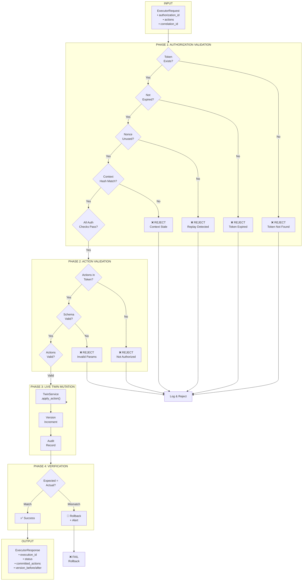
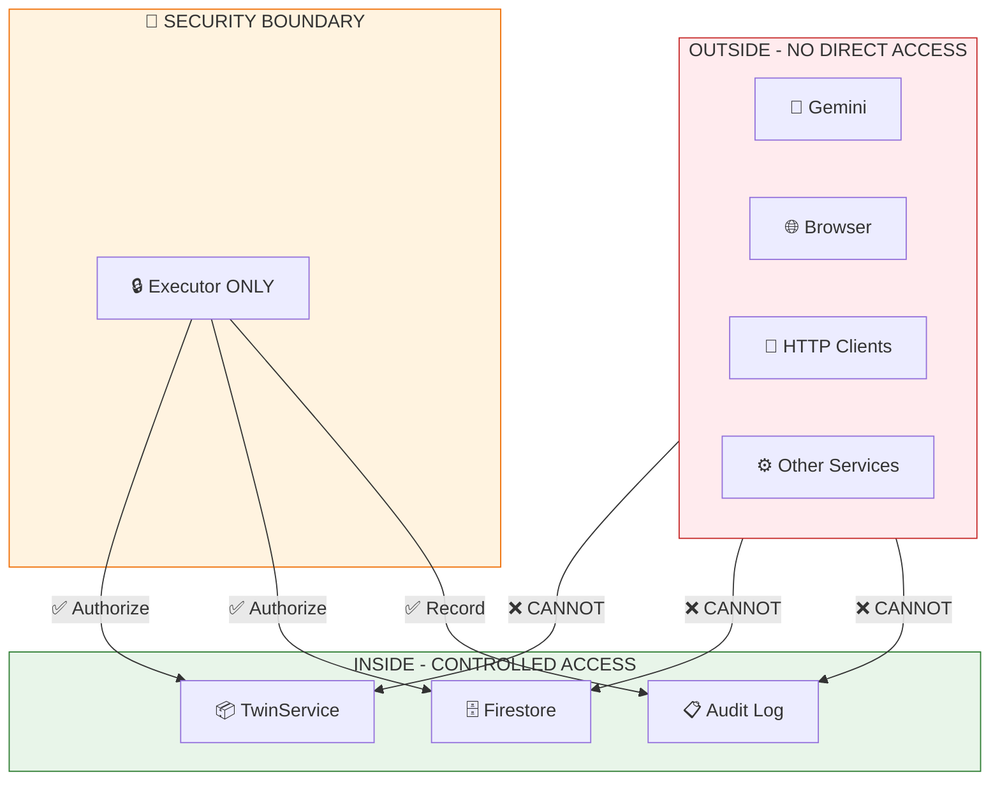
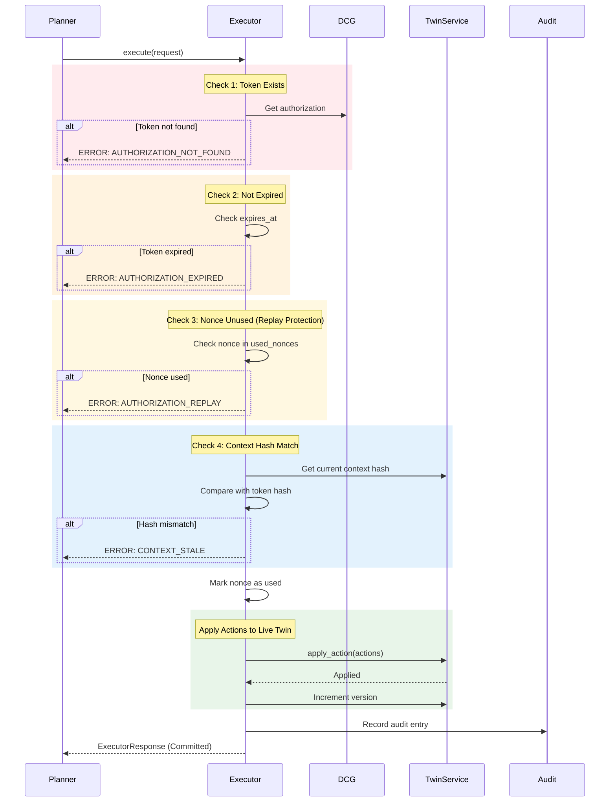
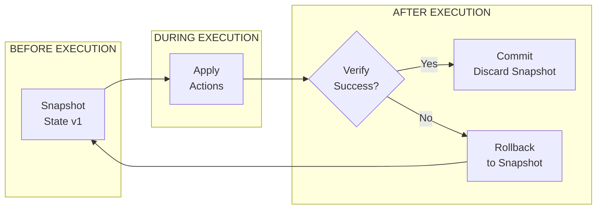

# ADR 0018: Guarded Executor Implementation

## Status

Accepted

## Context

The Executor is the **only component** allowed to perform guarded live mutations to the Digital Twin. This is a critical security boundary that ensures:

1. No LLM or browser can mutate live state directly
2. All mutations pass through DCG validation
3. Actions are atomic and auditable
4. Replay attacks are prevented

## Problem

Without a guarded Executor:

- Gemini could call generic live update endpoints
- Browser could write Firestore directly
- No enforcement of DCG decisions
- Stale actions could be applied
- Audit trail is incomplete

## Decision

We implement a **Guarded Executor Agent** that:

1. Requires valid DCG authorization token
2. Validates token before any mutation
3. Applies only authorized actions
4. Records all mutations with correlation IDs
5. Is the sole path for live state changes

## Executor Architecture



## Executor Security Boundary



## Authorization Token Validation Flow



## Executor Schema

```python
from enum import Enum
from pydantic import BaseModel, Field
from datetime import datetime

class ActionType(str, Enum):
    MOVE_PRODUCT = "move_product"
    CHANGE_FACINGS = "change_facings"
    REPLENISH = "replenish"
    CREATE_PROMOTION = "create_promotion"
    ADJUST_PRICE = "adjust_price"

class ActionStatus(str, Enum):
    PENDING = "pending"
    AUTHORIZED = "authorized"
    COMMITTED = "committed"
    FAILED = "failed"
    ROLLED_BACK = "rolled_back"

class ExecutorRequest(BaseModel):
    authorization_id: str
    actions: list[Action]
    correlation_id: str
    submitted_at: datetime = Field(default_factory=datetime.utcnow)

class ExecutorResponse(BaseModel):
    execution_id: str
    status: ActionStatus
    committed_actions: list[CommittedAction]
    failed_actions: list[FailedAction]
    context_version_before: str
    context_version_after: str
    execution_time_ms: float
    correlation_id: str

class CommittedAction(BaseModel):
    action_id: str
    action_type: ActionType
    sku: str
    parameters: dict
    applied_at: datetime

class FailedAction(BaseModel):
    action_id: str
    action_type: ActionType
    error_code: str
    error_message: str
```

## Executor Implementation

```python
class ExecutorError(Exception):
    """Base exception for Executor errors."""
    def __init__(self, code: str, message: str):
        self.code = code
        self.message = message
        super().__init__(f"[{code}] {message}")

class AuthorizationExpiredError(ExecutorError):
    """Authorization token has expired."""
    pass

class AuthorizationNotFoundError(ExecutorError):
    """Authorization token not found."""
    pass

class AuthorizationReplayError(ExecutorError):
    """Authorization nonce already used (replay attack)."""
    pass

class ContextStaleError(ExecutorError):
    """Context changed since authorization was issued."""
    pass

class ActionNotAuthorizedError(ExecutorError):
    """Action not in authorization scope."""
    pass

class ActionValidationError(ExecutorError):
    """Action parameters failed validation."""
    pass

class ExecutorAgent:
    """
    Guarded Executor - the ONLY component allowed to mutate Live Twin.

    Security Properties:
    1. Requires valid DCG authorization token
    2. Tokens are single-use (nonce-based)
    3. Actions must match authorized set exactly
    4. Context hash must match at execution time
    5. All mutations are atomic and auditable
    """

    def __init__(
        self,
        twin_service: TwinService,
        dcg: DecisionContextGuard,
        audit_logger: AuditLogger
    ):
        self.twin = twin_service
        self.dcg = dcg
        self.audit = audit_logger
        self._used_nonces: set[str] = set()
        self._pending_executions: dict[str, ExecutorRequest] = {}

    async def execute(
        self,
        request: ExecutorRequest
    ) -> ExecutorResponse:
        """
        Execute authorized actions against Live Twin.

        This is the ONLY public mutation method.
        All mutations MUST go through this method.
        """
        execution_id = f"exec-{uuid.uuid4().hex[:12]}"
        start_time = datetime.utcnow()

        try:
            # Phase 1: Authorization validation
            auth = self._validate_authorization(request)

            # Phase 2: Action validation
            self._validate_actions(request.actions, auth)

            # Phase 3: Capture pre-state
            version_before = self.twin.get_current_version()

            # Phase 4: Apply mutations atomically
            committed, failed = await self._apply_actions(
                execution_id,
                request.actions,
                auth
            )

            # Phase 5: Verify post-state
            version_after = self.twin.get_current_version()

            # Phase 6: Record to audit
            await self._record_audit(
                execution_id,
                request,
                committed,
                failed,
                version_before,
                version_after
            )

            execution_time = (datetime.utcnow() - start_time).total_seconds() * 1000

            return ExecutorResponse(
                execution_id=execution_id,
                status=ActionStatus.COMMITTED if committed else ActionStatus.FAILED,
                committed_actions=committed,
                failed_actions=failed,
                context_version_before=version_before,
                context_version_after=version_after,
                execution_time_ms=execution_time,
                correlation_id=request.correlation_id
            )

        except ExecutorError as e:
            await self._record_failure(execution_id, request, e)
            raise

    def _validate_authorization(
        self,
        request: ExecutorRequest
    ) -> Authorization:
        """Validate authorization token is valid and unused."""

        # Check token exists
        auth = self.dcg._issued_authorizations.get(request.authorization_id)
        if not auth:
            self.audit.log_unauthorized(request.authorization_id, "token_not_found")
            raise AuthorizationNotFoundError(
                "AUTHORIZATION_NOT_FOUND",
                f"Authorization {request.authorization_id} not found"
            )

        # Check expiry
        if datetime.utcnow() > auth.expires_at:
            self.audit.log_unauthorized(
                request.authorization_id,
                "token_expired",
                {"expired_at": auth.expires_at.isoformat()}
            )
            raise AuthorizationExpiredError(
                "AUTHORIZATION_EXPIRED",
                f"Authorization expired at {auth.expires_at.isoformat()}"
            )

        # Check replay (nonce already used)
        if auth.nonce in self._used_nonces:
            self.audit.log_unauthorized(
                request.authorization_id,
                "replay_detected",
                {"nonce": auth.nonce}
            )
            raise AuthorizationReplayError(
                "AUTHORIZATION_REPLAY",
                "Authorization nonce has already been used"
            )

        # Check context hash matches current state
        current_context = self.twin.get_current_context()
        current_hash = hashlib.sha256(
            current_context.version.encode()
        ).hexdigest()[:16]

        if auth.context_hash != current_hash:
            self.audit.log_unauthorized(
                request.authorization_id,
                "context_stale",
                {
                    "expected_hash": auth.context_hash,
                    "current_hash": current_hash
                }
            )
            raise ContextStaleError(
                "CONTEXT_STALE",
                f"Context changed: expected {auth.context_hash}, got {current_hash}"
            )

        # Mark nonce as used
        self._used_nonces.add(auth.nonce)

        return auth

    def _validate_actions(
        self,
        actions: list[Action],
        auth: Authorization
    ) -> None:
        """Validate all actions are authorized."""

        authorized_ids = {a.action_id for a in auth.allowed_actions}
        submitted_ids = {a.action_id for a in actions}

        # All submitted actions must be authorized
        unauthorized = submitted_ids - authorized_ids
        if unauthorized:
            raise ActionNotAuthorizedError(
                "ACTION_NOT_AUTHORIZED",
                f"Actions not in authorization: {unauthorized}"
            )

        # Validate action parameters
        for action in actions:
            if not self._validate_action_params(action):
                raise ActionValidationError(
                    "INVALID_ACTION_PARAMS",
                    f"Action {action.action_id} has invalid parameters"
                )

    def _validate_action_params(self, action: Action) -> bool:
        """Validate action-specific parameters."""

        if action.action_type == ActionType.REPLENISH:
            return (
                "quantity" in action.parameters
                and action.parameters["quantity"] > 0
                and action.parameters["quantity"] <= 1000
            )

        elif action.action_type == ActionType.CHANGE_FACINGS:
            return (
                "facings" in action.parameters
                and 1 <= action.parameters["facings"] <= 10
            )

        elif action.action_type == ActionType.MOVE_PRODUCT:
            return (
                "target_slot" in action.parameters
                and action.parameters["target_slot"]
            )

        return True
```

## Action Types and Parameters

### REPLENISH

```python
class ReplenishAction(Action):
    action_type = ActionType.REPLENISH
    parameters = {
        "quantity": int,       # Required: units to add (1-1000)
        "source": str,         # Optional: "backroom" (default)
    }

# Example
{
    "action_id": "RT-A-1042",
    "action_type": "replenish",
    "sku": "P017",
    "target": "A02-S03",
    "parameters": {
        "quantity": 12,
        "source": "backroom"
    },
    "risk_level": "LOW"
}
```

### CHANGE_FACINGS

```python
class ChangeFacingsAction(Action):
    action_type = ActionType.CHANGE_FACINGS
    parameters = {
        "facings": int,        # Required: number of facings (1-10)
    }

# Example
{
    "action_id": "RT-A-1043",
    "action_type": "change_facings",
    "sku": "P017",
    "target": "A02",
    "parameters": {"facings": 4},
    "risk_level": "LOW"
}
```

### MOVE_PRODUCT

```python
class MoveProductAction(Action):
    action_type = ActionType.MOVE_PRODUCT
    parameters = {
        "target_slot": str,    # Required: destination slot ID
        "position": dict,      # Optional: x, y, z coordinates
    }

# Example
{
    "action_id": "RT-A-1044",
    "action_type": "move_product",
    "sku": "P017",
    "source": "A02-S03",
    "target": "A02-S05",
    "parameters": {
        "target_slot": "A02-S05",
        "position": {"x": 1.5, "y": 1.2, "z": -0.3}
    },
    "risk_level": "MEDIUM"
}
```

## Rollback Mechanism



## Error Codes

| Code                      | Description          | HTTP Status |
| ------------------------- | -------------------- | ----------- |
| `AUTHORIZATION_NOT_FOUND` | Token doesn't exist  | 404         |
| `AUTHORIZATION_EXPIRED`   | Token TTL exceeded   | 401         |
| `AUTHORIZATION_REPLAY`    | Nonce already used   | 401         |
| `CONTEXT_STALE`           | Context changed      | 409         |
| `ACTION_NOT_AUTHORIZED`   | Action not in token  | 403         |
| `INVALID_ACTION_PARAMS`   | Bad parameters       | 400         |
| `INSUFFICIENT_INVENTORY`  | Can't fulfill action | 422         |
| `SHELF_CAPACITY_EXCEEDED` | Would overflow       | 422         |

## Testing

### Authorization Tests

- Valid token accepted
- Expired token rejected
- Replay attack blocked
- Context stale detected
- Unauthorized action rejected

### Action Tests

- REPLENISH applies correct quantity
- CHANGE_FACINGS updates shelf
- MOVE_PRODUCT relocates product
- Invalid parameters rejected
- Partial failure handled

### Atomicity Tests

- All-or-nothing execution
- Rollback on failure
- Concurrent execution safe

## Related Issues

- #18: Implement guarded Executor and short-lived commit token
- #16: Implement Decision Context Guard MVP
- #17: Enforce No-Stale-Commit

## Implementation Files

```
agents/executor/
├── __init__.py          # ExecutorAgent
├── schemas.py           # Request/Response models
├── errors.py            # ExecutorError classes
├── rollback.py          # RollbackManager
└── tests/
    ├── test_executor.py
    └── test_authorization.py
```

## Metrics

| Metric                   | Target            |
| ------------------------ | ----------------- |
| Authorization validation | < 5ms             |
| Action application       | < 50ms            |
| Rollback completion      | < 100ms           |
| Atomicity guarantee      | 100%              |
| Audit coverage           | 100% of mutations |
