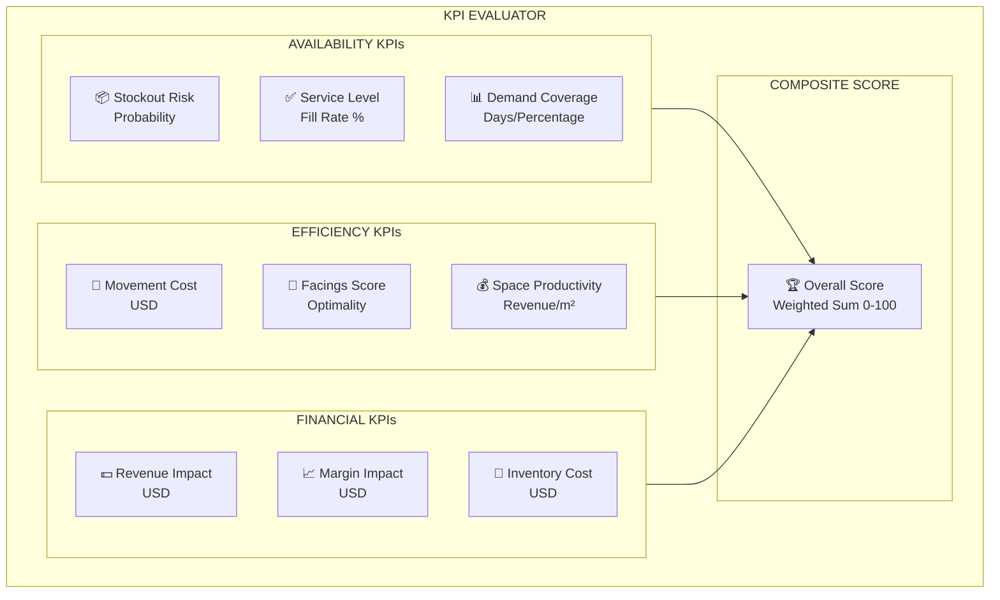
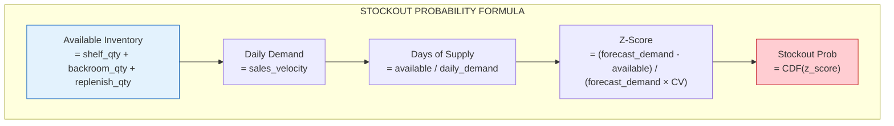
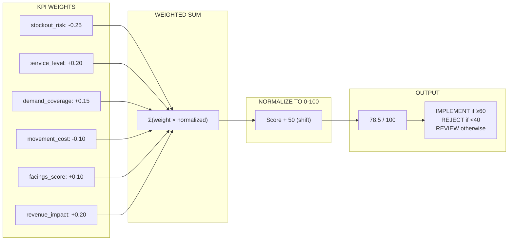
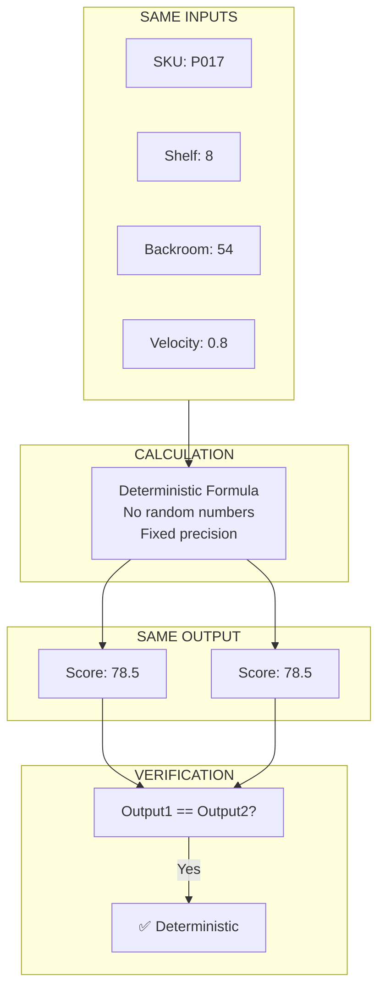

# ADR 0033: Simulation KPI Evaluator

## Status

Accepted

## Context

The Simulation Service needs to evaluate candidate action plans against measurable business KPIs. These evaluations must be:

1. **Deterministic** - same inputs always produce same outputs
2. **Quantitative** - no LLM fabrications
3. **Reproducible** - can be audited and explained
4. **Comparable** - multiple scenarios can be ranked

## Problem

Without a deterministic KPI evaluator:

- Gemini could claim any impact without evidence
- Different runs produce inconsistent results
- Cannot compare candidate scenarios objectively
- Audit trail lacks quantitative backing

## Decision

We implement a **KPI Evaluator** that calculates business impact using deterministic formulas based on:

1. Current inventory state
2. Action parameters
3. Historical sales data
4. Demand forecasts

## KPI Categories



## KPI Calculation Flow

```mermaid
flowchart LR
    subgraph Input["INPUT"]
        S[Store State<br/>• inventory<br/>• velocity<br/>• forecasts]
        A[Action<br/>• type<br/>• parameters]
    end

    subgraph Calculate["CALCULATE KPIs"]
        K1[Stockout Risk]
        K2[Service Level]
        K3[Demand Coverage]
        K4[Movement Cost]
        K5[Facings Score]
        K6[Revenue Impact]
    end

    subgraph Normalize["NORMALIZE (0-100)"]
        N1[100 - risk*100]
        N2[service*100]
        N3["coverage%"]
        N4["(max-cost)/max*100"]
        N5[score]
        N6[impact/max*100]
    end

    subgraph Weight["WEIGHT & SUM"]
        W[Weights<br/>• stockout: -0.25<br/>• service: +0.20<br/>• coverage: +0.15<br/>• cost: -0.10<br/>• facings: +0.10<br/>• revenue: +0.20]
        SUM["Σ(weight × normalized)"]
    end

    subgraph Output["OUTPUT"]
        SCORE[Composite Score<br/>0-100]
        REC[Recommendation<br/>IMPLEMENT/REJECT/REVIEW]
    end

    S --> Calculate
    A --> Calculate
    Calculate --> Normalize
    Normalize --> Weight
    Weight --> SUM
    SUM --> SCORE
    SCORE --> REC
```



## Stockout Risk Formula



## KPI Formulas

### 1. Stockout Risk

```python
def calculate_stockout_risk(
    sku: str,
    current_shelf_qty: int,
    backroom_qty: int,
    sales_velocity: float,
    forecast_demand: float,
    action_params: dict
) -> StockoutRiskResult:
    """
    Calculate probability of stockout within planning horizon.
    """

    # Apply action effects
    new_shelf_qty = action_params.get("shelf_quantity", current_shelf_qty)
    new_backroom_qty = backroom_qty - action_params.get("replenish_qty", 0)
    available = new_shelf_qty + max(0, new_backroom_qty)

    # Days of supply
    daily_demand = sales_velocity
    days_of_supply = available / daily_demand if daily_demand > 0 else float('inf')

    # Stockout probability (normal distribution)
    cv = 0.3  # 30% demand variability
    z_score = (forecast_demand - available) / (forecast_demand * cv)
    stockout_prob = norm.cdf(z_score)

    return StockoutRiskResult(
        sku=sku,
        stockout_probability=stockout_prob,
        days_of_supply=days_of_supply,
        risk_level=RiskLevel.HIGH if stockout_prob > 0.3 else RiskLevel.MEDIUM if stockout_prob > 0.1 else RiskLevel.LOW,
        available_inventory=available
    )
```

### 2. Service Level

```python
def calculate_service_level(
    sku: str,
    shelf_quantity: int,
    backroom_quantity: int,
    forecast_demand: float
) -> float:
    """
    Calculate service level (fill rate).

    service_level = 1 - (unfilled_demand / total_demand)
    """
    available = shelf_quantity + backroom_quantity

    if forecast_demand <= 0:
        return 1.0

    fill_rate = min(1.0, available / forecast_demand)
    return fill_rate
```

### 3. Movement Cost

```python
MOVEMENT_COST_PER_UNIT = 0.50  # USD per unit moved
REPLENISH_COST_PER_TRIP = 5.00  # USD per replenishment trip

def calculate_movement_cost(
    action: Action,
    current_state: dict
) -> MovementCostResult:
    """Calculate operational cost of executing an action."""

    if action.action_type == ActionType.REPLENISH:
        quantity = action.parameters.get("quantity", 0)
        cost = quantity * MOVEMENT_COST_PER_UNIT
        trips = ceil(quantity / 20)
        cost += trips * REPLENISH_COST_PER_TRIP

    elif action.action_type == ActionType.CHANGE_FACINGS:
        old_facings = current_state.get("facings", 0)
        new_facings = action.parameters.get("facings", 0)
        facings_change = abs(new_facings - old_facings)
        cost = facings_change * 2.00

    return MovementCostResult(
        action_id=action.action_id,
        cost=cost,
        cost_breakdown={...}
    )
```

### 4. Facings Score

```python
OPTIMAL_FACINGS = {
    "beverages": 4,
    "snacks": 3,
    "dairy": 2,
    "default": 3
}

def calculate_facings_score(
    sku: str,
    category: str,
    current_facings: int,
    new_facings: int,
    sales_velocity: float
) -> FacingsScoreResult:
    """
    Calculate how optimal the facings allocation is.
    """
    optimal = OPTIMAL_FACINGS.get(category, 3)

    # Deviation from optimal
    current_score = max(0, 100 - abs(current_facings - optimal) * 20)
    new_score = max(0, 100 - abs(new_facings - optimal) * 20)

    # Velocity multiplier
    velocity_multiplier = 1 + (sales_velocity / 10) * 0.2
    if new_facings > current_facings:
        new_score *= velocity_multiplier

    return FacingsScoreResult(
        sku=sku,
        current_score=current_score,
        projected_score=min(100, new_score),
        improvement=new_score - current_score,
        optimal_facings=optimal
    )
```

## Composite Score Calculation



## KPI Evaluator Interface

```python
class KPIEvaluator:
    """
    Deterministic KPI Evaluator for simulation scenarios.
    """

    def __init__(self, planning_horizon_days: int = 7):
        self.planning_horizon = planning_horizon_days

    def evaluate_scenario(
        self,
        scenario: SimulationScenario,
        current_state: StoreState,
        action: Action
    ) -> ScenarioEvaluation:
        """Evaluate a single scenario/action combination."""

        stockout = self.calculate_stockout_risk(...)
        service_level = self.calculate_service_level(...)
        demand_coverage = self.calculate_demand_coverage(...)
        movement_cost = self.calculate_movement_cost(...)
        facings_score = self.calculate_facings_score(...)
        revenue_impact = self.calculate_revenue_impact(...)

        composite = self.calculate_composite_score(kpi_results)

        return ScenarioEvaluation(
            scenario_id=scenario.scenario_id,
            sku=action.sku,
            kpis=KPIResults(...),
            composite_score=composite
        )

    def compare_scenarios(
        self,
        scenarios: list[ScenarioEvaluation]
    ) -> ScenarioComparison:
        """Compare multiple scenarios and rank them."""
        ranked = sorted(scenarios, key=lambda s: s.composite_score.total_score, reverse=True)
        return ScenarioComparison(scenarios=ranked, best_scenario=ranked[0])
```

## Example Output

```json
{
	"scenario_id": "SIM-001-C",
	"sku": "P017",
	"composite_score": {
		"total_score": 78.5,
		"components": {
			"stockout_risk": 23.0,
			"service_level": 18.4,
			"demand_coverage": 12.75,
			"movement_cost": 9.6,
			"facings_score": 9.5,
			"revenue_impact": 5.25
		},
		"recommendation": "IMPLEMENT"
	}
}
```

## Determinism Guarantee



## Testing Requirements

### Unit Tests

- Each KPI formula independently tested
- Edge cases: zero inventory, extreme velocity
- Rounding precision verification

### Determinism Tests

- Same inputs → Same outputs
- No external dependencies (time, network)

### Comparison Tests

- Higher stockout risk → Lower score
- Replenishment → Lower stockout risk
- Optimal facings → Higher score

## Related Issues

- #33: Implement Simulation KPI evaluator

## Implementation Files

```
services/simulation/
├── kpi.py                    # KPI Evaluator
├── formulas.py               # KPI formulas
├── schemas.py                # Pydantic models
└── tests/
    ├── test_kpi_evaluator.py
    └── test_determinism.py
```

## Metrics

| Metric                | Target         |
| --------------------- | -------------- |
| Evaluation latency    | < 50ms         |
| Determinism guarantee | 100%           |
| KPI coverage          | 6/6 categories |
| Composite score range | 0-100          |
