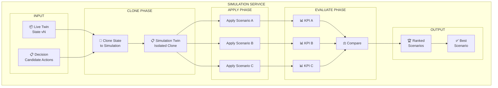
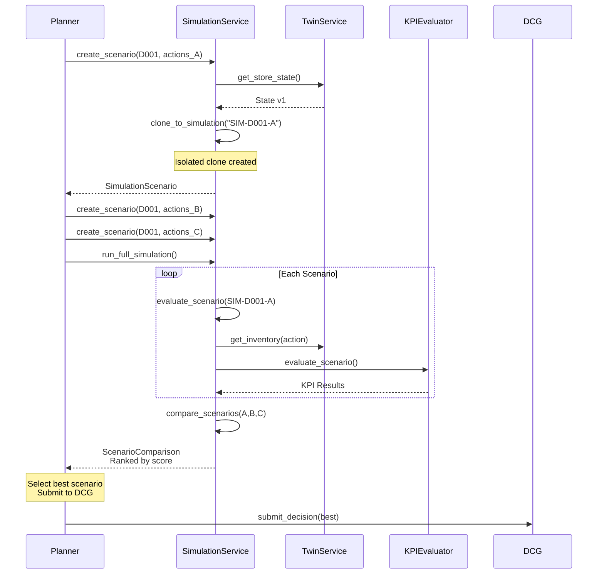
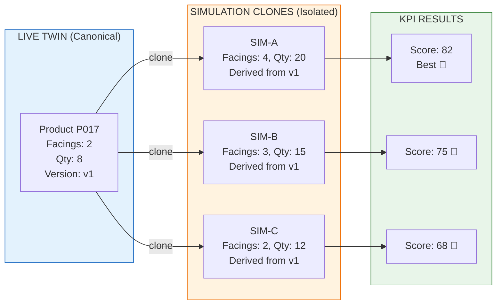
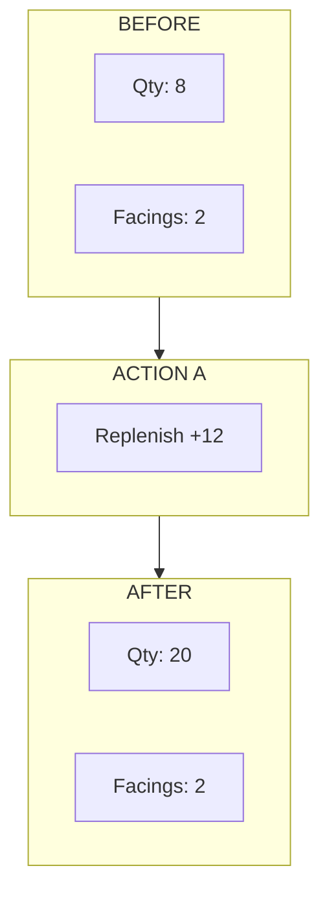
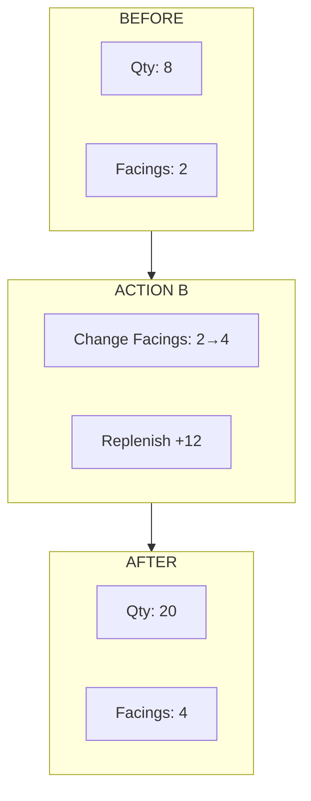
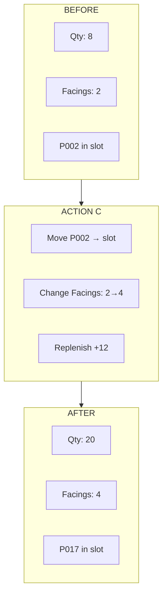

# ADR 0033: Simulation Service

## Status
Accepted

## Context

The Simulation Service provides isolated what-if analysis before committing actions to Live Twin. It clones state, applies candidate actions, and evaluates outcomes using deterministic KPIs.

## Problem

We need to:
- Test actions without affecting Live state
- Compare multiple candidate scenarios
- Generate quantitative impact assessments
- Support the Planner in selecting optimal actions

## Architecture



## Simulation Flow



## State Isolation



## Full Simulation Pipeline

```mermaid
flowchart TB
    subgraph Pipeline["SIMULATION PIPELINE"]
        subgraph Create["1. CREATE SCENARIOS"]
            C1[Scenario A<br/>Replenish +12]
            C2[Scenario B<br/>Facings 2→4 +12]
            C3[Scenario C<br/>Move P002 +Facings 4 +12]
        end
        
        subgraph Clone["2. CLONE STATE"]
            L1[Live State v1]
            S1[SIM-A v1]
            S2[SIM-B v1]
            S3[SIM-C v1]
        end
        
        subgraph Apply["3. APPLY ACTIONS"]
            A1[SIM-A: +12 qty]
            A2[SIM-B: +4 facings +12]
            A3[SIM-C: move +4f +12]
        end
        
        subgraph Evaluate["4. EVALUATE KPIs"]
            E1[KPI Score: 82]
            E2[KPI Score: 75]
            E3[KPI Score: 68]
        end
        
        subgraph Rank["5. RANK"]
            R1[A: 82 🥇]
            R2[B: 75 🥈]
            R3[C: 68 🥉]
        end
    end
    
    Create --> Clone
    Clone --> Apply
    Apply --> Evaluate
    Evaluate --> Rank
```



## Simulation Service Interface

```python
class ISimulationService(Protocol):
    """Interface for Simulation Service."""
    
    async def create_scenario(
        self,
        decision_id: str,
        actions: list[Action]
    ) -> SimulationScenario: ...
    
    async def evaluate_scenario(
        self,
        scenario: SimulationScenario
    ) -> ScenarioEvaluation: ...
    
    async def compare_scenarios(
        self,
        scenarios: list[SimulationScenario]
    ) -> ScenarioComparison: ...

class SimulationScenario(BaseModel):
    """A candidate action plan to evaluate."""
    scenario_id: str  # "SIM-001-A"
    decision_id: str
    actions: list[Action]
    simulation_twin: SimulationTwin
    created_at: datetime
    status: str = "created"

class SimulationService:
    """
    Orchestrates simulation scenarios.
    
    Flow:
    1. Create scenario from decision
    2. Clone Live Twin state
    3. Apply candidate actions
    4. Evaluate KPIs
    5. Compare scenarios
    6. Return ranked results
    """
    
    def __init__(
        self,
        twin_service: ITwinService,
        kpi_evaluator: KPIEvaluator
    ):
        self.twin = twin_service
        self.kpi = kpi_evaluator
    
    async def create_scenario(
        self,
        decision_id: str,
        actions: list[Action],
        scenario_letter: str = "A"
    ) -> SimulationScenario:
        """Create a new simulation scenario."""
        
        scenario_id = f"SIM-{decision_id}-{scenario_letter}"
        
        # Get current Live state
        live_state = await self.twin.get_store_state()
        
        # Create simulation twin (isolated clone)
        simulation_twin = await self.twin.create_simulation(
            simulation_id=scenario_id,
            from_version=await self.twin.get_current_version()
        )
        
        return SimulationScenario(
            scenario_id=scenario_id,
            decision_id=decision_id,
            actions=actions,
            simulation_twin=simulation_twin,
            created_at=datetime.utcnow()
        )
    
    async def evaluate_scenario(
        self,
        scenario: SimulationScenario
    ) -> ScenarioEvaluation:
        """Evaluate a single scenario."""
        
        # Apply actions to simulation
        for action in scenario.actions:
            scenario.simulation_twin.apply_action(action)
        
        # Evaluate KPIs
        evaluation = self.kpi.evaluate_scenario(
            scenario=scenario,
            current_state=await self.twin.get_store_state(),
            action=scenario.actions[0] if scenario.actions else None
        )
        
        scenario.status = "evaluated"
        return evaluation
    
    async def run_full_simulation(
        self,
        decision_id: str,
        candidate_actions: list[list[Action]]
    ) -> SimulationResult:
        """Run complete simulation pipeline."""
        
        scenarios = []
        letters = ["A", "B", "C", "D", "E"]
        
        # Create and evaluate all scenarios
        for i, actions in enumerate(candidate_actions):
            scenario = await self.create_scenario(
                decision_id=decision_id,
                actions=actions,
                scenario_letter=letters[i]
            )
            await self.evaluate_scenario(scenario)
            scenarios.append(scenario)
        
        # Compare and rank
        comparison = self.kpi.compare_scenarios(evaluations)
        
        return SimulationResult(
            decision_id=decision_id,
            scenarios=scenarios,
            comparison=comparison,
            best_scenario=comparison.best_scenario
        )
```

## Candidate Actions for Weekend Demand Surge

### Scenario A: Replenish Only



```python
candidates_a = [
    Action(
        action_id="RT-A-001",
        action_type=ActionType.REPLENISH,
        sku="P017",
        parameters={"quantity": 12}
    )
]
```

### Scenario B: Increase Facings + Replenish



```python
candidates_b = [
    Action(
        action_id="RT-A-002",
        action_type=ActionType.CHANGE_FACINGS,
        sku="P017",
        parameters={"facings": 4}
    ),
    Action(
        action_id="RT-A-003",
        action_type=ActionType.REPLENISH,
        sku="P017",
        parameters={"quantity": 12}
    )
]
```

### Scenario C: Relocate + Facings + Replenish



```python
candidates_c = [
    Action(
        action_id="RT-A-004",
        action_type=ActionType.MOVE_PRODUCT,
        sku="P002",
        parameters={"target_slot": "A02-S01"}
    ),
    Action(
        action_id="RT-A-005",
        action_type=ActionType.CHANGE_FACINGS,
        sku="P017",
        parameters={"facings": 4}
    ),
    Action(
        action_id="RT-A-006",
        action_type=ActionType.REPLENISH,
        sku="P017",
        parameters={"quantity": 12}
    )
]
```

## Related Issues

- #15: Integrate Agent with Simulation Service
- #33: Implement Simulation KPI evaluator

## Implementation Files

```
services/simulation/
├── __init__.py           # SimulationService
├── scenarios.py           # Scenario management
├── isolation.py           # State isolation logic
└── tests/
    └── test_simulation_service.py
```
