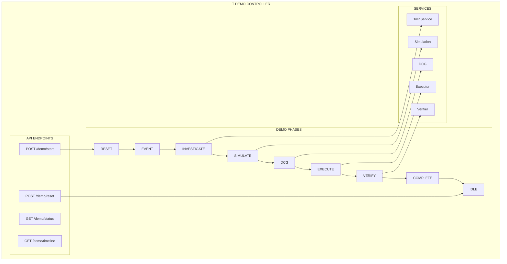
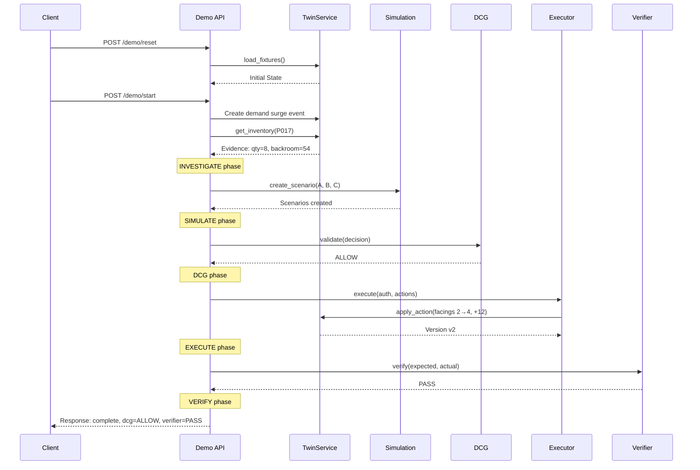
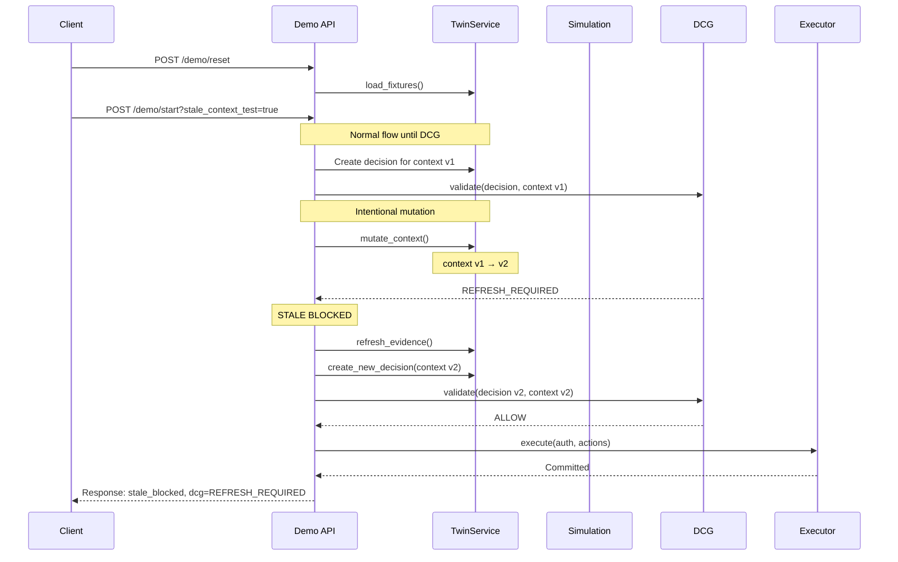
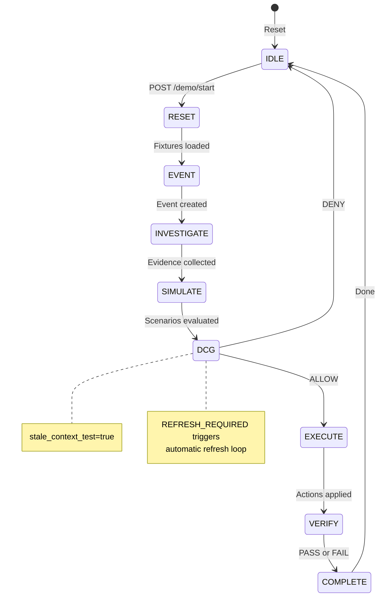
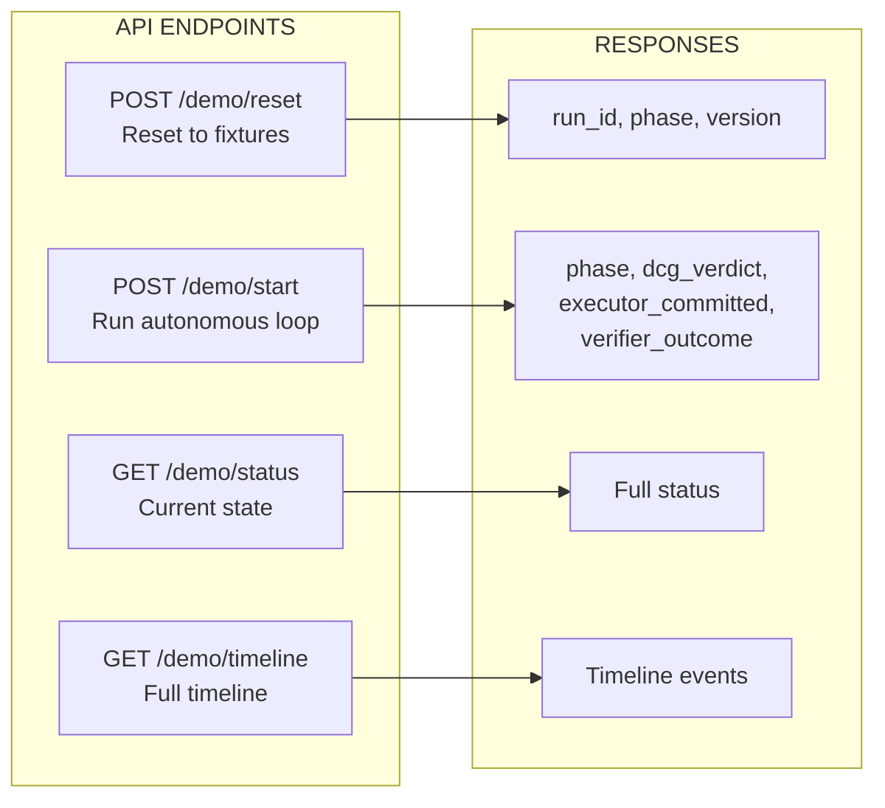
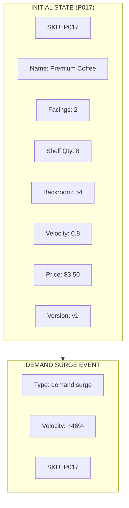

# ADR 0041: Demo Controller Implementation

## Status

Accepted

## Context

Live AI/cloud demonstrations are timing-sensitive and non-reproducible by default. The flagship scenario must be reproducible without faking Gemini, Firestore, Simulation, DCG or execution results.

## Problem

Without a deterministic demo controller:

- Demo runs may fail intermittently
- Judges cannot reproduce the scenario
- Stale-context rejection cannot be reliably demonstrated
- Release gates cannot be verified consistently

## Decision

We implement a **deterministic in-process demo controller** for the Weekend Demand Surge flagship scenario that:

1. Uses real components (TwinService, SimulationService, DCG, Executor, Verifier)
2. Controls only event timing and initial state for reproducibility
3. Provides reset/start/status endpoints for automated testing
4. Supports stale-context mutation for G04 verification

## Architecture



## Happy Path Flow



## Stale Context Flow



## Demo Phases



## API Endpoints



### POST /demo/reset

```bash
curl -X POST http://127.0.0.1:8000/demo/reset

# Response:
{
  "run_id": "run-20261010-001",
  "phase": "idle",
  "context_version": "store-001:v1",
  "slots_loaded": 5
}
```

### POST /demo/start

```bash
# Happy path
curl -X POST http://127.0.0.1:8000/demo/start
# Response: {dcg_verdict: "ALLOW", executor_committed: true, verifier_outcome: "PASS"}

# Stale context
curl -X POST "http://127.0.0.1:8000/demo/start?stale_context_test=true"
# Response: {dcg_verdict: "REFRESH_REQUIRED", executor_committed: false}
```

## Timeline Events

```mermaid
flowchart TB
    subgraph Timeline["TIMELINE EVENTS"]
        T1["16:01:02 TRIGGER<br/>Demand surge: P017"]
        T2["16:01:03 EVIDENCE<br/>Shelf qty: 8, Backroom: 54"]
        T3["16:01:05 DIAGNOSIS<br/>Shelf allocation insufficient"]
        T4["16:01:07 SIMULATION<br/>A/B/C evaluated"]
        T5["16:01:08 SELECTION<br/>Scenario B selected"]
        T6["16:01:09 GUARD<br/>REFRESH_REQUIRED"]
        T7["16:01:11 REFRESH<br/>Context refreshed"]
        T8["16:01:14 GUARD<br/>ALLOW"]
        T9["16:01:15 ACTION<br/>Facings 2→4, +12"]
        T10["16:01:17 VERIFY<br/>PASS"]
    end

    T1 --> T2
    T2 --> T3
    T3 --> T4
    T4 --> T5
    T5 --> T6
    T6 --> T7
    T7 --> T8
    T8 --> T9
    T9 --> T10
```



## Demo Fixtures



## Implementation

```python
class DemoPhase(str, Enum):
    IDLE = "idle"
    RESET = "reset"
    EVENT = "event"
    INVESTIGATE = "investigate"
    SIMULATE = "simulate"
    DCG = "dcg"
    EXECUTE = "execute"
    VERIFY = "verify"
    COMPLETE = "complete"
    STALE_BLOCKED = "stale_blocked"

class DemoOrchestrator:
    """
    Deterministic demo controller for Weekend Demand Surge.
    """

    def __init__(
        self,
        twin_service: TwinService,
        simulation_service: SimulationService,
        dcg: DecisionContextGuard,
        executor: ExecutorAgent,
        verifier: VerifierAgent
    ):
        self.twin = twin_service
        self.simulation = simulation_service
        self.dcg = dcg
        self.executor = executor
        self.verifier = verifier
        self._state = DemoPhase.IDLE
        self._timeline: list[TimelineEvent] = []

    async def reset(self) -> DemoResetResponse:
        """Reset to initial fixtures."""
        await self.twin.load_fixtures()
        self._timeline = []
        self._state = DemoPhase.IDLE
        return DemoResetResponse(...)

    async def start(
        self,
        stale_context_test: bool = False
    ) -> DemoStartResponse:
        """Run the autonomous loop once."""

        # Happy path or stale context test
        if stale_context_test:
            return await self._run_stale_context_test()
        else:
            return await self._run_happy_path()

    async def _run_happy_path(self) -> DemoStartResponse:
        """Normal run with ALLOW verdict."""

        # 1. EVENT
        self._state = DemoPhase.EVENT
        event = self._create_demand_surge_event()

        # 2. INVESTIGATE
        self._state = DemoPhase.INVESTIGATE
        evidence = await self._investigate(event)

        # 3. SIMULATE
        self._state = DemoPhase.SIMULATE
        best = await self._simulate(evidence)

        # 4. DCG
        self._state = DemoPhase.DCG
        decision = await self._create_decision(evidence, best)
        context = await self.twin.get_current_context()
        result = await self.dcg.validate(decision, context, ...)

        if result.outcome == DCGOutcome.ALLOW:
            # 5. EXECUTE
            self._state = DemoPhase.EXECUTE
            auth = self.dcg.issue_authorization(decision, context)
            await self.executor.execute(...)

            # 6. VERIFY
            self._state = DemoPhase.VERIFY
            verifier_result = await self.verifier.verify(...)

            self._state = DemoPhase.COMPLETE
            return DemoStartResponse(
                dcg_verdict="ALLOW",
                executor_committed=True,
                verifier_outcome="PASS"
            )
```

## Testing

```bash
# Run all demo tests
pytest apps/api/tests/test_demo_controller.py -v

# Happy path
pytest apps/api/tests/test_demo_controller.py::test_happy_path -v

# Stale context
pytest apps/api/tests/test_demo_controller.py::test_stale_context -v
```

## Verification Checklist

- [ ] Happy path completes with ALLOW verdict
- [ ] Stale context returns REFRESH_REQUIRED
- [ ] Timeline shows all phases
- [ ] Reset returns to initial fixtures
- [ ] Executor only commits after ALLOW
- [ ] Verifier reports correct outcome
- [ ] No secrets in demo data
- [ ] Reproducible from clean reset

## Related Issues

- #41: Build deterministic flagship demo controller
- #16: Implement Decision Context Guard MVP
- #17: Enforce No-Stale-Commit
- #18: Implement guarded Executor
