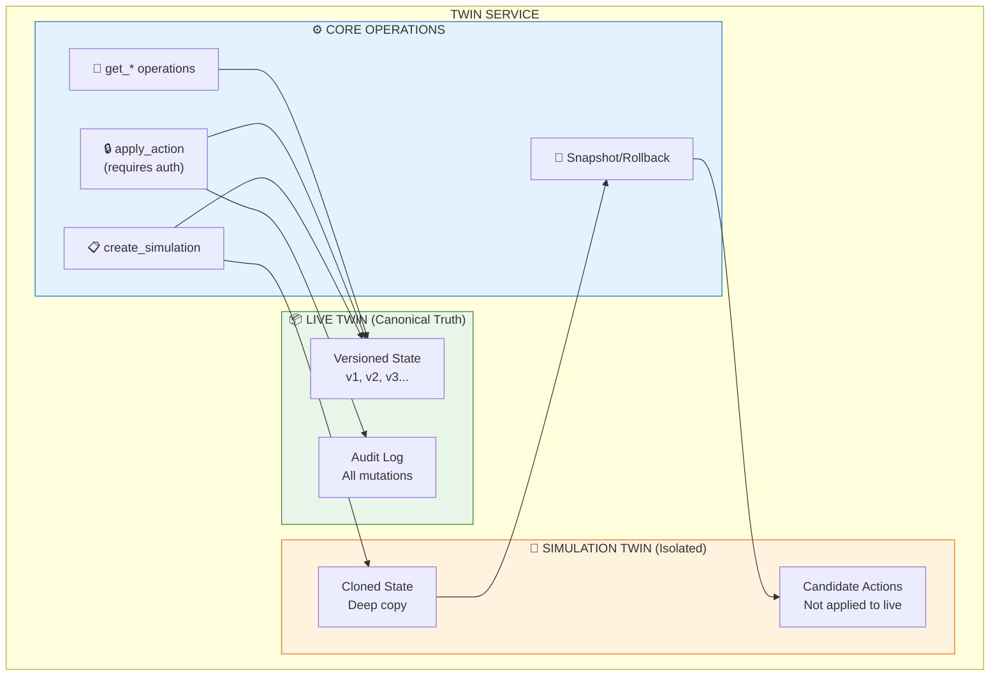
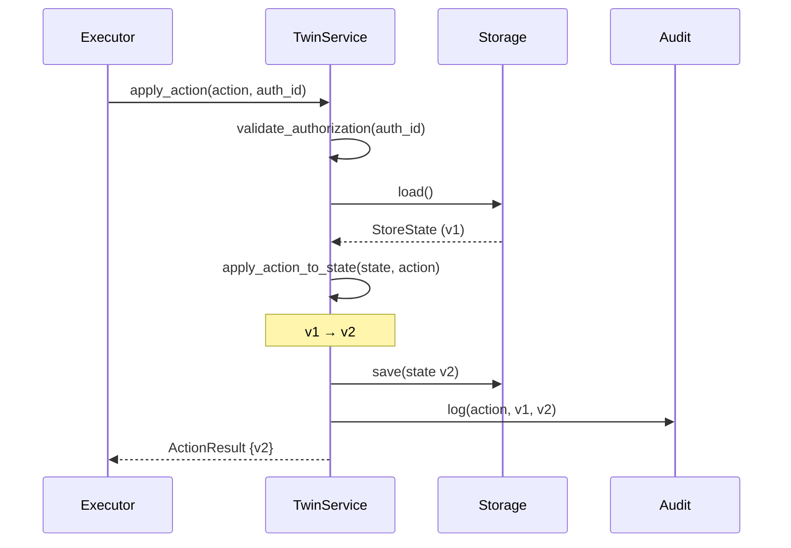
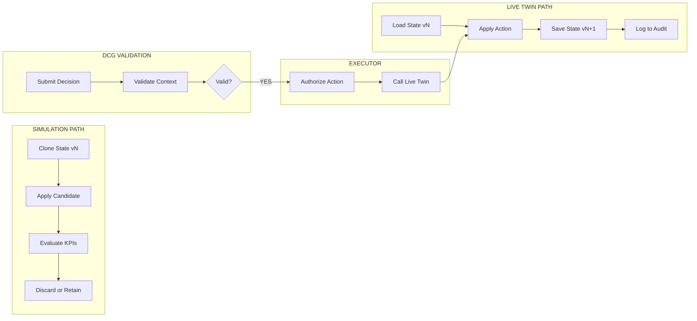
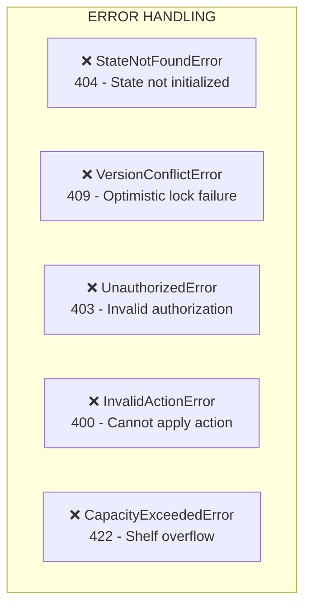

# ADR: Twin Service (Live & Simulation)

## Status

Accepted

## Context

The Twin Service manages the canonical state of the retail store. It provides:

1. **Live Twin** - current operational truth
2. **Simulation Twin** - isolated clone for what-if scenarios

## Problem

State management must be:

- Versioned for staleness detection
- Isolated between Live and Simulation
- Atomic for transactions
- Auditable for compliance

## Architecture



## State Versioning Flow



## Live vs Simulation Isolation



## Twin Service Interface

```python
class TwinType(str, Enum):
    LIVE = "live"
    SIMULATION = "simulation"

class Product(BaseModel):
    product_id: str
    sku: str
    name: str
    category: str
    shelf_id: str
    slot_id: str
    facings: int
    shelf_quantity: int
    backroom_quantity: int
    price: float
    position: dict
    sales_velocity: float
    forecast_demand: float
    stockout_probability: float
    version: int
    updated_at: datetime

class StoreState(BaseModel):
    store_id: str
    version: str  # "store-001:v23871"
    version_number: int
    products: dict[str, Product]
    shelves: dict[str, Shelf]
    updated_at: datetime

class ITwinService(Protocol):
    """Interface for Twin Service."""

    async def get_store_state(self) -> StoreState: ...
    async def get_product(self, sku: str) -> Product: ...
    async def get_current_version(self) -> str: ...
    async def apply_action(
        self,
        action: Action,
        authorization_id: str
    ) -> ActionResult: ...
    async def create_simulation(
        self,
        simulation_id: str,
        from_version: str | None = None
    ) -> SimulationTwin: ...

class TwinService(ITwinService):
    """
    Live Twin Service - the ONLY source of truth for operational state.

    Security:
    - All mutations require authorization_id from Executor
    - Every change increments version
    - All changes are logged
    """

    def __init__(self, storage: TwinStorage):
        self.storage = storage
        self._current_state: StoreState | None = None
        self._version = 0
        self._audit_log: list[AuditEntry] = []

    async def apply_action(
        self,
        action: Action,
        authorization_id: str
    ) -> ActionResult:
        """
        Apply action to Live Twin.

        This method should ONLY be called by ExecutorAgent.
        Direct calls are rejected at the API boundary.
        """
        # Validate authorization
        if not self._validate_authorization(authorization_id):
            raise UnauthorizedError("Invalid authorization")

        # Get current state
        state = await self.get_store_state()

        # Apply action
        old_version = state.version_number
        new_state = self._apply_action_to_state(state, action)
        new_state.version_number = old_version + 1
        new_state.updated_at = datetime.utcnow()

        # Save and log
        await self.storage.save(new_state)
        await self._log_action(action, authorization_id, old_version, new_state.version_number)

        self._current_state = new_state

        return ActionResult(
            success=True,
            action_id=action.action_id,
            old_version=f"v{old_version}",
            new_version=f"v{new_state.version_number}"
        )

    async def create_simulation(
        self,
        simulation_id: str,
        from_version: str | None = None
    ) -> SimulationTwin:
        """Create isolated simulation from current state."""
        base_state = await self.get_store_state()
        return SimulationTwin(
            simulation_id=simulation_id,
            base_state=deep_copy(base_state)
        )
```

## Storage Backends

```mermaid
flowchart TB
    subgraph Backends["STORAGE BACKENDS"]
        subgraph Firestore["🗄️ Firestore (Production)"]
            FDB[Firestore Client]
            FC[Collection<br/>store_states]
        end

        subgraph Memory["💾 In-Memory (Testing/Demo)"]
            IM[InMemoryStorage]
            STATE[_state]
            AUDIT[_audit]
        end
    end

    subgraph Interface["ITwinStorage"]
        SAVE[save(state)]
        LOAD[load()]
        LOG[log_audit(entry)]
    end

    FDB --> SAVE
    FDB --> LOAD
    FDB --> LOG

    IM --> SAVE
    IM --> LOAD
    IM --> LOG

    style Firestore fill:#e3f2fd,stroke:#1565c0
    style Memory fill:#fff3e0,stroke:#ef6c00
```

## Version Lifecycle

```mermaid
stateDiagram-v2
    [*] --> v1: Initial Load

    v1 --> v2: apply_action()
    v2 --> v3: apply_action()
    v3 --> v4: apply_action()

    v4 --> [*]: End

    Note right of v1: Product P017<br/>Facings: 2, Qty: 8
    Note right of v2: apply: replenish +12<br/>Facings: 2, Qty: 20
    Note right of v3: apply: facings 2→4<br/>Facings: 4, Qty: 20
    Note right of v4: Verified ✓
```

## Error Handling



## Related Issues

- #81: Implement Firestore-backed TwinRepository
- #4: Bind 3D product to live state

## Implementation Files

```
services/twin/
├── __init__.py           # TwinService
├── storage.py            # Storage backends
├── simulation.py         # SimulationTwin
├── schemas.py            # Pydantic models
└── tests/
    └── test_twin_service.py
```
