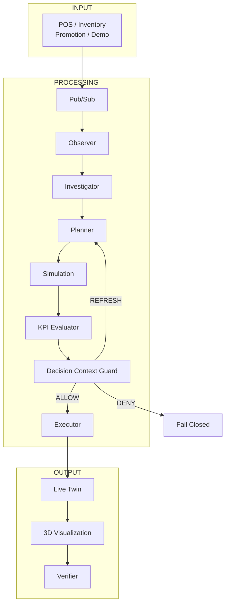
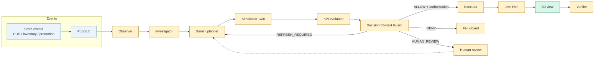
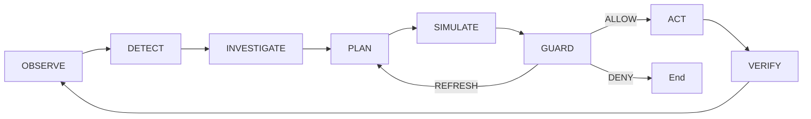
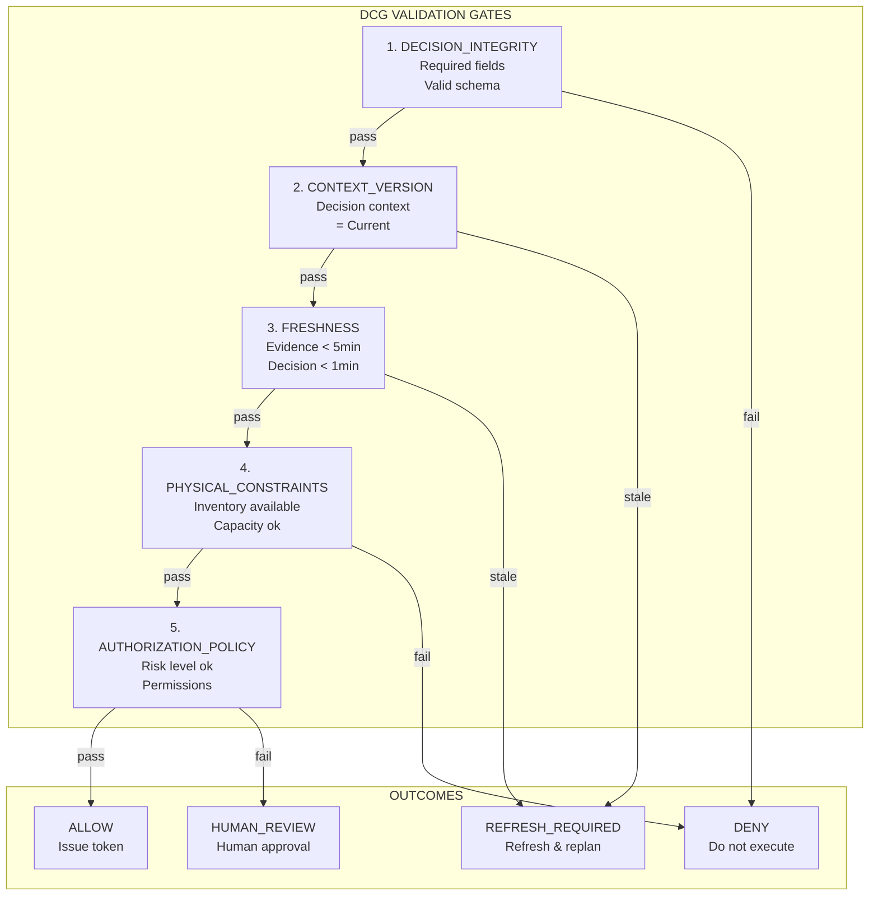
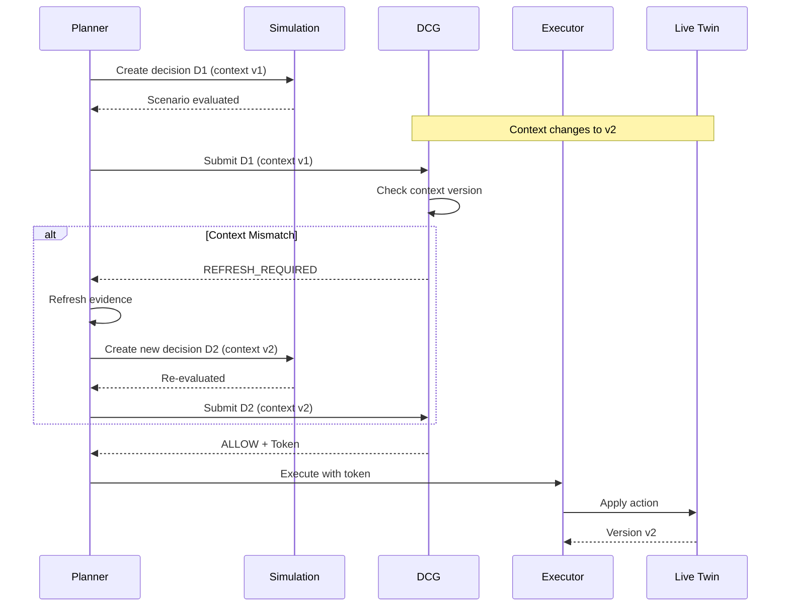
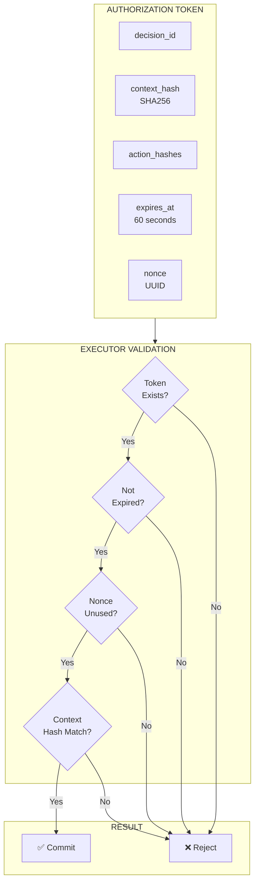
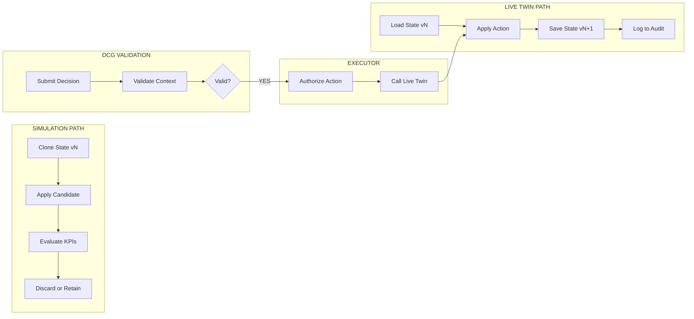
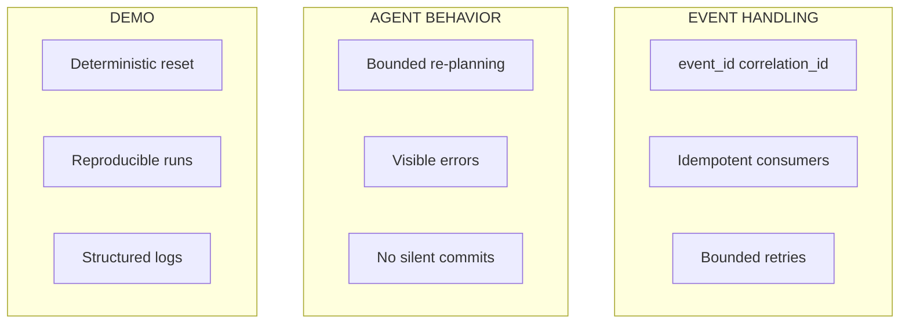
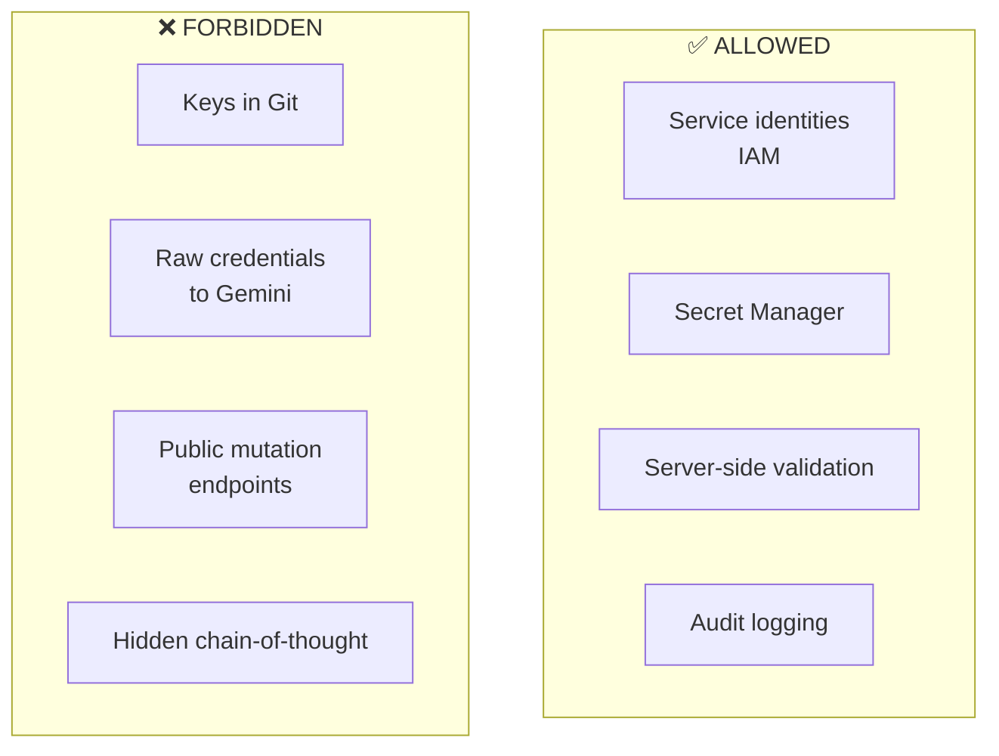
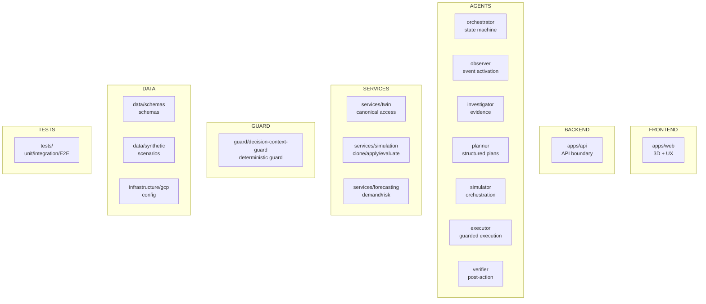

# RetailTwin AI — Technical Architecture

> This document is the **target architecture**. It does not imply every component is already implemented. See `docs/getting-started/CURRENT_STATUS.md` for the current `main` baseline and gate status.

RetailTwin AI must autonomously react to retail events while preserving a strict boundary between AI reasoning and live operational state.

## 1. High-Level Architecture



## 2. End-to-End Flow (Planned vs Implemented)



> All gates are **pending** — no linked test, deployment, or 20-run evidence available.

## 3. Control Loop



## 4. Technology Stack

| Layer | Technology |
|-------|------------|
| **Frontend** | React + TypeScript, React Three Fiber / Three.js + Drei, GLB/glTF assets |
| **Backend** | Python, FastAPI, Cloud Run |
| **AI** | Gemini on Vertex AI (structured tool calling) |
| **Database** | Firestore (Live Twin), BigQuery (Analytics) |
| **Events** | Pub/Sub |
| **Storage** | Cloud Storage (3D assets) |
| **Security** | Secret Manager, Cloud Logging, Firebase Auth |

## 5. Component Responsibilities

| Component | Description |
|-----------|-------------|
| **Observer** | Consumes normalized store events, deduplicates, starts investigation |
| **Investigator** | Collects bounded, versioned evidence |
| **Planner** | Uses Gemini to produce structured candidate plans |
| **Simulation Service** | Clones live state, applies candidate actions |
| **KPI Evaluator** | Computes deterministic business/operational effects |
| **DCG** | Deterministic validation before live commit |
| **Executor** | Only component that performs authorized live mutations |
| **Verifier** | Reads post-action state, compares expected vs observed |
| **3D Twin** | State-driven operational interface |

## 6. Decision Context Guard (DCG)

### 6.1 Decision Structure

```json
{
  "decision_id": "RT-D-1027",
  "agent_id": "retailtwin-orchestrator",
  "context_version": "store-001:v23871",
  "context_timestamp": "2026-10-07T08:00:00Z",
  "evidence": [],
  "proposed_actions": [],
  "simulation_id": "SIM-204",
  "expected_impact": {}
}
```

### 6.2 Five Validation Gates



### 6.3 No-Stale-Commit Flow



### 6.4 DCG Outcomes

| Outcome | Description | Action |
|---------|-------------|--------|
| `ALLOW` | All gates passed | Issue authorization token |
| `REFRESH_REQUIRED` | Context/staleness issue | Refresh evidence, retry |
| `DENY` | Critical failure | Do not execute |
| `HUMAN_REVIEW` | High-risk action | Require human approval |

## 7. Commit Authorization



Authorization contains:
- decision ID
- context hash/version
- exact allowed action set
- expiry (60 seconds)
- nonce for replay protection

## 8. State Separation



**Rule:** Simulation path never mutates Live Twin directly.

## 9. Action Risk Levels

| Level | Actions | Policy |
|-------|---------|--------|
| **L1** | Focus camera, highlight, read/analyze | Automatic |
| **L2** | Move SKU, facings, planogram changes | Automatic (Simulation only) |
| **L3** | Bounded replenishment/layout | Autonomous if DCG passes |
| **High** | Price/promotion changes | `HUMAN_REVIEW` required |

## 10. Reliability Rules



- Pub/Sub events carry `event_id` and `correlation_id`
- Consumers are idempotent
- Retries are bounded
- Errors are visible
- Demo reset is deterministic

## 11. Security Rules



- No service-account key or secret in Git
- Use service identities/IAM and Secret Manager
- Frontend cannot bypass backend guard/executor
- Gemini never receives raw database credentials
- Validate all tool arguments server-side
- Audit live decisions/actions

## 12. Repository Ownership



| Directory | Owner |
|----------|-------|
| `apps/web` | 3D + UX |
| `apps/api` | API / Integration |
| `agents/*` | AI / Agent / DCG |
| `services/*` | Data / Cloud |
| `guard/*` | AI / Agent / DCG |
| `data/*` | Data / Cloud |
| `infrastructure/*` | Data / Cloud |
| `tests/*` | All roles |

## 13. Related Documentation

| Document | Description |
|----------|-------------|
| [DOMAIN_AND_DATA_MODEL.md](DOMAIN_AND_DATA_MODEL.md) | Entities, schemas, events, actions |
| [SECURITY.md](SECURITY.md) | Security architecture, DCG, Executor |
| [getting-started/CURRENT_STATUS.md](../getting-started/CURRENT_STATUS.md) | Current implementation status |
