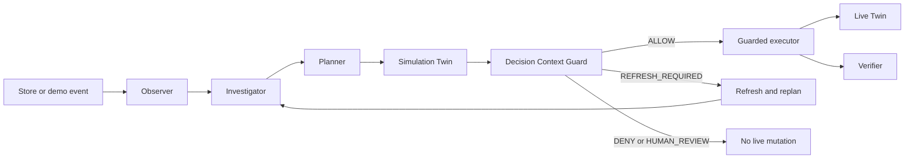

# Architecture

This concise diagram is the canonical orientation to the autonomous control loop. It describes source-backed implementation boundaries; it is not evidence that a cloud deployment or release gate has passed. See [CURRENT_STATUS.md](../CURRENT_STATUS.md) for recorded maturity and gate evidence.

Rules:

- Gemini cannot write Live Twin state directly.
- Simulation actions remain isolated from live state.
- Every live commit goes through the Decision Context Guard and guarded executor.
- Stale context fails closed and can enter the bounded replan path.
- Quantitative impact must come from deterministic services or simulation, not fabricated LLM output.

The Vite/React client reads the FastAPI API and polls `GET /store`; it does not access the Live Twin directly. The decision log is in [docs/adr/](../adr/README.md). A pull request that changes these rules links the relevant ADR or adds a superseding record.
