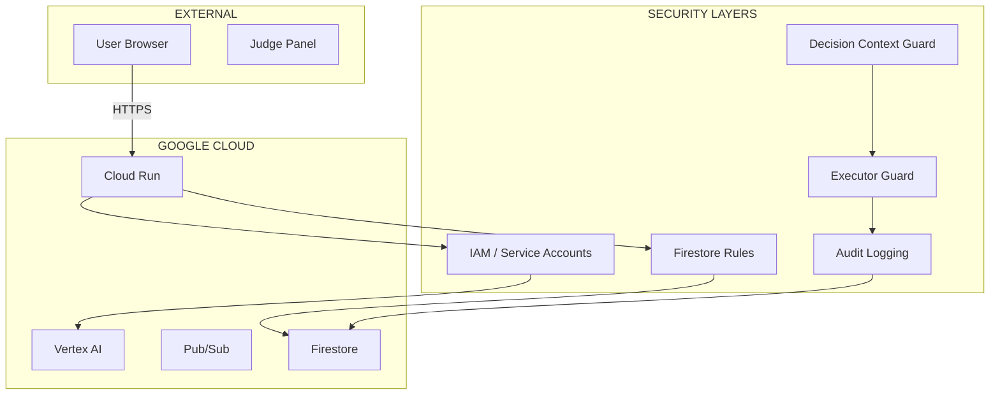
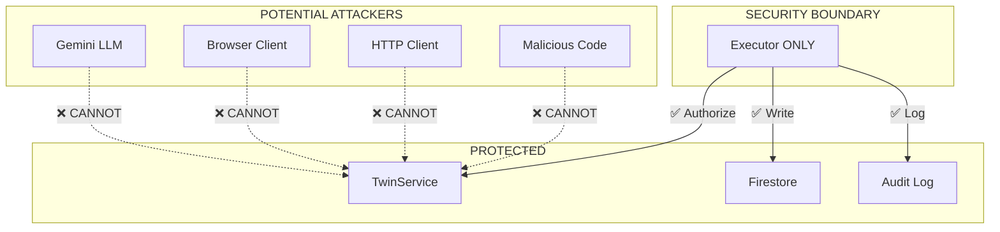
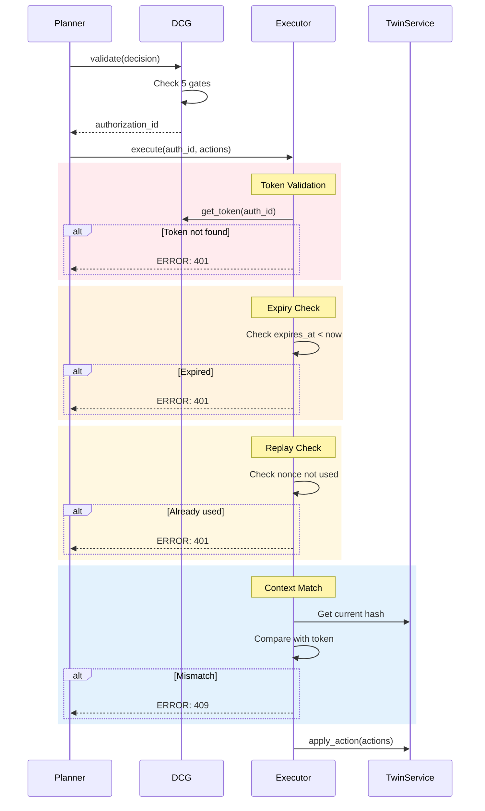
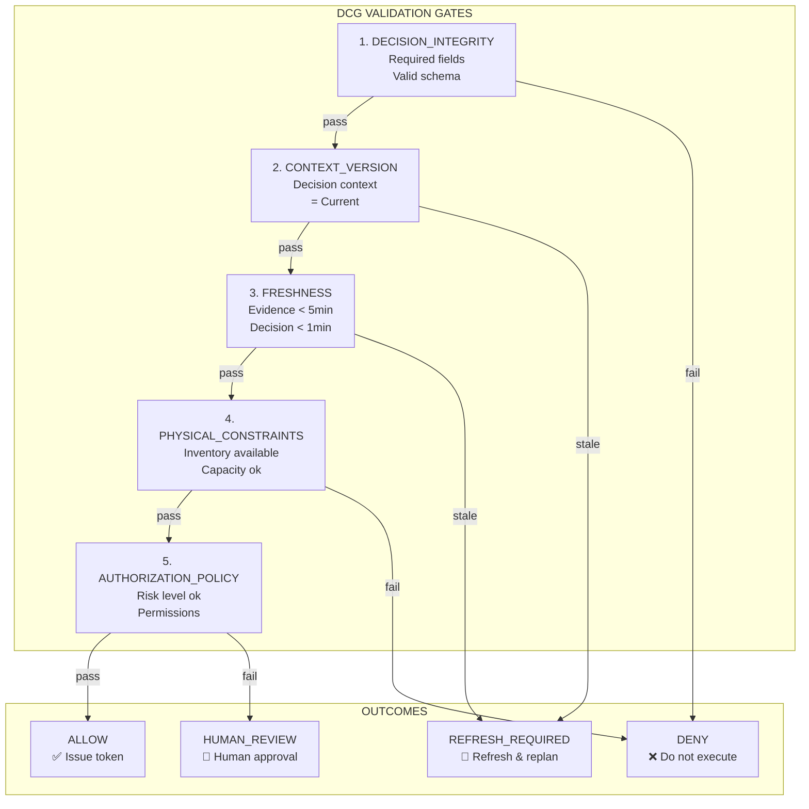
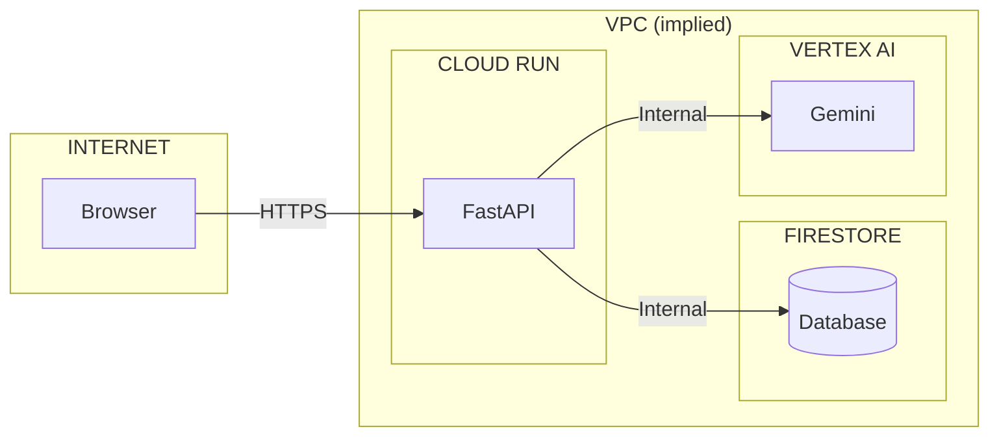

# Security Documentation

## Overview

RetailTwin AI implements defense-in-depth security with multiple layers:

- Network security (Cloud Run, VPC)
- Access control (IAM, service accounts)
- Application security (DCG, Executor guard)
- Data security (Firestore rules, encryption)

## Security Architecture



## 1. Identity & Access Management (IAM)

### 1.1 Service Account Principle

**Never use user credentials or service account keys in production.**

```bash
# ❌ NEVER do this
gcloud iam service-accounts keys create key.json \
  --iam-account=retailtwin-api@...

# ✅ Use Application Default Credentials
gcloud auth application-default login
```

### 1.2 Service Account Matrix

| Service | Account                | Permissions                             | Cannot Do              |
| ------- | ---------------------- | --------------------------------------- | ---------------------- |
| API     | `retailtwin-api@...`   | Firestore R/W, Pub/Sub publish, Logging | Vertex AI, Admin roles |
| Agent   | `retailtwin-agent@...` | Vertex AI user                          | Firestore, Editor      |

### 1.3 Least Privilege Principle

```bash
# Grant only required roles
gcloud projects add-iam-policy-binding retailtwin-ai-511002 \
  --member="serviceAccount:retailtwin-api@..." \
  --role="roles/datastore.user"  # Only Firestore access

# Explicitly deny dangerous roles
# No roles/owner, roles/editor, or roles/aiplatform.user for API account
```

### 1.4 IAM Best Practices

- [ ] No service account keys in Git
- [ ] Use ADC (Application Default Credentials) locally
- [ ] Use Workload Identity in production
- [ ] Rotate service accounts annually
- [ ] Audit IAM changes with Cloud Logging

## 2. Application Security

### 2.1 Executor Security Boundary

The Executor is the **only** component that can mutate Live Twin state.



### 2.2 Authorization Token Flow



### 2.3 Authorization Token Properties

| Property         | Value      | Purpose           |
| ---------------- | ---------- | ----------------- |
| **Lifetime**     | 60 seconds | Short-lived       |
| **Nonce**        | UUID       | Replay protection |
| **Context Hash** | SHA256     | Staleness check   |
| **Action Hash**  | SHA256     | Tamper detection  |
| **Single Use**   | Yes        | Prevents replay   |

### 2.4 Action Validation

```python
# agents/executor/__init__.py
class ExecutorAgent:
    """Guarded Executor - ONLY path to Live Twin mutation."""

    def _validate_authorization(self, request: ExecutorRequest) -> Authorization:
        """Validate authorization token."""

        # 1. Token exists
        auth = self.dcg._issued_authorizations.get(request.authorization_id)
        if not auth:
            raise AuthorizationNotFoundError()

        # 2. Not expired
        if datetime.utcnow() > auth.expires_at:
            raise AuthorizationExpiredError()

        # 3. Nonce unused (replay protection)
        if auth.nonce in self._used_nonces:
            raise AuthorizationReplayError()

        # 4. Context hash matches
        current_context = self.twin.get_current_context()
        current_hash = self._hash_context(current_context)
        if auth.context_hash != current_hash:
            raise ContextStaleError()

        # 5. Mark nonce as used
        self._used_nonces.add(auth.nonce)

        return auth

    def _validate_actions(
        self,
        actions: list[Action],
        auth: Authorization
    ) -> None:
        """Validate actions match authorization."""

        authorized_ids = {a.action_id for a in auth.allowed_actions}
        submitted_ids = {a.action_id for a in actions}

        # All submitted actions must be in authorization
        unauthorized = submitted_ids - authorized_ids
        if unauthorized:
            raise ActionNotAuthorizedError()

        # Validate parameters
        for action in actions:
            if not self._validate_params(action):
                raise ActionValidationError()
```

## 3. DCG - Decision Context Guard

### 3.1 Five Validation Gates



### 3.2 Gate Details

#### Gate 1: Decision Integrity

```python
def _check_integrity(self, decision: Decision) -> bool:
    """Check required fields and valid schema."""

    required_fields = [
        'decision_id',
        'context_version',
        'evidence',
        'proposed_actions'
    ]

    for field in required_fields:
        if not hasattr(decision, field) or getattr(decision, field) is None:
            return False

    # Validate action schema
    for action in decision.proposed_actions:
        if not self._validate_action_schema(action):
            return False

    return True
```

#### Gate 2: Context Version

```python
def _check_context_version(
    self,
    decision: Decision,
    context: StoreContext
) -> bool:
    """Check decision context matches current state."""

    return decision.context_version == context.version
```

#### Gate 3: Freshness

```python
def _check_freshness(self, decision: Decision) -> bool:
    """Check evidence and decision are recent."""

    now = datetime.utcnow()

    # Evidence must be < 5 minutes old
    for evidence in decision.evidence:
        age = now - evidence.collected_at
        if age.total_seconds() > 300:  # 5 minutes
            return False

    # Decision must be < 1 minute old
    decision_age = now - decision.created_at
    if decision_age.total_seconds() > 60:
        return False

    return True
```

#### Gate 4: Physical Constraints

```python
def _check_constraints(
    self,
    decision: Decision,
    context: StoreContext
) -> bool:
    """Check inventory and capacity constraints."""

    for action in decision.proposed_actions:
        if action.action_type == ActionType.REPLENISH:
            sku = action.sku
            qty = action.parameters['quantity']

            # Check backroom has enough
            if context.inventory[sku].backroom_quantity < qty:
                return False

            # Check shelf has capacity
            if context.shelves[sku].available_capacity < qty:
                return False

        elif action.action_type == ActionType.CHANGE_FACINGS:
            # Check within limits
            facings = action.parameters['facings']
            if not (1 <= facings <= 10):
                return False

    return True
```

#### Gate 5: Authorization Policy

```python
def _check_policy(self, decision: Decision) -> bool:
    """Check against authorization policy."""

    for action in decision.proposed_actions:
        # High-risk actions require human review
        if action.risk_level == RiskLevel.HIGH:
            return False

        # Price/promotion changes are sensitive
        if action.action_type in [ActionType.CHANGE_PRICE, ActionType.CREATE_PROMOTION]:
            return False

    return True
```

## 4. Data Security

### 4.1 Firestore Security Rules

```javascript
rules_version = '2';
service cloud.firestore {
  match /databases/{database}/documents {

    // Helper functions
    function isAuthenticated() {
      return request.auth != null;
    }

    function isAPI() {
      return request.auth.token.email.contains('retailtwin-api@');
    }

    // Products - readable by all, writable by API only
    match /products/{productId} {
      allow read: if true;  // Public for 3D display
      allow write: if isAPI();
    }

    // Inventory - readable by all, writable by API only
    match /inventory/{sku} {
      allow read: if true;
      allow write: if isAPI();
    }

    // Simulations - writable by API only
    match /simulations/{simId} {
      allow read: if isAuthenticated();
      allow write: if isAPI();
    }

    // Event claims - idempotency ledger
    match /store_event_claims/{eventId} {
      allow read: if isAuthenticated();
      allow create: if isAPI();
      allow update: if false;  // Immutable
    }

    // Audit log - append only
    match /audit/{auditId} {
      allow read: if isAuthenticated();
      allow create: if isAPI();
      allow update: if false;
    }
  }
}
```

### 4.2 Encryption

| Data          | At Rest                  | In Transit |
| ------------- | ------------------------ | ---------- |
| Firestore     | AES-256 (Google managed) | TLS 1.2+   |
| BigQuery      | AES-256 (Google managed) | TLS 1.2+   |
| Cloud Storage | AES-256 (Google managed) | TLS 1.2+   |
| Cloud Run     | AES-256 (Google managed) | TLS 1.2+   |

### 4.3 Network Security



- Cloud Run uses VPC Connector (optional for enhanced security)
- All GCP internal traffic uses Google's network
- No public IPs for backend services

## 5. Audit & Monitoring

### 5.1 Audit Log Events

```python
class AuditEntry(BaseModel):
    """Every live mutation is logged."""

    audit_id: str
    timestamp: datetime
    actor: str  # "executor-agent"
    action_type: str
    decision_id: str | None
    authorization_id: str | None
    context_version_before: str
    context_version_after: str
    status: str  # "committed", "failed", "rollback"
    correlation_id: str
```

### 5.2 Monitored Events

| Event                   | Severity | Alert |
| ----------------------- | -------- | ----- |
| Authorization failure   | ERROR    | Yes   |
| Replay attack detected  | ERROR    | Yes   |
| Context stale rejection | WARNING  | No    |
| DCG denial              | WARNING  | No    |
| Executor success        | INFO     | No    |
| Policy violation        | ERROR    | Yes   |

### 5.3 Cloud Logging Filters

```bash
# View authorization failures
gcloud logging read "severity>=ERROR AND resource.type=cloud_run" \
  --project=retailtwin-ai-511002

# View DCG rejections
gcloud logging read "jsonPayload.component=dcg AND jsonPayload.outcome=REFRESH" \
  --project=retailtwin-ai-511002

# View executor mutations
gcloud logging read "jsonPayload.component=executor AND jsonPayload.status=committed" \
  --project=retailtwin-ai-511002
```

## 6. Secrets Management

### 6.1 Secret Manager Usage

```bash
# Store API key
echo -n "your-api-key" | gcloud secrets create GEMINI_API_KEY --data-file=-

# Grant access to service account
gcloud secrets add-iam-policy-binding GEMINI_API_KEY \
  --member="serviceAccount:retailtwin-api@..." \
  --role="roles/secretmanager.secretAccessor"
```

### 6.2 Access Secrets in Code

```python
from google.cloud import secretmanager

def get_secret(secret_id: str) -> str:
    """Retrieve secret from Secret Manager."""
    client = secretmanager.SecretManagerServiceClient()

    name = f"projects/{PROJECT}/secrets/{secret_id}/versions/latest"
    response = client.access_secret_version(name=name)

    return response.payload.data.decode('UTF-8')
```

### 6.3 Environment Variables (Development)

```bash
# .env.example (never commit .env)
GOOGLE_CLOUD_PROJECT=retailtwin-ai-511002
GEMINI_API_KEY=  # Leave empty, use Secret Manager in prod
```

## 7. Security Checklist

### Pre-Deployment

- [ ] No service account keys in Git
- [ ] Firestore rules configured
- [ ] IAM roles follow least privilege
- [ ] Secrets in Secret Manager (not .env)
- [ ] Budget alerts configured
- [ ] Cloud Logging enabled

### Runtime

- [ ] Monitor authorization failures
- [ ] Alert on replay attacks
- [ ] Review audit logs daily
- [ ] Rotate service accounts annually
- [ ] Update dependencies monthly

### Incident Response

1. **Identify** - Check Cloud Logging for errors
2. **Contain** - Disable service account if compromised
3. **Investigate** - Review audit trail
4. **Remediate** - Fix vulnerability
5. **Post-mortem** - Document lessons learned

## 8. Compliance Notes

- **No PII** - Project uses synthetic data
- **No financial data** - Demo only
- **Audit trail** - All mutations logged
- **Encryption** - Google-managed AES-256

## Related Documentation

- [ADR 0016-0017: DCG & No-Stale-Commit](adr/0016-0017-dcg-no-stale-commit.md)
- [ADR 0018: Guarded Executor](adr/0018-guarded-executor.md)
- [GCP Documentation](GCP_DOCUMENTATION.md)
