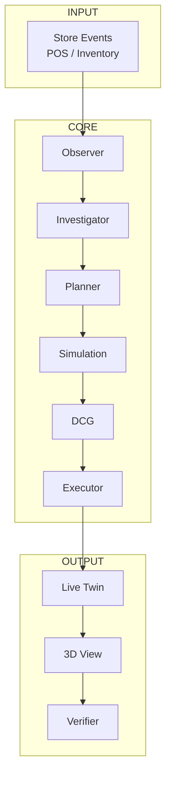
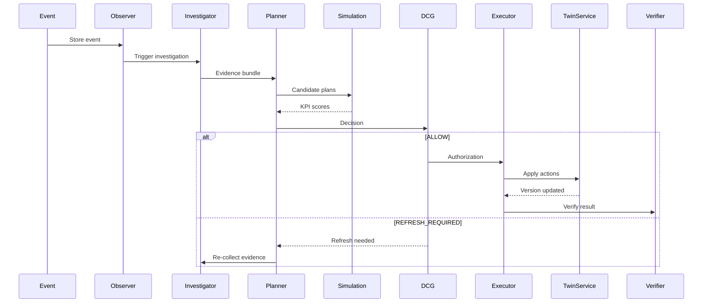
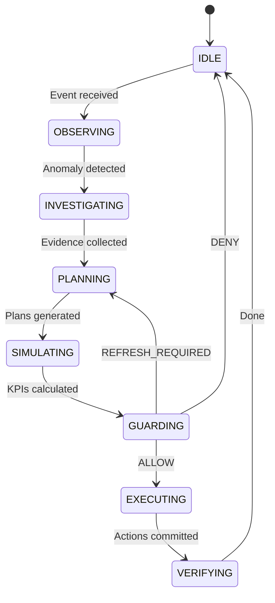

# Development Guide: Zero to Final

This guide walks through developing RetailTwin AI from scratch to production deployment.

## Table of Contents

1. [Prerequisites](#1-prerequisites)
2. [Local Development Setup](#2-local-development-setup)
3. [Understanding the Architecture](#3-understanding-the-architecture)
4. [Building Core Components](#4-building-core-components)
5. [Implementing AI Agents](#5-implementing-ai-agents)
6. [Building the 3D Frontend](#6-building-the-3d-frontend)
7. [GCP Setup](#7-gcp-setup)
8. [Deployment](#8-deployment)
9. [Testing](#9-testing)
10. [Release Process](#10-release-process)

---

## 1. Prerequisites

### Required Tools

| Tool | Version | Purpose |
|------|---------|---------|
| Python | 3.11+ | Backend development |
| Node.js | 18+ | Frontend development |
| npm | 9+ | Package management |
| Git | 2.40+ | Version control |
| Docker | 24+ | Containerization |
| Google Cloud SDK | 450+ | GCP CLI |

### Accounts

- [ ] Google Cloud account with billing enabled
- [ ] GitHub account
- [ ] Firebase project (optional for auth)

---

## 2. Local Development Setup

### 2.1 Clone Repository

```bash
git clone https://github.com/vinhphan812/retailtwin-ai.git
cd retailtwin-ai
```

### 2.2 Backend Setup

```bash
# Navigate to API
cd apps/api

# Create virtual environment
python -m venv .venv

# Activate (Windows)
.\.venv\Scripts\activate

# Activate (Linux/Mac)
source .venv/bin/activate

# Install dependencies
pip install -e ".[dev]"

# Run API
uvicorn retailtwin_api.main:app --reload --port 8000

# Test health endpoint
curl http://127.0.0.1:8000/health
```

### 2.3 Frontend Setup

```bash
# Navigate to web app
cd apps/web

# Install dependencies
npm ci

# Run development server
npm run dev

# Open in browser
# http://localhost:5173
```

### 2.4 Environment Variables

```bash
# Copy example
cp .env.example .env

# Edit .env with your values
GOOGLE_CLOUD_PROJECT=retailtwin-ai-511002
REGION=us-central1
```

---

## 3. Understanding the Architecture

### 3.1 System Overview



### 3.2 Data Flow



### 3.3 Key Concepts

| Concept | Description |
|---------|-------------|
| **Live Twin** | Canonical current state - only Executor can mutate |
| **Simulation Twin** | Isolated clone for what-if analysis |
| **DCG** | Decision Context Guard - deterministic validation |
| **Evidence** | Versioned facts for decision-making |
| **No-Stale-Commit** | Decisions must match current context |

---

## 4. Building Core Components

### 4.1 Twin Service

The Twin Service manages canonical state.

```python
# services/twin/schemas.py
from pydantic import BaseModel
from enum import Enum

class TwinType(str, Enum):
    LIVE = "live"
    SIMULATION = "simulation"

class Product(BaseModel):
    product_id: str
    sku: str
    category: str
    shelf_id: str
    slot_id: str
    facings: int
    shelf_quantity: int
    backroom_quantity: int
    version: int
    updated_at: datetime

class StoreState(BaseModel):
    store_id: str
    version: str
    products: dict[str, Product]
```

```python
# services/twin/__init__.py
class TwinService:
    """Live Twin Service - only source of truth."""
    
    async def get_store_state(self) -> StoreState:
        """Get current state from Firestore."""
        pass
    
    async def apply_action(
        self,
        action: Action,
        authorization_id: str
    ) -> ActionResult:
        """Apply action (Executor only)."""
        pass
```

### 4.2 KPI Evaluator

Deterministic business impact calculation.

```python
# services/simulation/kpi.py
class KPIEvaluator:
    """Calculate business KPIs deterministically."""
    
    def evaluate_scenario(
        self,
        scenario: SimulationScenario,
        action: Action
    ) -> ScenarioEvaluation:
        """Evaluate one scenario."""
        
        stockout = self.calculate_stockout_risk(...)
        service_level = self.calculate_service_level(...)
        movement_cost = self.calculate_movement_cost(...)
        facings_score = self.calculate_facings_score(...)
        
        composite = self.calculate_composite_score([
            stockout, service_level, movement_cost, facings_score
        ])
        
        return ScenarioEvaluation(
            scenario_id=scenario.scenario_id,
            composite_score=composite
        )
```

### 4.3 DCG - Decision Context Guard

Five validation gates.

```python
# guard/decision_context_guard/__init__.py
class DCGOutcome(str, Enum):
    ALLOW = "ALLOW"
    DENY = "DENY"
    REFRESH_REQUIRED = "REFRESH_REQUIRED"
    HUMAN_REVIEW = "HUMAN_REVIEW"

class DecisionContextGuard:
    """
    Deterministic decision validation.
    Not an LLM - pure code enforcement.
    """
    
    async def validate(
        self,
        decision: Decision,
        context: StoreContext
    ) -> DCGResult:
        """Run all 5 validation gates."""
        
        # Gate 1: Decision integrity
        if not self._check_integrity(decision):
            return DCGResult(outcome=DCGOutcome.DENY, reason="Invalid decision")
        
        # Gate 2: Context version
        if not self._check_context_version(decision, context):
            return DCGResult(outcome=DCGOutcome.REFRESH_REQUIRED, reason="Stale context")
        
        # Gate 3: Freshness
        if not self._check_freshness(decision):
            return DCGResult(outcome=DCGOutcome.REFRESH_REQUIRED, reason="Stale evidence")
        
        # Gate 4: Physical constraints
        if not self._check_constraints(decision, context):
            return DCGResult(outcome=DCGOutcome.DENY, reason="Constraint violation")
        
        # Gate 5: Authorization policy
        if not self._check_policy(decision):
            return DCGResult(outcome=DCGOutcome.HUMAN_REVIEW, reason="High-risk action")
        
        return DCGResult(outcome=DCGOutcome.ALLOW, authorization_id=self._issue_token())
```

### 4.4 Guarded Executor

Only component allowed to mutate Live Twin.

```python
# agents/executor/__init__.py
class ExecutorAgent:
    """
    Guarded Executor - the ONLY component that mutates Live Twin.
    
    Security:
    - Requires valid DCG authorization token
    - Tokens are single-use (nonce-based)
    - Context hash verification
    - Atomic mutations with rollback
    """
    
    async def execute(
        self,
        request: ExecutorRequest
    ) -> ExecutorResponse:
        """Execute authorized actions."""
        
        # 1. Validate authorization
        auth = self._validate_authorization(request.authorization_id)
        
        # 2. Validate actions
        self._validate_actions(request.actions, auth)
        
        # 3. Apply mutations atomically
        committed, failed = await self._apply_actions(request.actions)
        
        # 4. Record to audit
        await self._record_audit(request, committed, failed)
        
        return ExecutorResponse(
            status=ActionStatus.COMMITTED if committed else ActionStatus.FAILED,
            committed_actions=committed
        )
```

---

## 5. Implementing AI Agents

### 5.1 Agent Orchestrator

State machine controlling the autonomous loop.



### 5.2 Gemini Integration

```python
# agents/planner/gemini.py
class GeminiPlanner:
    """Gemini-powered planning with constrained outputs."""
    
    def __init__(self, model: str = "gemini-2.0-flash"):
        self.model = model
    
    async def generate_plans(
        self,
        evidence: EvidenceBundle,
        constraints: list[str]
    ) -> list[CandidatePlan]:
        """
        Generate bounded candidate plans.
        Never returns raw JSON - only structured outputs.
        """
        
        prompt = f"""
        Evidence: {evidence.to_json()}
        Constraints: {constraints}
        
        Generate exactly 3 candidate plans (A, B, C).
        Each plan must include:
        - actions: list of constrained actions
        - expected_impact: KPI projections
        - risk_level: LOW/MEDIUM/HIGH
        """
        
        response = await vertexai.generate_content(prompt)
        
        # Parse structured output
        return self._parse_structured_output(response)
```

### 5.3 Tool Registry

Constrained tools Gemini can call.

```python
# agents/planner/tools.py
class ToolRegistry:
    """Allowed tools for Gemini - white-list only."""
    
    TOOLS = [
        # Read tools (safe)
        "get_store_state",
        "get_inventory",
        "get_sales_velocity",
        "get_stockout_risk",
        
        # Simulation tools (safe - doesn't affect Live)
        "create_simulation",
        "apply_simulation_action",
        "evaluate_simulation",
        
        # Submit tool (requires DCG)
        "submit_decision",
    ]
    
    def validate_tool_call(self, tool_name: str, params: dict) -> bool:
        """Validate against whitelist."""
        return tool_name in self.TOOLS
```

---

## 6. Building the 3D Frontend

### 6.1 React Three Fiber Setup

```tsx
// apps/web/src/App.tsx
import { Canvas } from '@react-three/fiber'
import { Store } from './components/Store'
import { AgentPanel } from './components/AgentPanel'

function App() {
  return (
    <div className="app">
      <Canvas>
        <Store />
      </Canvas>
      <AgentPanel />
    </div>
  )
}
```

### 6.2 Product Component

```tsx
// apps/web/src/components/Product.tsx
import { useGLTF } from '@react-three/drei'
import { useStore } from '../stores/twinStore'

export function Product({ entityId }: { entityId: string }) {
  const { state } = useStore()
  const product = state.products[entityId]
  
  const { scene } = useGLTF(`/models/${product.category}.glb`)
  
  // Bind position to product state
  scene.position.set(
    product.position.x,
    product.position.y,
    product.position.z
  )
  
  // Bind facings to state
  const scale = 1 + (product.facings - 1) * 0.1
  
  return <primitive object={scene} scale={scale} />
}
```

### 6.3 State Binding

```tsx
// apps/web/src/stores/twinStore.ts
import { create } from 'zustand'

interface TwinState {
  storeId: string
  version: string
  products: Record<string, Product>
  mode: 'LIVE' | 'SIMULATION'
  
  // Actions
  setStoreState: (state: StoreState) => void
  setMode: (mode: 'LIVE' | 'SIMULATION') => void
}

export const useStore = create<TwinState>((set) => ({
  storeId: 'store-001',
  version: 'v1',
  products: {},
  mode: 'LIVE',
  
  setStoreState: (state) => set(state),
  setMode: (mode) => set({ mode }),
}))

// Polling for updates
function useTwinSync() {
  const { setStoreState } = useStore()
  
  useEffect(() => {
    const poll = async () => {
      const res = await fetch('/store')
      const data = await res.json()
      setStoreState(data)
    }
    
    const interval = setInterval(poll, 5000) // Poll every 5s
    return () => clearInterval(interval)
  }, [])
}
```

---

## 7. GCP Setup

### 7.1 Create Project

```bash
# Set project
gcloud config set project retailtwin-ai-511002

# Enable billing
gcloud beta billing projects link retailtwin-ai-511002 \
  --billing-account=$(gcloud beta billing accounts list --format="value(name)")
```

### 7.2 Bootstrap Infrastructure

```bash
# Run bootstrap script
CONFIRM_GCP_BOOTSTRAP=yes infrastructure/gcp/bootstrap.sh

# Verify setup
infrastructure/gcp/verify.sh
```

### 7.3 Create Service Accounts

```bash
# Create API service account
gcloud iam service-accounts create retailtwin-api \
  --display-name="RetailTwin API"

# Create Agent service account
gcloud iam service-accounts create retailtwin-agent \
  --display-name="RetailTwin Agent"

# Grant roles to API account
gcloud projects add-iam-policy-binding retailtwin-ai-511002 \
  --member="serviceAccount:retailtwin-api@retailtwin-ai-511002.iam.gserviceaccount.com" \
  --role="roles/datastore.user"

gcloud projects add-iam-policy-binding retailtwin-ai-511002 \
  --member="serviceAccount:retailtwin-api@retailtwin-ai-511002.iam.gserviceaccount.com" \
  --role="roles/pubsub.publisher"

# Grant roles to Agent account
gcloud projects add-iam-policy-binding retailtwin-ai-511002 \
  --member="serviceAccount:retailtwin-agent@retailtwin-ai-511002.iam.gserviceaccount.com" \
  --role="roles/aiplatform.user"
```

### 7.4 Create Budget Alert

```bash
# Create budget
gcloud billing budgets create \
  --billing-account=BILLING_ACCOUNT \
  --display-name="retailtwin-dev-guard" \
  --budget-amount=25000VND \
  --threshold-rule-flag=threshold_percent=0.5 \
  --threshold-rule-flag=threshold_percent=0.9
```

---

## 8. Deployment

### 8.1 Build Docker Image

```bash
# Local build
docker build -t retailtwin-api:latest .

# Or use Cloud Build
gcloud builds submit \
  --tag us-central1-docker.pkg.dev/retailtwin-ai-511002/retailtwin/api:latest
```

### 8.2 Deploy to Cloud Run

```bash
gcloud run deploy retailtwin-api \
  --image us-central1-docker.pkg.dev/retailtwin-ai-511002/retailtwin/api:latest \
  --platform managed \
  --region us-central1 \
  --allow-unauthenticated \
  --service-account=retailtwin-api@retailtwin-ai-511002.iam.gserviceaccount.com \
  --min-instances=0 \
  --max-instances=10 \
  --memory=512Mi \
  --cpu=1
```

### 8.3 Verify Deployment

```bash
# Get service URL
SERVICE_URL=$(gcloud run services describe retailtwin-api \
  --region us-central1 \
  --format 'value(status.url)')

# Test health
curl $SERVICE_URL/health

# Test demo reset
curl -X POST $SERVICE_URL/demo/reset
```

---

## 9. Testing

### 9.1 Unit Tests

```bash
# API tests
cd apps/api
pytest tests/ -v

# Web tests
cd apps/web
npm test
```

### 9.2 Integration Tests

```bash
# Test DCG
pytest apps/api/tests/test_dcg.py -v

# Test Executor
pytest apps/api/tests/test_executor.py -v

# Test TwinService
pytest apps/api/tests/test_twin_service.py -v
```

### 9.3 E2E Tests

```bash
# Run E2E suite
pytest tests/e2e/ -v

# Demo controller tests
pytest apps/api/tests/test_demo_controller.py -v
```

### 9.4 Coverage Requirements

| Component | Target |
|-----------|--------|
| API | 90% line, 85% branch |
| Web | 90% line, 85% branch |
| E2E | 100% critical paths |

---

## 10. Release Process

### 10.1 Pre-Release Checklist

- [ ] All gates G02-G06 passed
- [ ] 20 consecutive E2E runs successful
- [ ] No secrets in repository
- [ ] Documentation updated
- [ ] Demo video recorded

### 10.2 Release Tags

```bash
# Create release tag
git tag -a v1.0.0 -m "MVP Release - Competition submission"
git push origin v1.0.0
```

### 10.3 Final Submission

1. **Deployed URL** - Cloud Run service URL
2. **Repository** - Public GitHub repo
3. **Demo Video** - <3 minute demo
4. **Presentation** - Architecture explanation
5. **G06 Evidence** - 20-run logs

---

## Troubleshooting

### API Not Starting

```bash
# Check port 8000 not in use
netstat -ano | findstr :8000

# Check logs
cd apps/api
python -c "from retailtwin_api import main; print('Import OK')"
```

### Frontend Build Errors

```bash
# Clear cache
cd apps/web
rm -rf node_modules package-lock.json
npm ci
```

### GCP Authentication

```bash
# Reset credentials
gcloud auth revoke
gcloud auth login
gcloud auth application-default login
```

---

## Related Documentation

| Document | Description |
|----------|-------------|
| [ARCHITECTURE.md](ARCHITECTURE.md) | System architecture |
| [DOMAIN_AND_DATA_MODEL.md](DOMAIN_AND_DATA_MODEL.md) | Data models |
| [IMPLEMENTATION_GUIDE.md](IMPLEMENTATION_GUIDE.md) | Role-based guide |
| [GCP_DOCUMENTATION.md](GCP_DOCUMENTATION.md) | GCP setup |
| [API_DOCUMENTATION.md](API_DOCUMENTATION.md) | API reference |
