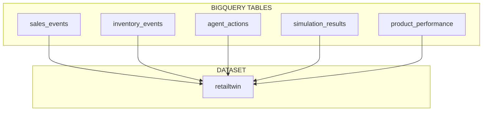
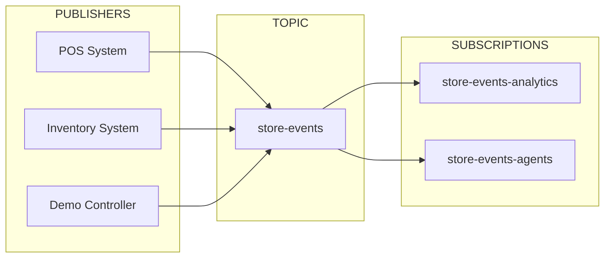
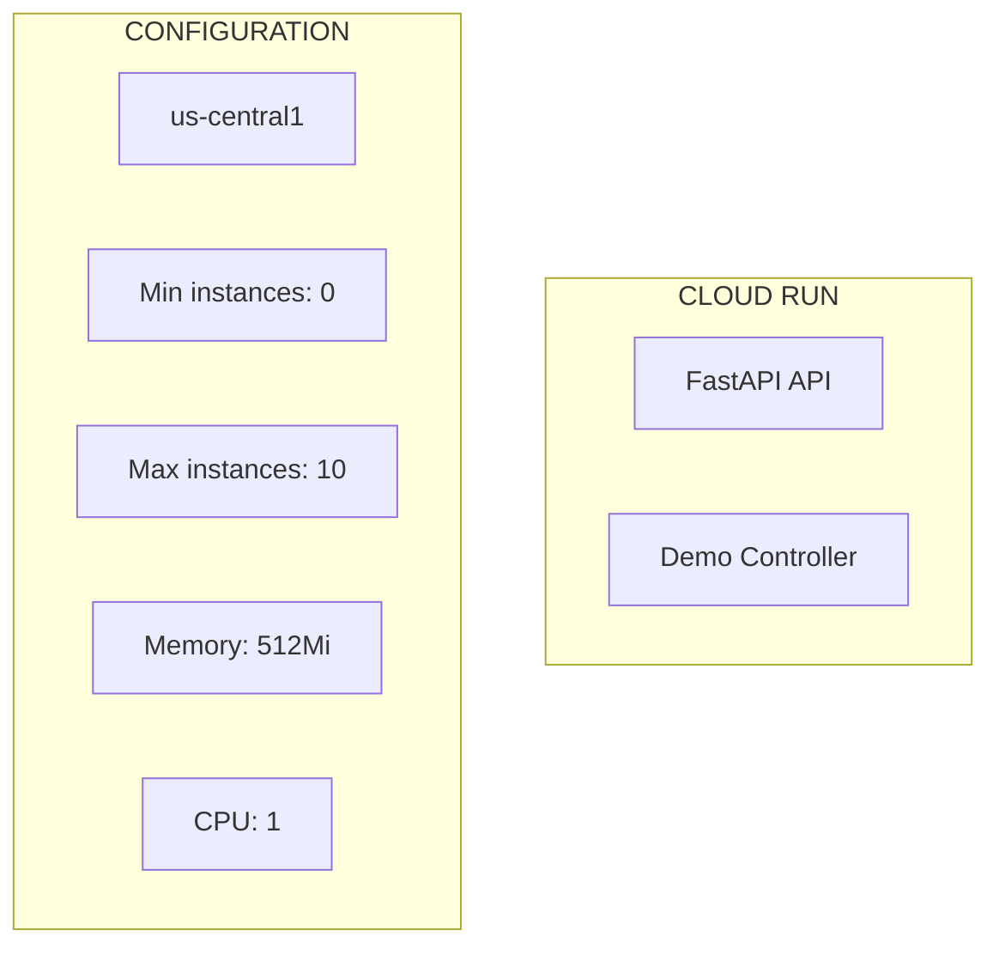

# GCP (Google Cloud Platform) Detailed Documentation

## Overview

RetailTwin AI runs on Google Cloud Platform with `us-central1` region. The project uses always-free tier resources to minimize costs while providing enterprise-grade infrastructure.

## Project Configuration

| Setting | Value |
|---------|-------|
| **Project ID** | `retailtwin-ai-511002` |
| **Region** | `us-central1` |
| **Billing** | ~1 USD/month budget alert |
| **Currency** | VND (25,000 VND budget) |

## GCP Resources

### 1. Firestore

**Purpose:** Live Twin state storage - products, inventory, shelves, simulations

```mermaid
flowchart TB
    subgraph Collections["FIRESTORE COLLECTIONS"]
        S[stores/{store_id}]
        Z[zones/{zone_id}]
        SH[shelves/{shelf_id}]
        SL[slots/{slot_id}]
        P[products/{product_id}]
        I[inventory/{sku}]
        SIM[simulations/{sim_id}]
        A[alerts/{alert_id}]
    end

    subgraph Security["SECURITY"]
        RULES[Firestore Rules<br/>Validate read/write]
        IAM[IAM: retailtwin-api<br/>read/write]
    end
```

**Configuration:**
- Mode: Standard, Native
- Location: `us-central1`
- Delete protection: Enabled
- PITR: Disabled (not needed)

**Always-Free Limits:**
- 1 GiB storage
- 50,000 reads/day
- 20,000 writes/day
- 20,000 deletes/day
- 10 GiB egress/month

### 2. BigQuery

**Purpose:** Analytics and historical data - sales events, agent actions, audit trail



**Tables Schema:**

```sql
-- sales_events
CREATE TABLE retailtwin.sales_events (
  event_id STRING,
  correlation_id STRING,
  event_type STRING,
  store_id STRING,
  sku STRING,
  quantity INT64,
  occurred_at TIMESTAMP,
  source STRING,
  inserted_at TIMESTAMP DEFAULT CURRENT_TIMESTAMP()
);

-- inventory_events
CREATE TABLE retailtwin.inventory_events (
  event_id STRING,
  correlation_id STRING,
  event_type STRING,
  store_id STRING,
  sku STRING,
  shelf_quantity INT64,
  backroom_quantity INT64,
  occurred_at TIMESTAMP,
  inserted_at TIMESTAMP DEFAULT CURRENT_TIMESTAMP()
);

-- agent_actions
CREATE TABLE retailtwin.agent_actions (
  action_id STRING,
  decision_id STRING,
  correlation_id STRING,
  action_type STRING,
  sku STRING,
  parameters JSON,
  status STRING,
  executed_at TIMESTAMP,
  inserted_at TIMESTAMP DEFAULT CURRENT_TIMESTAMP()
);
```

**Always-Free Limits:**
- 1 TiB queries/month
- 10 GiB storage/month

### 3. Pub/Sub

**Purpose:** Event-driven architecture - store events trigger autonomous workflow



**Resources:**
- Topic: `store-events`
- Subscription: `store-events-analytics`
- Message retention: 7 days (default)

**Always-Free Limits:**
- 10 GiB messages/month

### 4. Cloud Run

**Purpose:** Serverless compute for FastAPI backend



**Configuration:**
- Platform: Managed
- Region: `us-central1`
- Min instances: 0 (scale to zero)
- Max instances: 10
- Memory: 512 MiB
- CPU: 1 vCPU
- Concurrency: 80 (default)
- Timeout: 300 seconds

**Always-Free Limits:**
- 2 million requests/month
- 360,000 GB-seconds/month
- 180,000 vCPU-seconds/month
- 1 GB North America egress/month

### 5. Cloud Storage

**Purpose:** 3D assets and static files

**Configuration:**
- Bucket: `retailtwin-ai-511002-assets`
- Location: `us-central1`
- Access: Uniform (recommended)
- Soft delete: Off

**Always-Free Limits:**
- 5 GB-months in `us-central1`, `us-east1`, `us-west1`

### 6. Vertex AI

**Purpose:** Gemini model access for AI planning

**Configuration:**
- API: Enabled
- Model: Gemini 2.0 Flash
- Endpoint: Vertex AI API

**Note:** Not on always-free list. Use carefully.

### 7. Secret Manager

**Purpose:** Runtime secrets (API keys, credentials)

**Configuration:**
- Secrets: 6 active versions
- Access: 10,000 accesses/month

### 8. Artifact Registry

**Purpose:** Docker image registry

**Configuration:**
- Repository: `retailtwin`
- Format: Docker
- Mode: Standard

**Always-Free Limits:**
- 0.5 GB/month

### 9. Cloud Build

**Purpose:** CI/CD automation

**Configuration:**
- Minutes: 2,500 (e2-standard-2)

## Service Accounts

### retailtwin-api

**Email:** `retailtwin-api@retailtwin-ai-511002.iam.gserviceaccount.com`

**Purpose:** API runtime service account

**Permissions:**
| Role | Resource | Access |
|------|----------|--------|
| `roles/datastore.user` | Firestore | Read/Write |
| `roles/pubsub.publisher` | Pub/Sub `store-events` | Publish |
| `roles/logging.logWriter` | Cloud Logging | Write |
| `roles/run.invoker` | Cloud Run | Invoke |

**Must NOT have:**
- `roles/editor`
- `roles/owner`
- `roles/aiplatform.user`

### retailtwin-agent

**Email:** `retailtwin-agent@retailtwin-ai-511002.iam.gserviceaccount.com`

**Purpose:** AI Agent runtime service account

**Permissions:**
| Role | Resource | Access |
|------|----------|--------|
| `roles/aiplatform.user` | Vertex AI | Use models |

**Must NOT have:**
- `roles/datastore.user`
- `roles/editor`
- `roles/owner`
- `roles/viewer`

## Security Rules

### 1. No Service Account Keys

```bash
# ❌ NEVER do this
gcloud iam service-accounts keys create key.json \
  --iam-account=retailtwin-api@...

# ✅ Use Application Default Credentials
gcloud auth application-default login
```

### 2. Firestore Rules

```javascript
rules_version = '2';
service cloud.firestore {
  match /databases/{database}/documents {
    // Allow API service to read/write products and inventory
    match /products/{productId} {
      allow read: if request.auth != null || true;
      allow write: if request.auth != null;
    }
    
    // Allow read for inventory
    match /inventory/{sku} {
      allow read: if request.auth != null || true;
      allow write: if request.auth != null;
    }
    
    // Simulation state - read for agents
    match /simulations/{simId} {
      allow read, write: if request.auth != null;
    }
    
    // Event claims - idempotency ledger
    match /store_event_claims/{eventId} {
      allow read: if request.auth != null;
      allow create: if request.auth != null;
      allow update: if false; // Immutable
    }
  }
}
```

### 3. Cloud Storage Rules

```json
{
  "bindings": [
    {
      "role": "roles/storage.objectViewer",
      "members": ["public"]
    },
    {
      "role": "roles/storage.objectCreator",
      "members": ["serviceAccount:retailtwin-api@..."]
    }
  ]
}
```

## Budget Alerts

**Budget Name:** `retailtwin-dev-guard`

**Configuration:**
- Amount: 25,000 VND (~1 USD)
- Scope: `retailtwin-ai-511002` only
- Currency: VND
- Alerts: 50%, 90%, 100%

**Note:** Alert does not disable billing.

## Local Development

### Setup Application Default Credentials

```bash
# Login
gcloud auth login

# Set project
gcloud config set project retailtwin-ai-511002

# Application Default Credentials
gcloud auth application-default login
```

### Use .env for Local Overrides

```bash
# Copy example
cp .env.example .env

# Edit with your overrides
# GOOGLE_CLOUD_PROJECT=retailtwin-ai-511002
# REGION=us-central1
# GEMINI_API_KEY=your-key
```

## Deployment

### Build and Deploy

```bash
# Build with Cloud Build
gcloud builds submit \
  --tag us-central1-docker.pkg.dev/retailtwin-ai-511002/retailtwin/api:latest \
  --project=retailtwin-ai-511002

# Deploy to Cloud Run
gcloud run deploy retailtwin-api \
  --image us-central1-docker.pkg.dev/retailtwin-ai-511002/retailtwin/api:latest \
  --platform managed \
  --region us-central1 \
  --allow-unauthenticated \
  --service-account=retailtwin-api@retailtwin-ai-511002.iam.gserviceaccount.com \
  --min-instances=0 \
  --max-instances=10 \
  --memory=512Mi \
  --cpu=1 \
  --timeout=300 \
  --concurrency=80 \
  --project=retailtwin-ai-511002
```

### Verify Deployment

```bash
# Check service
gcloud run services describe retailtwin-api \
  --region us-central1

# Test endpoint
curl -s $(gcloud run services describe retailtwin-api \
  --region us-central1 \
  --format 'value(status.url)')
```

## Monitoring

### Cloud Logging

```bash
# View API logs
gcloud logging read "resource.type=cloud_run_revision" \
  --project=retailtwin-ai-511002 \
  --limit=50

# Filter by severity
gcloud logging read "severity>=ERROR" \
  --project=retailtwin-ai-511002 \
  --limit=20
```

### Error Reporting

```bash
# View errors
gcloud alpha monitoring policies list \
  --project=retailtwin-ai-511002
```

## Cost Optimization

### 1. Scale to Zero

Cloud Run min instances = 0 ensures no cost when idle.

### 2. Use Always-Free Tier

Stay within free limits for Firestore, BigQuery, Pub/Sub.

### 3. Batch BigQuery Queries

Instead of many small queries, batch operations.

### 4. Cache Responses

Use Cloud CDN for static assets.

## Troubleshooting

### Firestore Connection Issues

```bash
# Check Firestore is accessible
gcloud firestore databases describe \
  --project=retailtwin-ai-511002
```

### Pub/Sub Not Receiving Events

```bash
# Check topic exists
gcloud pubsub topics describe store-events \
  --project=retailtwin-ai-511002

# Check subscriptions
gcloud pubsub subscriptions list \
  --project=retailtwin-ai-511002

# Test publish
gcloud pubsub topics publish store-events \
  --message '{"test":"hello"}' \
  --project=retailtwin-ai-511002
```

### Cloud Run Not Starting

```bash
# Check logs
gcloud run services logs read retailtwin-api \
  --region us-central1 \
  --limit=50

# Check revisions
gcloud run revisions list \
  --service retailtwin-api \
  --region us-central1
```

## Related Documentation

- [ADR 0004: Keep the cloud foundation on free tier](adr/0004-keep-the-cloud-foundation-on-free-tier.md)
- [ADR 0009-0034: Cloud Run deployment runbook](adr/0009-0034-cloud-run-deployment.md)
- [infrastructure/gcp/README.md](../infrastructure/gcp/README.md)
