# RetailTwin AI — Complete Project Documentation

> **Updated:** 2026-10-10
> **Language:** English

---

## Table of Contents

1. [Project Overview](#1-project-overview)
2. [System Architecture](#2-system-architecture)
3. [Core Components](#3-core-components)
4. [Google Cloud Platform](#4-google-cloud-platform)
5. [Data Models & Storage](#5-data-models--storage)
6. [GitHub Issues & Release Gates](#6-github-issues--release-gates)
7. [ADR Documentation](#7-adr-documentation)
8. [Repository Structure](#8-repository-structure)
9. [Development Roadmap](#9-development-roadmap)
10. [Deployment Guide](#10-deployment-guide)
11. [Quick Start](#11-quick-start)

---

## 1. Project Overview

### 1.1 Introduction

**RetailTwin AI — Context-Guarded Autonomous 3D Retail Digital Twin** is an autonomous retail-operations system built around a live 3D digital twin of a store.

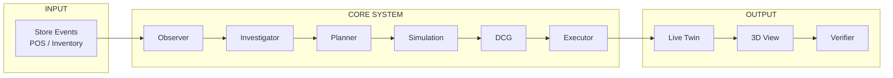

### 1.2 What Is RetailTwin AI?

**RetailTwin AI = Store Data + 3D Digital Twin + Autonomous AI Agent + Simulation + Context-Guarded Execution**

The product is not a chatbot and the 3D scene is not decorative. The store is represented as machine-readable state:
- Zones
- Shelves
- Slots
- Products
- Inventory
- Sales signals
- Promotions
- Operational constraints

An AI agent continuously:
1. Observes events
2. Detects business problems
3. Investigates evidence
4. Proposes alternatives
5. Simulates them against a cloned Digital Twin
6. Validates through **Decision Context Guard (DCG)**
7. Applies allowed actions to Live Twin
8. Verifies the result

### 1.3 The Problem We Solve

| Gap | Traditional Approach | RetailTwin AI |
|-----|---------------------|---------------|
| **Reactivity** | Dashboards show what happened | System reacts automatically to events |
| **Context** | Flat data without spatial understanding | 3D Digital Twin with explicit entities |
| **Safety** | AI suggestions without validation | Simulation + DCG before any live action |

### 1.4 Main Control Loop

```
OBSERVE → DETECT → INVESTIGATE → PLAN → SIMULATE → GUARD → ACT → VERIFY
```

### 1.5 Product Modes

| Mode | Description | Use Case |
|------|-------------|----------|
| **Autopilot** | Primary competition mode. Events trigger AI loop automatically. | Demo / Competition |
| **Copilot** | Human requests analysis; AI proposes; human approves | Human-in-the-loop |
| **Manual** | Inspect 3D Twin, manipulate simulation state | Diagnostic/Testing |

### 1.6 Core Product Principles

1. **Digital Twin owns truth** — LLM does not own inventory, context version, or KPI truth
2. **Gemini decides WHAT and WHY** — Interprets evidence, forms bounded plans
3. **Deterministic services calculate numbers** — Forecasting, KPI calculations by code
4. **Simulate before live** — Actions first applied to isolated Simulation Twin
5. **Context guard before commit** — DCG is deterministic server-side enforcement
6. **Fail closed** — If validity cannot be established, system does not commit
7. **No stale commit** — Decisions for context N must not apply after context changes to N+1
8. **Semantic preservation** — Approved decisions must not silently change during execution

### 1.7 Demo Scenario: Weekend Demand Surge

This is the primary end-to-end scenario:

1. **AUTOPILOT ON** — No user prompts required
2. **Event** — SKU P017 sells unusually fast (+46%)
3. **Observer** — Pub/Sub emits event, activates workflow
4. **Investigator** — Collects inventory evidence
5. **Planner** — Creates 3 alternative plans (A, B, C)
6. **Simulation Twin** — Evaluates each plan with KPIs
7. **DCG** — Detects stale context → `REFRESH_REQUIRED`
8. **Agent** — Automatically refreshes and replans
9. **DCG** — Validates new decision, issues authorization
10. **Executor** — Commits exact authorized actions
11. **3D Store** — Visible changes
12. **Verifier** — Confirms results

**The point:** Not merely "AI moved a product" — demonstrates **autonomy + simulation + stale-context protection + controlled execution + verification**.

---

## 2. System Architecture

### 2.1 Overall Architecture

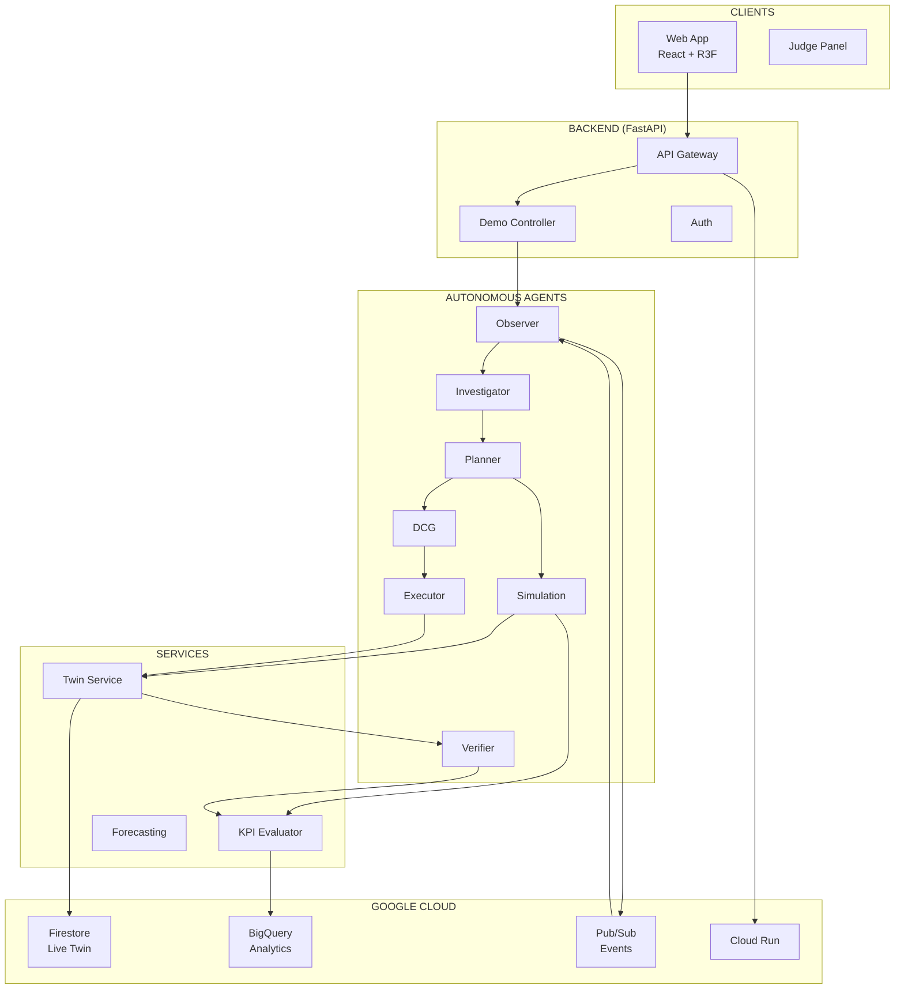

### 2.2 State Separation

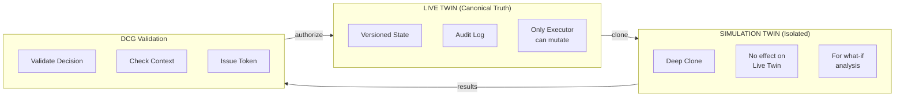

### 2.3 No-Stale-Commit Flow

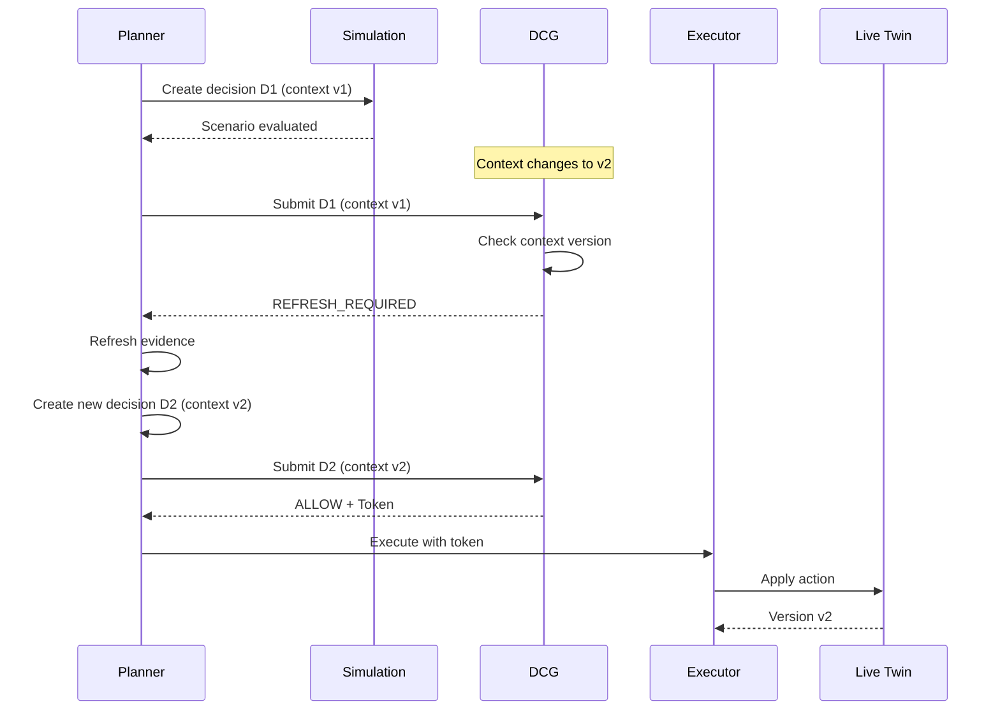

### 2.4 Component Responsibilities

| Component | Description |
|-----------|-------------|
| **Observer** | Consumes normalized store events, deduplicates, starts investigation |
| **Investigator** | Collects bounded, versioned evidence |
| **Planner** | Uses Gemini to produce structured candidate plans |
| **Simulation Service** | Clones live state, applies candidate actions |
| **KPI Evaluator** | Computes deterministic business/operational effects |
| **Decision Context Guard** | Deterministic revalidation before live commit |
| **Executor** | Only component that performs authorized live mutations |
| **Verifier** | Reads post-action state, compares expected vs observed |

---

## 3. Core Components

### 3.1 Agent Components

| Component | Description | Status |
|-----------|-------------|--------|
| [Observer](adr/0011-0015-agent-orchestrator.md) | Consumes events, detects anomalies | Planned |
| [Investigator](adr/0011-0015-agent-orchestrator.md) | Collects versioned evidence | Planned |
| [Planner](adr/0011-0015-agent-orchestrator.md) | Creates candidate plans with Gemini | Planned |
| [DCG](adr/0016-0017-dcg-no-stale-commit.md) | 5 validation gates, deterministic | Planned |
| [Executor](adr/0018-guarded-executor.md) | Guarded live mutations | Planned |
| [Verifier](adr/0011-0015-agent-orchestrator.md) | Post-action verification | Planned |

### 3.2 Services

| Service | Description | Status |
|---------|-------------|--------|
| [TwinService](adr/twin-service.md) | Live & Simulation state | Planned |
| [SimulationService](adr/0033-simulation-service.md) | Clone, apply, evaluate | Planned |
| [KPI Evaluator](adr/0033-kpi-evaluator.md) | Deterministic calculations | Planned |
| [Forecasting](adr/) | Demand prediction | Planned |

### 3.3 DCG - 5 Validation Gates

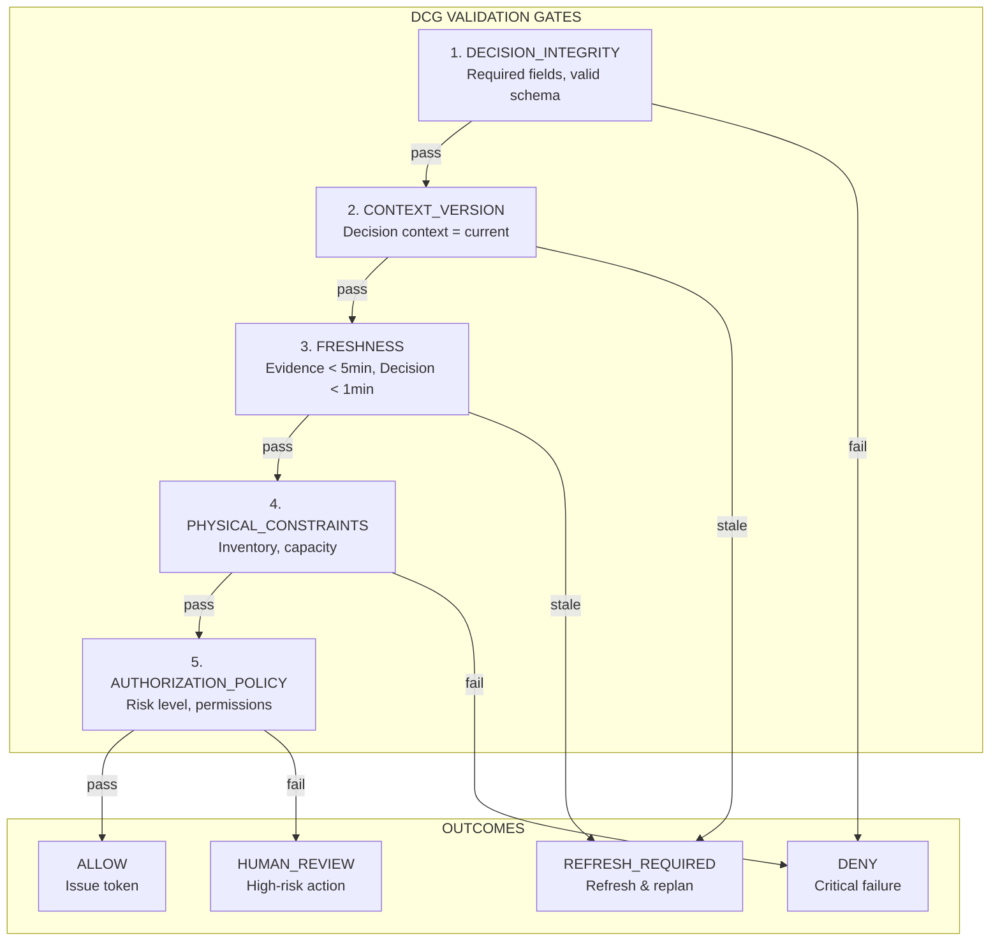

### 3.4 Executor Security Boundary

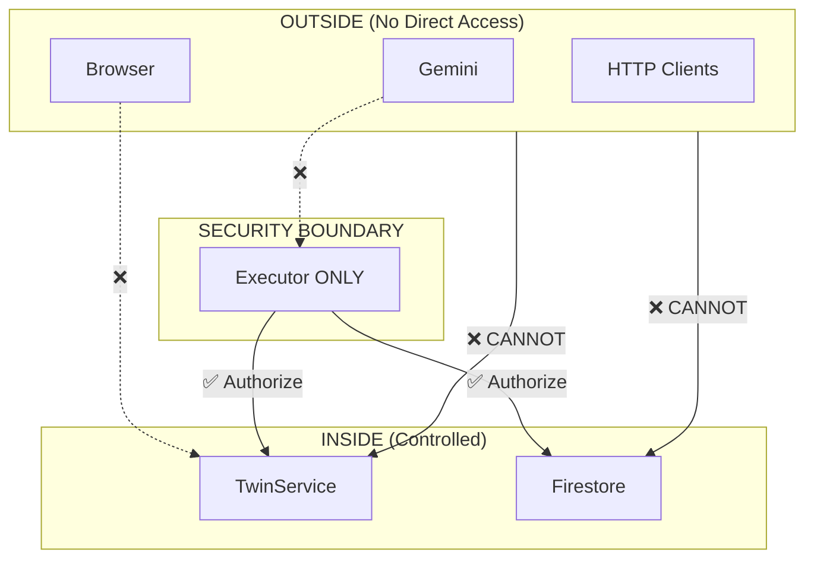

### 3.5 Commit Authorization Flow

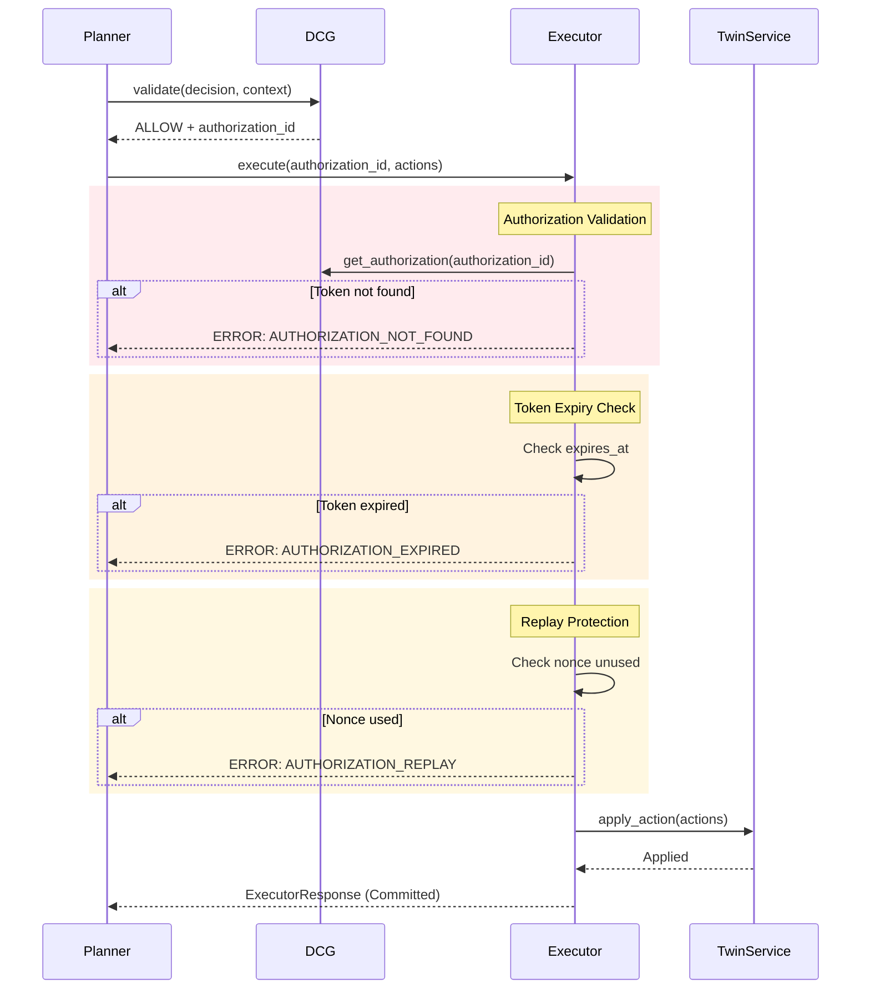

---

## 4. Google Cloud Platform

### 4.1 GCP Project Overview

| Resource | Project | Region |
|----------|---------|--------|
| **Project ID** | `retailtwin-ai-511002` | `us-central1` |
| **Operator** | Owner Google account | - |
| **Budget** | 25,000 VND/month (~1 USD) | Alerts at 50%, 90%, 100% |

### 4.2 GCP Resources

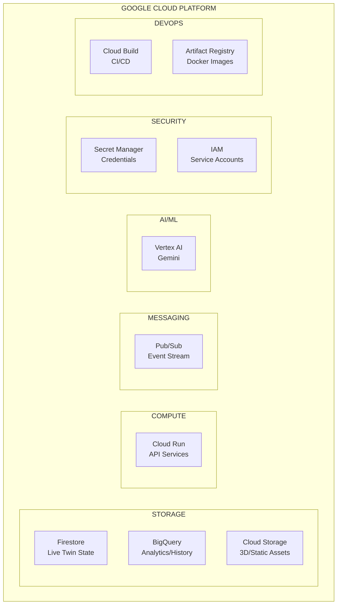

### 4.3 GCP Resources Detail

| Resource | Type | Purpose | Always-Free Limit |
|----------|------|---------|-------------------|
| **Firestore** | Database | Live Twin state, products, inventory | 1 GiB, 50K reads/day |
| **BigQuery** | Analytics | Sales history, audit trail | 1 TiB queries, 10 GiB storage/month |
| **Pub/Sub** | Messaging | Event-driven activation | 10 GiB messages/month |
| **Cloud Storage** | Object | 3D assets, static files | 5 GB-months |
| **Cloud Run** | Compute | FastAPI backend | 2M requests, 360K GB-seconds |
| **Vertex AI** | AI/ML | Gemini model calls | API only (not free) |
| **Secret Manager** | Security | Runtime secrets | 6 versions, 10K accesses |
| **Artifact Registry** | Registry | Docker images | 0.5 GB/month |
| **Cloud Build** | CI/CD | Build automation | 2,500 minutes |

### 4.4 Service Accounts

| Account | Purpose | Permissions |
|---------|---------|-------------|
| `retailtwin-api@...` | API runtime | Firestore R/W, Cloud Logging, Pub/Sub publish |
| `retailtwin-agent@...` | Agent runtime | Vertex AI user |

**Security Rule:** No service-account keys in Git. Use Application Default Credentials.

### 4.5 GCP Architecture Flow

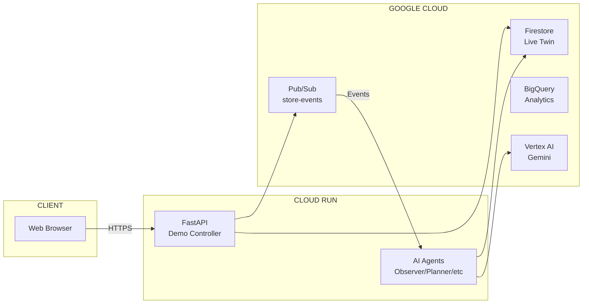

---

## 5. Data Models & Storage

### 5.1 Spatial Hierarchy

```
Store → Zone → Shelf → Slot → Product
```

### 5.2 Product Entity

```json
{
  "product_id": "P017",
  "sku": "SKU-P017",
  "category": "beverages",
  "shelf_id": "A02",
  "slot_id": "A02-S03",
  "position": {"x": 1.2, "y": 1.4, "z": -0.5},
  "rotation": {"x": 0, "y": 0, "z": 0},
  "facings": 2,
  "shelf_quantity": 8,
  "backroom_quantity": 54,
  "price": 3.5,
  "promotion": null,
  "sales_velocity": 0.8,
  "forecast_demand": 22,
  "stockout_probability": 0.18,
  "version": 981,
  "updated_at": "2026-10-07T08:00:00Z"
}
```

### 5.3 Store Event

```json
{
  "event_id": "evt-000123",
  "correlation_id": "run-20261007-001",
  "event_type": "sale.completed",
  "store_id": "store-001",
  "sku": "P017",
  "quantity": 3,
  "occurred_at": "2026-10-07T08:01:00Z",
  "source": "synthetic-pos"
}
```

### 5.4 EvidenceBundle

```json
{
  "context_version": "store-001:v23871",
  "collected_at": "2026-10-07T08:02:00Z",
  "items": [
    {
      "type": "inventory",
      "entity_id": "P017",
      "version": "981",
      "observed_at": "2026-10-07T08:01:58Z",
      "value": {"shelf_quantity": 8, "backroom_quantity": 54}
    }
  ]
}
```

### 5.5 Decision Structure

```json
{
  "decision_id": "RT-D-1027",
  "agent_id": "retailtwin-orchestrator",
  "context_version": "store-001:v23871",
  "context_timestamp": "2026-10-07T08:00:00Z",
  "evidence": [],
  "proposed_actions": [],
  "simulation_id": "SIM-204",
  "expected_impact": {}
}
```

### 5.6 Storage Responsibilities

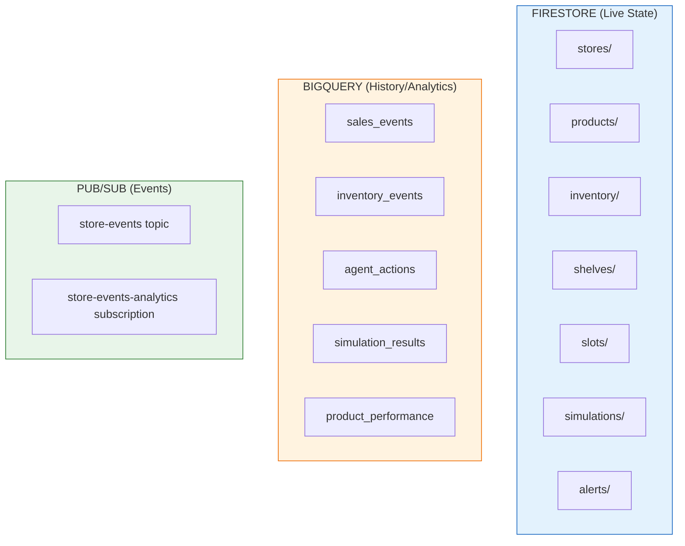

### 5.7 Firestore Collections

| Collection | Purpose | Mutable |
|------------|---------|---------|
| `stores/{store_id}` | Store metadata | No |
| `zones/{zone_id}` | Zone information | No |
| `shelves/{shelf_id}` | Shelf configuration | No |
| `slots/{slot_id}` | Slot allocation | Yes |
| `products/{product_id}` | Product catalog | Yes |
| `inventory/{sku}` | Current inventory | Yes |
| `promotions/{promo_id}` | Active promotions | Yes |
| `simulations/{sim_id}` | Simulation state | Yes |
| `alerts/{alert_id}` | System alerts | Yes |
| `store_event_claims/{event_id}` | Idempotency ledger | No |

### 5.8 BigQuery Tables

| Table | Purpose |
|-------|---------|
| `retailtwin.sales_events` | POS transaction events |
| `retailtwin.inventory_events` | Inventory changes |
| `retailtwin.agent_actions` | AI agent actions/audits |
| `retailtwin.simulation_results` | KPI evaluation results |
| `retailtwin.product_performance` | Aggregated product metrics |

---

## 6. GitHub Issues & Release Gates

### 6.1 Issues Overview

| Status | Count |
|--------|-------|
| Open | ~50 |
| Closed | 11 |
| **Total** | **~61** |

### 6.2 Release Gates

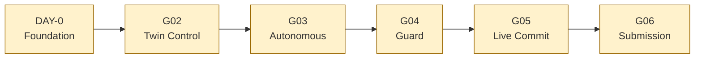

| Gate | Issue | Description | Status |
|------|-------|-------------|--------|
| DAY-0 | #10 | Foundation smoke test | NOT PASSED |
| G02 | #49 | Simulation Twin control | NOT PASSED |
| G03 | #50 | Autonomous event trigger | NOT PASSED |
| G04 | #51 | Stale decision blocked | NOT PASSED |
| G05 | #52 | Valid decision commits | NOT PASSED |
| G06 | #53 | 20 consecutive E2E runs | NOT PASSED |

### 6.3 P0 Priority Issues

| # | Title | Role |
|---|-------|------|
| #83 | Expose FE integration APIs | integration |
| #82 | Fix Vitest coverage config | integration |
| #81 | Firestore-backed TwinRepository | data-cloud |
| #79 | Serve anomalies from API | integration |
| #74 | Verify PR #65 with Live Twin | integration |
| #41 | Demo Controller | integration |
| #34 | Cloud Run deployment | data-cloud |
| #33 | KPI Evaluator | data-cloud |
| #32 | Stockout-risk calculation | data-cloud |
| #30 | Demand-surge scenario | data-cloud |
| #18 | Guarded Executor | agent-dcg |
| #17 | No-Stale-Commit | agent-dcg |
| #16 | DCG MVP | agent-dcg |

### 6.4 Issue Roles

| Role | Focus Areas |
|------|-------------|
| `integration` | API, frontend, E2E tests, deployment |
| `agent-dcg` | AI agents, DCG, Executor, Verifier |
| `data-cloud` | GCP, Firestore, BigQuery, Pub/Sub, KPIs |
| `3d-ux` | React Three Fiber, 3D visualization |

---

## 7. ADR Documentation

### 7.1 ADR List

| ADR | Title | Status |
|-----|-------|--------|
| [0001](adr/0001-record-architecture-decisions-in-pull-requests.md) | Record ADR in PRs | Accepted |
| [0002](adr/0002-render-store-entities-as-named-primitives.md) | Named primitives | Accepted |
| [0003](adr/0003-serve-store-reads-through-the-api.md) | API reads | Accepted |
| [0004](adr/0004-keep-the-cloud-foundation-on-free-tier.md) | GCP free tier | Accepted |
| [0005](adr/0005-land-each-normalized-store-event-once.md) | Event idempotency | Accepted |
| [0006](adr/0006-use-heroui-v2-for-app-status-ui.md) | HeroUI v2 | Accepted |
| [0007](adr/0007-keep-store-layout-static-until-the-twin-serves-geometry.md) | Static layout | Accepted |
| [0009-0034](adr/0009-0034-cloud-run-deployment.md) | Cloud Run deployment | Accepted |
| [0011-0015](adr/0011-0015-agent-orchestrator.md) | Agent Orchestrator | Accepted |
| [0016-0017](adr/0016-0017-dcg-no-stale-commit.md) | DCG & No-Stale-Commit | Accepted |
| [0018](adr/0018-guarded-executor.md) | Guarded Executor | Accepted |
| [0033](adr/0033-kpi-evaluator.md) | KPI Evaluator | Accepted |
| [0033](adr/0033-simulation-service.md) | Simulation Service | Accepted |
| [0037](adr/0037-agent-activity-timeline.md) | Agent Timeline | Proposed |
| [0041](adr/0041-demo-controller.md) | Demo Controller | Accepted |
| [Twin](adr/twin-service.md) | Twin Service | Accepted |

### 7.2 Key ADR: DCG & No-Stale-Commit

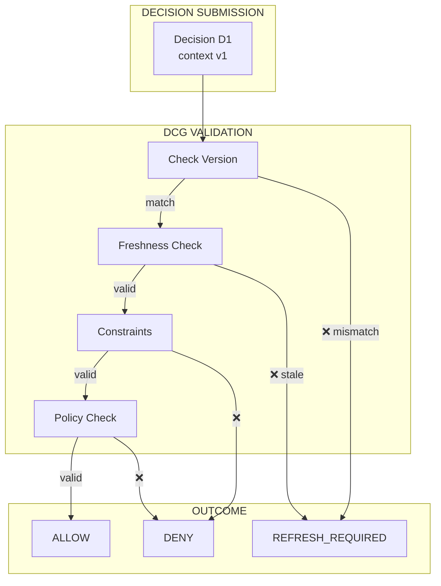

### 7.3 Key ADR: Guarded Executor

| Feature | Target |
|---------|--------|
| Token validation | < 5ms |
| Nonce-based replay protection | 100% |
| Context hash verification | Required |
| Atomic mutations | All-or-nothing |

---

## 8. Repository Structure

### 8.1 Main Directories

```
retailtwin-ai/
├── apps/
│   ├── api/                      # FastAPI backend
│   │   └── retailtwin_api/
│   │       ├── demo.py           # DemoOrchestrator
│   │       ├── routes.py        # API routes
│   │       ├── backbone.py       # GCP integration
│   │       └── main.py          # App entry
│   │
│   └── web/                      # React frontend
│       └── src/
│           ├── components/       # UI components
│           ├── stores/           # Zustand state
│           └── App.tsx           # Root component
│
├── services/
│   ├── twin/                     # TwinService
│   │   ├── __init__.py
│   │   ├── storage.py           # Storage backends
│   │   ├── simulation.py        # SimulationTwin
│   │   └── schemas.py           # Pydantic models
│   │
│   ├── simulation/               # SimulationService, KPI
│   │   ├── kpi.py              # KPI Evaluator
│   │   ├── formulas.py         # KPI formulas
│   │   └── schemas.py         # Simulation models
│   │
│   └── forecasting/              # Demand forecasting
│
├── guard/
│   └── decision_context_guard/   # DCG implementation
│       ├── __init__.py
│       ├── gates.py            # 5 validation gates
│       ├── authorization.py    # Token management
│       └── schemas.py         # DCG models
│
├── agents/
│   ├── orchestrator/             # AgentOrchestrator
│   ├── executor/                 # ExecutorAgent
│   │   ├── __init__.py
│   │   ├── errors.py           # ExecutorError classes
│   │   └── rollback.py         # RollbackManager
│   ├── planner/                  # Gemini Planner
│   ├── investigator/             # Evidence collector
│   ├── observer/                 # Event consumer
│   ├── simulator/               # Simulation orchestrator
│   └── verifier/                 # Result verifier
│
├── data/
│   ├── schemas/                  # JSON schemas
│   │   └── store-event.schema.json
│   ├── synthetic/                # Synthetic events
│   │   └── sale-completed.json
│   └── fixtures/                # Demo fixtures
│       └── store-state.example.json
│
├── infrastructure/
│   └── gcp/                     # GCP configuration
│       ├── bootstrap.sh         # GCP setup script
│       ├── verify.sh           # Verification script
│       └── README.md           # GCP docs
│
├── docs/
│   ├── adr/                     # Architecture decisions
│   │   ├── README.md           # ADR index
│   │   ├── 0001-*.md          # ADR files
│   │   └── template.md        # ADR template
│   ├── architecture/            # Architecture docs
│   ├── demo/                     # Demo docs
│   └── competition/              # Competition docs
│
├── tests/
│   ├── api/                     # API tests
│   ├── web/                     # Web tests
│   └── e2e/                     # End-to-end tests
│
├── package.json                  # Frontend dependencies
├── pyproject.toml              # Backend dependencies
└── README.md                   # Project README
```

### 8.2 Technology Stack

| Layer | Technology |
|-------|------------|
| **Frontend** | React 18, TypeScript, React Three Fiber, Zustand, HeroUI v2 |
| **Backend** | Python 3.11+, FastAPI, Pydantic, Uvicorn |
| **AI** | Gemini on Vertex AI |
| **Database** | Firestore (Live Twin), BigQuery (Analytics) |
| **Events** | Pub/Sub |
| **Deployment** | Cloud Run, Cloud Build |
| **Testing** | pytest, Vitest |

---

## 9. Development Roadmap

### 9.1 Phases

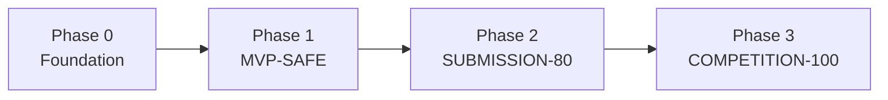

| Phase | Objectives | Status |
|-------|------------|--------|
| Phase 0 | web + API + Firestore + Pub/Sub + Gemini + Cloud Run | In Progress |
| Phase 1 | One autonomous event: Simulation → DCG → Live + 3D | Planned |
| Phase 2 | Complete verification, 2-3 candidates, polished UI | Planned |
| Phase 3 | Multi-agent ADK, advanced optimizer | Planned |

### 9.2 Minimum Viable Story

```
ONE 3D store
+ ONE autonomous event
+ ONE Gemini Agent
+ ONE investigation
+ ONE simulation
+ ONE DCG stale-context rejection
+ ONE automatic refresh/replan
+ ONE successful guarded commit
+ ONE visible 3D change
```

### 9.3 Scope Reduction Priority

**Cut First (If Needed):**
1. ✅ Photorealistic assets
2. ✅ Multi-agent complexity
3. ✅ Advanced optimization solvers
4. ✅ Looker dashboards

**Never Cut:**
1. ❌ Pub/Sub autonomous trigger
2. ❌ Simulation-before-Live
3. ❌ No-Stale-Commit
4. ❌ DCG validation
5. ❌ Guarded Executor

---

## 10. Deployment Guide

### 10.1 GCP Setup

```bash
# Verify GCP foundation
infrastructure/gcp/verify.sh

# If not set up, bootstrap
CONFIRM_GCP_BOOTSTRAP=yes infrastructure/gcp/bootstrap.sh
```

### 10.2 Deploy to Cloud Run

```bash
# Build Docker image
gcloud builds submit --tag us-central1-docker.pkg.dev/retailtwin-ai-511002/retailtwin/api:latest

# Deploy to Cloud Run
gcloud run deploy retailtwin-api \
  --image us-central1-docker.pkg.dev/retailtwin-ai-511002/retailtwin/api:latest \
  --platform managed \
  --region us-central1 \
  --allow-unauthenticated \
  --min-instances=0 \
  --max-instances=10
```

### 10.3 Environment Variables

```bash
# Required
GOOGLE_CLOUD_PROJECT=retailtwin-ai-511002
REGION=us-central1

# Optional (for local dev)
GEMINI_API_KEY=your-key
FIRESTORE_EMULATOR_HOST=localhost:8080
```

---

## 11. Quick Start

### 11.1 Run API

```bash
cd apps/api
python -m venv .venv
source .venv/Scripts/activate  # Windows
pip install -e ".[dev]"
uvicorn retailtwin_api.main:app --reload
```

### 11.2 Run Web

```bash
cd apps/web
npm ci
npm run dev
```

### 11.3 Demo Controller API

```bash
# Reset
curl -X POST http://127.0.0.1:8000/demo/reset

# Happy path
curl -X POST http://127.0.0.1:8000/demo/start

# Stale context test
curl -X POST "http://127.0.0.1:8000/demo/start?stale_context_test=true"

# Check status
curl http://127.0.0.1:8000/demo/status
```

### 11.4 Run Tests

```bash
# API tests
cd apps/api
pytest -v

# Web tests
cd apps/web
npm test

# E2E tests
pytest tests/e2e/ -v
```

---

## Glossary

| Term | Definition |
|------|------------|
| **Live Twin** | Canonical current operational state |
| **Simulation Twin** | Isolated clone for what-if analysis |
| **DCG** | Decision Context Guard - deterministic validation |
| **No-Stale-Commit** | Prevents applying outdated decisions |
| **Executor** | Only component allowed to mutate Live Twin |
| **EvidenceBundle** | Versioned facts for decision-making |
| **Commit Token** | Short-lived authorization for exact actions |

---

## Related Documentation

| Document | Description |
|----------|-------------|
| [PROJECT_CONTEXT.md](PROJECT_CONTEXT.md) | Product overview and problem statement |
| [ARCHITECTURE.md](ARCHITECTURE.md) | Detailed architecture |
| [CURRENT_STATUS.md](CURRENT_STATUS.md) | Current implementation status |
| [DOMAIN_AND_DATA_MODEL.md](DOMAIN_AND_DATA_MODEL.md) | Data schemas and models |
| [IMPLEMENTATION_GUIDE.md](IMPLEMENTATION_GUIDE.md) | Development guide |
| [DEMO_AND_ACCEPTANCE.md](DEMO_AND_ACCEPTANCE.md) | Demo scenarios and acceptance criteria |
| [DEVELOPMENT_WORKFLOW.md](DEVELOPMENT_WORKFLOW.md) | Git workflow and PR rules |
| [adr/README.md](adr/README.md) | ADR index |

---

## Contact

- **Author:** Vinh Phan (vinhphan812)
- **Project:** Google Cloud AI Builder Cup 2026
- **Repository:** RetailTwin AI
